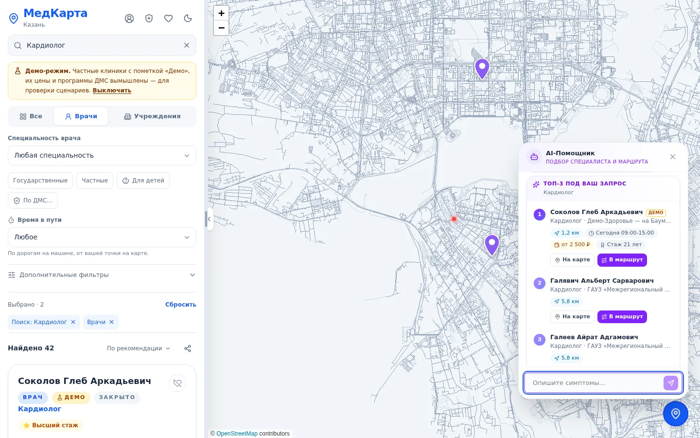
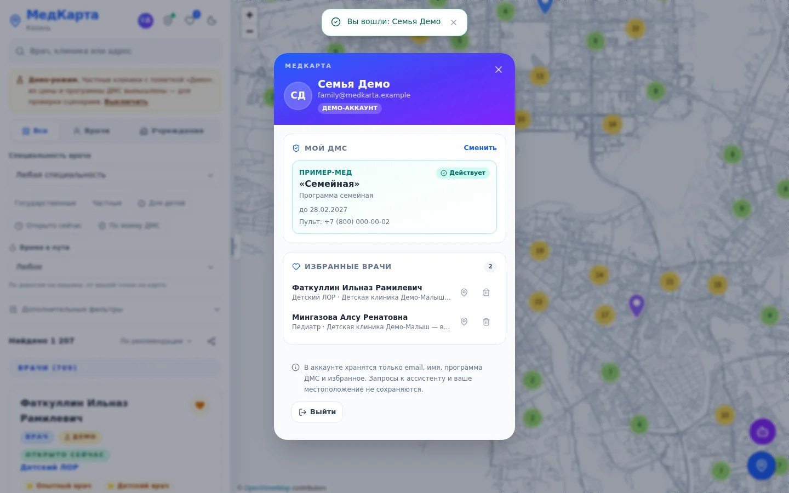
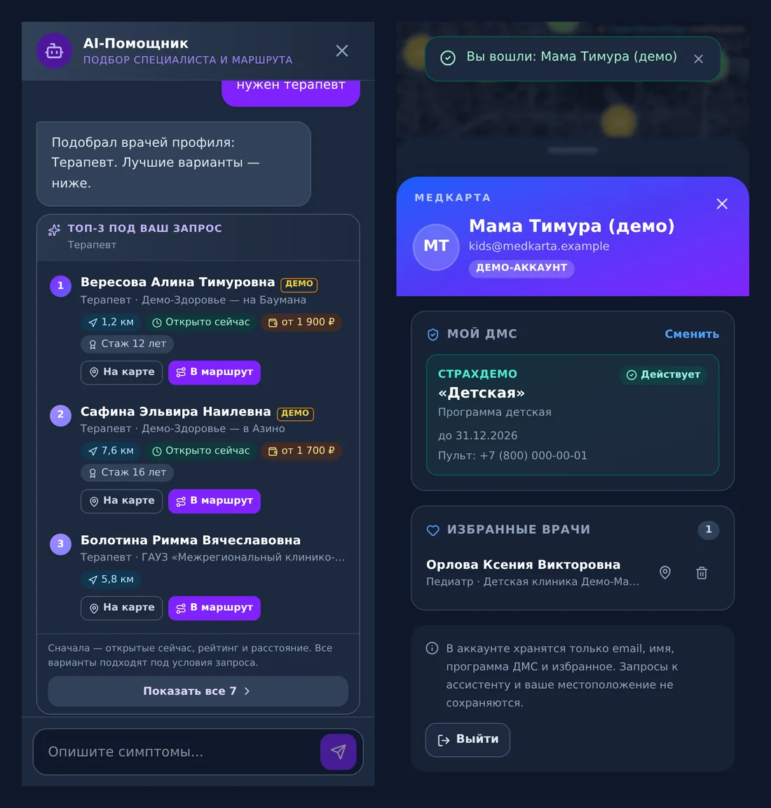

<div align="center">

# МедКарта

**Медицинский навигатор по Казани**

Найти врача на карте или спросить ассистента обычными словами — и сразу получить
три лучших варианта и маршрут до них.


</div>



## Возможности

### 💬 Ассистент с топ-3
Пишете как человеку: «у ребёнка болит ухо, нужен лор по ДМС, не дальше 20 минут» —
ассистент применяет все условия и показывает **три лучших варианта** с причиной
выбора: время в пути, «открыто сейчас», «по вашему ДМС», цена, стаж. Одним
нажатием — на карту или в маршрут; остальные — кнопкой «Показать все».

### 👤 Личный кабинет
Программа ДМС и избранные врачи сохраняются в аккаунте и доступны с любого
устройства. Для показа есть демо-аккаунты с разными программами ДМС — вход без
пароля одной кнопкой.



### 🛡 Приватность по построению
Внешней модели уходит **только обезличенное описание запроса** из перечислимых
значений — ни одного слова пользователя, ни одного имени, телефона или адреса.
Проверено на размеченном наборе из 22,7 тыс. запросов: **0 утечек на 14 728
примерах с персональными данными** (`npm run eval:privacy`).

### 🗺 Карта, фильтры, маршруты
- Врачи и учреждения Казани, кластеры, тёмная тема, мобильная версия.
- Специальность, район, «открыто сейчас», вечер и выходные, детский приём,
  доступная среда, **время в пути по реальным дорогам**, «Мой ДМС», цены.
- Собственный маршрутизатор на графе OpenStreetMap: машина, пешком,
  велосипед, до 5 точек, 2–80 мс на маршрут через весь город.
- Кнопки «Открыть в Яндекс Картах / 2ГИС» — довести до двери.



## Как устроено

```
Браузер ── React 19 · Vite 8 · Tailwind 4 · Leaflet
   │        топ-3, ДМС и время в пути считаются здесь: координаты не уходят
   ▼
Node 22 (node:http, без npm-зависимостей)
   ├─ /api/chat        Privacy Gateway → описание запроса → LLM → JSON-план → валидатор → исполнитель
   ├─ /api/route       свой маршрутизатор (A*, Dijkstra «один-ко-многим»)
   ├─ /api/account     личный кабинет: SQLite (node:sqlite), scrypt, cookie HttpOnly
   └─ /api/events      обезличенная аналитика
```

| Документ | О чём |
|---|---|
| [docs/privacy-architecture.md](docs/privacy-architecture.md) | что видит внешняя модель и что нет |
| [docs/privacy-evaluation.md](docs/privacy-evaluation.md) | методика и цифры проверки обезличивания |
| [docs/accounts.md](docs/accounts.md) | личный кабинет, переход на PostgreSQL, 152-ФЗ |
| [docs/routing.md](docs/routing.md) | собственный движок маршрутов |
| [docs/deployment.md](docs/deployment.md) | развёртывание на VPS (1 vCPU / 2 ГБ) |
| [SECURITY.md](SECURITY.md) | модель угроз и принятые меры |

## Запуск

```bash
npm install
cp .env.example .env     # ключ модели — по желанию: без него работает локальный планировщик
npm run build
DEMO_DATA=on npm start   # http://localhost:3001, с демо-клиниками и демо-аккаунтами
```

Режим разработки: `npm run dev` (Vite + все обработчики API, демо включено).

Проверки:

```bash
npm run test:security    # все тесты в обоих режимах приватности
npm run eval:privacy     # 11 тыс. размеченных запросов, около минуты
npm run lint
```

## Переменные окружения

Полный список с пояснениями — в [.env.example](.env.example). Главные:

| Переменная | Назначение |
|---|---|
| `OPENROUTER_API_KEY`, `AI_UPSTREAM_URL`, `AI_MODEL` | внешняя модель-планировщик (необязательно) |
| `AI_PROXY_URL` | прокси для запросов к модели с российского сервера; проверка — `npm run ai:check` |
| `PRIVACY_OUTBOUND_MODE` | `structured` (по умолчанию) или `hybrid` |
| `DEMO_DATA=on` | демо-клиники, цены, программы ДМС и демо-аккаунты |
| `ACCOUNTS_REGISTRATION=on` | открыть регистрацию (сначала — юридическая подготовка, см. docs/accounts.md) |
| `TRUST_PROXY`, `ALLOWED_HOSTS` | работа за nginx |

Секреты не должны начинаться с `VITE_`: такие переменные попадают в бандл.

## Структура

```
backend/    сервер: api/, privacy/ (шлюз), planner/, executor/, routing/, accounts/
frontend/   интерфейс: App, ассистент, топ-3, кабинет, фильтры
shared/     общий код фронтенда и сервера: контракт, ДМС, расписания
data/       справочники врачей, учреждений, демо-набор
tools/      сборщик данных клиник, набор для проверки обезличивания
tests/      500+ тестов node:test
docs/       архитектура, приватность, кабинет, развёртывание
```

## Данные

Врачи — с официальных сайтов государственных поликлиник и больниц; учреждения —
из OpenStreetMap (ODbL); тайлы карты — `tile.openstreetmap.org`. Рейтингов,
стажа и свободных слотов в открытых источниках нет — мы их не выдумываем.
Частные клиники, цены и программы ДМС в демо-режиме вымышлены и помечены «Демо».

## Оговорка

Приложение помогает найти учреждение и специалиста. Оно не ставит диагнозы
и не заменяет консультацию врача. При неотложном состоянии звоните 103 или 112.

## Лицензия

© 2026 МедКарта. Все права защищены. Использование кода без разрешения
правообладателя запрещено. Подробности в файле [LICENSE](./LICENSE).
