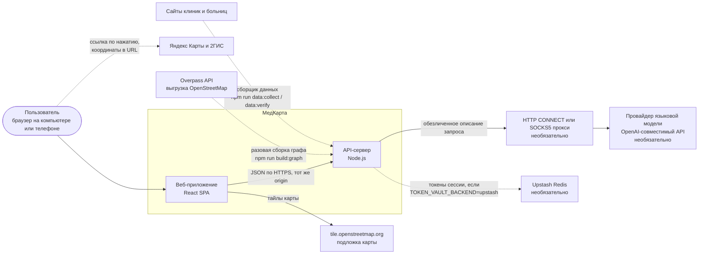
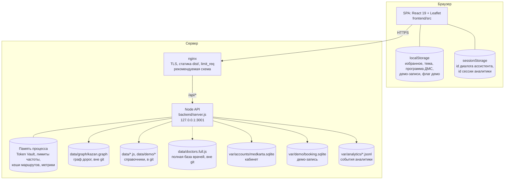
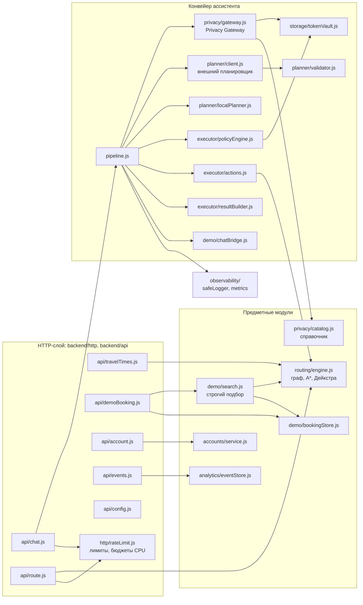
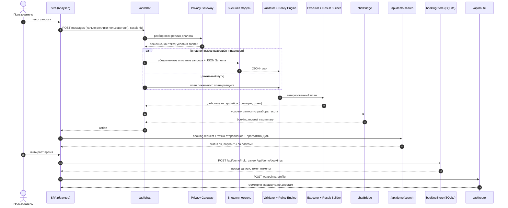
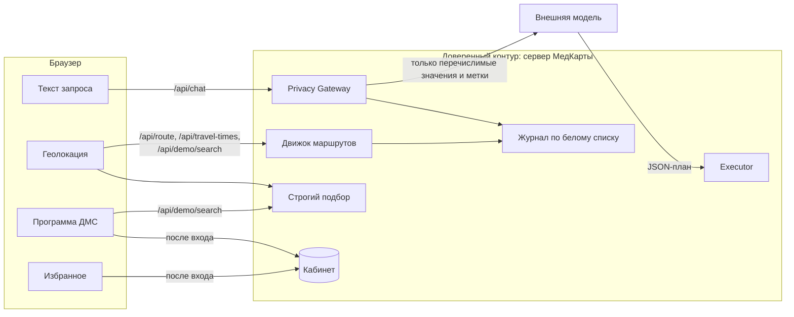
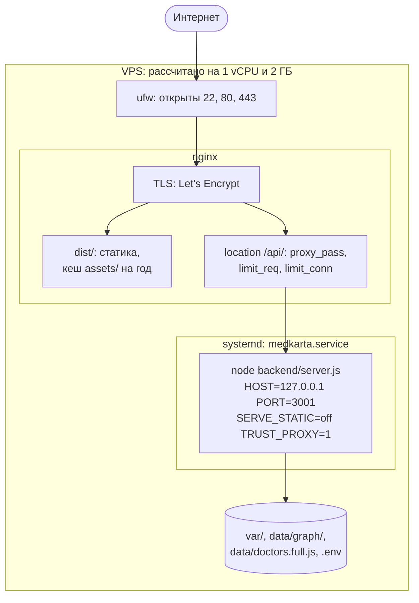

# 02. Архитектура

Документ описывает систему на четырёх уровнях: контекст (кто с кем
взаимодействует), контейнеры (что запускается и где хранятся данные),
компоненты сервера и потоки данных главного сценария. В конце — схема
развёртывания и принципы, на которых держится архитектура.

## Контекст системы

Сплошные стрелки — работа во время запросов пользователя, пунктир —
необязательные связи и офлайн-скрипты, которые запускаются вручную и не на
боевом сервере ([routing.md](routing.md), [data-pipeline.md](data-pipeline.md)).

Что важно на этом уровне:

- **Браузер ходит только в собственный API** — `connect-src 'self'` в CSP
  ([securityHeaders.js](../backend/http/securityHeaders.js)). Единственный
  внешний хост в политике — тайлы OpenStreetMap в `img-src`.
- **Внешняя модель необязательна.** Без ключа ассистент работает на
  локальном планировщике ([pipeline.js](../backend/pipeline.js)).
- **Координаты пользователя не уходят третьим лицам** при построении маршрута
  и расчёте времени в пути: их обрабатывает собственный движок
  ([api/route.js](../backend/api/route.js)). Исключения — тайлы карты (видно,
  какой участок открыт) и ссылки во внешние карты, которые пользователь
  открывает сам ([externalMaps.js](../frontend/src/externalMaps.js)).

## Контейнеры и хранилища

| Контейнер | Технология | Ответственность | Код |
|---|---|---|---|
| SPA | React 19, Vite 8, Tailwind 4, Leaflet | карта, фильтры, ассистент, кабинет, демо-запись; расстояния, «топ-3» и покрытие ДМС считаются здесь | [frontend/src/](../frontend/src/App.jsx) |
| API-сервер | Node.js `node:http`, без фреймворков | все `/api/*`, при `SERVE_STATIC` — статика из `dist/`, заголовки безопасности | [backend/server.js](../backend/server.js) |
| nginx | конфигурация из документации | TLS, статика, ограничение частоты до Node | [deployment.md](deployment.md) |
| SQLite кабинета | `node:sqlite` | пользователи, сессии, избранное | [sqliteStore.js](../backend/accounts/sqliteStore.js) |
| SQLite демо-записи | `node:sqlite` | слоты, удержания, записи | [bookingStore.js](../backend/demo/bookingStore.js) |
| Журнал аналитики | файлы JSON Lines по дням | обезличенные продуктовые события | [eventStore.js](../backend/analytics/eventStore.js) |
| Граф дорог | бинарный файл `GMK1` | маршруты и время в пути | [format.js](../backend/routing/format.js) |

nginx в репозитории не конфигурируется — его настройки приведены в
[deployment.md](deployment.md). Без nginx `backend/server.js` сам отдаёт
`dist/` со сжатием gzip и `ETag` ([05-backend.md](05-backend.md)).

## Компоненты сервера

| Компонент | Ответственность | Подробно |
|---|---|---|
| Privacy Gateway | разбор реплик: детекторы ПДн, связывание со справочником, классификатор жалоб, условия записи, решение «можно ли к модели», сборка `SanitizedPlannerRequest` | [07-privacy.md](07-privacy.md) |
| Token Vault | соответствия `@DOCTOR_A → id справочника`, ключ — HMAC от сессии и запроса, TTL | [07-privacy.md](07-privacy.md) |
| Внешний планировщик | единственный исходящий вызов модели; принимает только `SanitizedPlannerRequest`; повторная проверка тела перед отправкой | [06-ai-assistant.md](06-ai-assistant.md) |
| Локальный планировщик | детерминированный план по уже извлечённым структурам | [06-ai-assistant.md](06-ai-assistant.md) |
| Validator и Policy Engine | строгая проверка JSON-плана; авторизация токенов в сессии, бюджет сложности | [06-ai-assistant.md](06-ai-assistant.md), [08-security.md](08-security.md) |
| Executor и Result Builder | исполнение плана по справочнику, выбор ближайшего, шаблонный ответ | [06-ai-assistant.md](06-ai-assistant.md) |
| chatBridge и строгий подбор | превращение понятых условий в запрос подбора; исполнение подбора по демо-набору | [11-demo-booking.md](11-demo-booking.md) |
| Движок маршрутизации | граф в типизированных массивах, A*, «один ко многим», привязка к дороге | [09-routing-engine.md](09-routing-engine.md) |
| Кабинет | сессии в cookie, scrypt, SQLite | [accounts.md](accounts.md) |
| Наблюдаемость | журнал по белому списку полей, метрики с перечислимыми метками | [17-performance-and-observability.md](17-performance-and-observability.md) |

## Главный сценарий: от фразы до маршрута

Сценарий демо-режима: пользователь пишет «Нужен лор завтра после 18:00 не
дороже 3000 рублей», выбирает время, записывается и строит маршрут.

Ключевые свойства сценария (проверены тестами
[demo-scenarios.test.js](../tests/demo-scenarios.test.js) и
[pipeline.integration.test.js](../tests/pipeline.integration.test.js)):

- условия записи («завтра», «после 18:00», «до 3000 ₽») берутся из
  детерминированного разбора текста, а не из ответа модели — модель не может
  их потерять или ослабить ([chatBridge.js](../backend/demo/chatBridge.js));
- точка отправления и программа ДМС уходят только в `/api/demo/search`, в
  `/api/chat` их нет ([services/demoBooking.js](../frontend/src/services/demoBooking.js),
  [services/ai.js](../frontend/src/services/ai.js));
- запись — симуляция: ничего не отправляется в клиники, страховые и МИС.

## Потоки данных

| Данные | Куда попадают | Чего не происходит |
|---|---|---|
| Текст реплик | сервер (разбор в памяти) | не пишется в журнал; в режиме `structured` не уходит модели ни одним словом |
| Координаты пользователя | сервер — маршрут, время в пути, строгий подбор | не пишутся в журнал, не уходят модели; в `/api/chat` клиент их не отправляет |
| Программа ДМС | `localStorage`; `/api/demo/search`; кабинет после входа | не уходит в `/api/chat` |
| Email, имя, хэш пароля | SQLite кабинета | не связаны с ассистентом |
| События аналитики | файлы JSON Lines | без текста поиска, координат, IP |

Подробная модель — в [07-privacy.md](07-privacy.md).

## Развёртывание

Рекомендуемая схема из [deployment.md](deployment.md): одна машина, nginx
снаружи, Node только на `127.0.0.1`.

Параметры unit-файла, nginx и порядок шагов — [15-deployment.md](15-deployment.md).

## Архитектурные принципы

Принципы ниже не декларация: у каждого есть механизм в коде.

| Принцип | Механизм | Где проверяется |
|---|---|---|
| Внешняя модель — недоверенный компонент | вход модели — только `SanitizedPlannerRequest`; выход — строгий валидатор и Policy Engine; текст ответа собирается шаблонами | [boundary.test.js](../tests/boundary.test.js), [planner-validation.test.js](../tests/planner-validation.test.js) |
| Fail-closed | при сомнении — локальный план, а не отправка | [policies.js](../backend/privacy/policies.js), [outbound-leakage.test.js](../tests/outbound-leakage.test.js) |
| Детерминированные условия | подбор исполняет код по разбору текста, модель выбирает только действие | [chatBridge.js](../backend/demo/chatBridge.js), [demo-scenarios.test.js](../tests/demo-scenarios.test.js) |
| Безопасность в коде, а не в настройках хостинга | заголовки ставит сервер; лимиты — в процессе | [securityHeaders.js](../backend/http/securityHeaders.js), [boundary.test.js](../tests/boundary.test.js) |
| Общий контракт фронтенда и сервера | `shared/` — единственное место общих правил; фронтенд и бэкенд не импортируют друг друга | проверено поиском по импортам при аудите; отдельного теста нет ([18-known-limitations.md](18-known-limitations.md)) |
| Слабый сервер как ограничение | один поток разбора, бюджеты процессорного времени, плоские массивы в движке | [rateLimit.js](../backend/http/rateLimit.js), [astar.js](../backend/routing/astar.js) |

Решения и рассмотренные альтернативы — в [adr/](adr/README.md).
