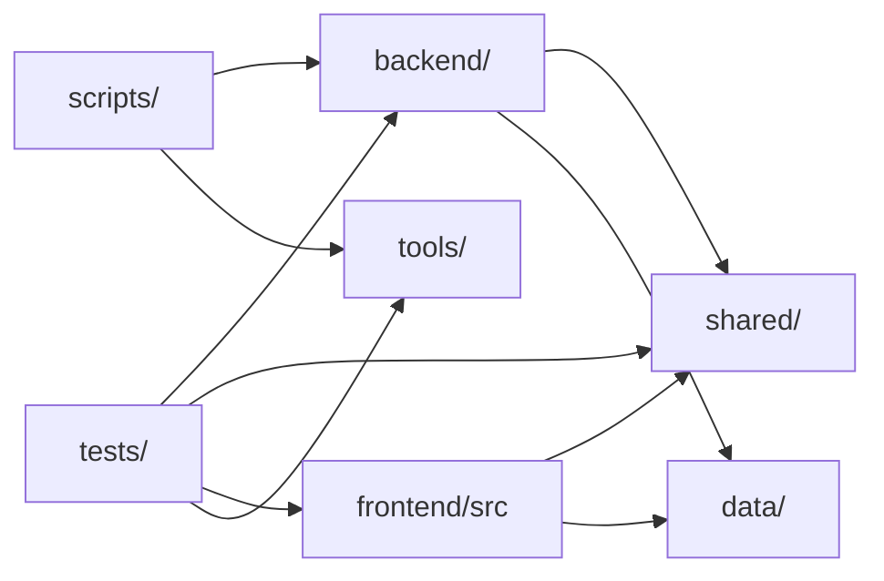

# 03. Структура репозитория

Состояние на коммите `d9c0de6`: в git 222 файла. Число строк ниже посчитано
по файлам `.js`, `.jsx`, `.mjs` при аудите и приведено для порядка величин.

## Корень

```text
.
├── backend/            серверный код; в браузерный бандл не попадает
├── frontend/           SPA: index.html, public/, src/
├── shared/             общий код браузера и сервера (контракт, ДМС, расписания)
├── data/               справочники и демо-набор (данные, а не логика)
├── tools/              сборщик данных клиник, набор для проверки обезличивания
├── scripts/            CLI-скрипты npm run …
├── tests/              тесты node:test и фикстуры
├── docs/               эта документация
├── package.json        скрипты npm, зависимости, engines
├── vite.config.js      сборка, dev-сервер с обработчиками API
├── eslint.config.js    правила линтера, включая границу доверия
├── .env.example        шаблон переменных окружения (без значений секретов)
├── README.md, SECURITY.md, TECHNICAL_PASSPORT.md, FINANCIAL_ESTIMATE.md/.pdf, LICENSE
└── scratch/          рабочий файл; в .gitignore, но закоммичен ранее
```

`TECHNICAL_PASSPORT.md` описывает раннюю версию проекта (Vercel, прежняя
структура каталогов) и не соответствует текущему коду — см.
[18-known-limitations.md](18-known-limitations.md).

## backend/ — сервер

| Каталог | Файлов | Строк | Назначение |
|---|---:|---:|---|
| [api/](../backend/api/chat.js) | 13 | 2 173 | HTTP-обработчики: `chat` (+ `chatAccess`), `route`, `travelTimes`, `events`, `config`, `account`, `me`, `admin`, `demoBooking`; общее для аккаунтов — `accountContext`, `accountHttp`, `systemInfo` |
| [http/](../backend/http/request.js) | 4 | 514 | чтение тела и Origin, лимиты частоты и бюджеты CPU, заголовки безопасности, таблица маршрутов с параметрами |
| [privacy/](../backend/privacy/gateway.js) | 15 | 7 358 | Privacy Gateway: нормализация, детекторы, морфология, entity linking, классификатор жалоб, закрытый словарь, условия записи |
| [planner/](../backend/planner/client.js) | 6 | 1 669 | схема плана, системный промпт, клиент модели, прокси-транспорт, валидатор, локальный планировщик |
| [executor/](../backend/executor/actions.js) | 5 | 1 129 | Policy Engine, исполнение плана, доступ к справочнику, выбор по времени в пути, шаблоны ответа |
| [routing/](../backend/routing/engine.js) | 6 | 2 028 | формат графа, загрузка и привязка, A* и «один ко многим», разбор OSM, покрытие |
| [demo/](../backend/demo/search.js) | 8 | 2 407 | генератор демо-набора, строгий подбор, хранилище записи, мост из чата, флаги, время |
| [accounts/](../backend/accounts/service.js) | 9 | 2 935 | аккаунты: пароли, роли и разрешения, сервис входа и профиля, сервис админ-панели, настройки, аватары, первый администратор, хранилище SQLite |
| [analytics/](../backend/analytics/eventStore.js) | 2 | 420 | журнал событий, отчёт по поискам |
| [observability/](../backend/observability/safeLogger.js) | 3 | 305 | журнал по белому списку, метрики, счётчики запросов для админ-панели |
| [storage/](../backend/storage/tokenVault.js) | 1 | 266 | Token Vault |
| [pipeline.js](../backend/pipeline.js), [server.js](../backend/server.js) | 2 | | сборка конвейера ассистента; HTTP-сервер |

## frontend/ — интерфейс

54 файла в `src/`, около 13,5 тыс. строк; из них
[App.jsx](../frontend/src/App.jsx) — 4 734 строки (главный компонент: карта,
список, фильтры, маршрут, состояние в URL). Профиль — `profile/`,
админ-панель — `admin/`, общие компоненты — `ui/`. Подробно —
[04-frontend.md](04-frontend.md).

## shared/ — общий код

| Модуль | Назначение |
|---|---|
| [contract.js](../shared/contract.js) | лимиты запроса, перечисления, `sanitizeAiAction`, `validateChatMessages` |
| [demoSearch.js](../shared/demoSearch.js) | формат запроса строгого подбора и его нормализация, описание условий словами |
| [dms.js](../shared/dms.js) | модель покрытия ДМС: программа × филиал × специальность/услуга |
| [specialties.js](../shared/specialties.js) | 16 канонических специальностей, признак детского приёма |
| [services.js](../shared/services.js) | закрытый справочник услуг и нормализация цен |
| [openingHours.js](../shared/openingHours.js) | разбор часов работы |
| [privateCatalog.js](../shared/privateCatalog.js) | проверка и разворачивание справочника частных клиник |
| [analytics.js](../shared/analytics.js) | закрытый словарь событий аналитики |
| [translit.js](../shared/translit.js) | транслитерация |

## data/ — данные

| Файл | Содержимое | В git |
|---|---|---|
| [facilities.js](../data/facilities.js) | 487 учреждений из OpenStreetMap | да |
| [doctors.js](../data/doctors.js) | публичный срез врачей (6 записей) | да |
| `doctors.full.js` | полная база врачей | **нет** (`.gitignore`) |
| [doctors.legacy.js](../data/doctors.legacy.js) | пустой массив прежнего формата | да |
| [clinics.js](../data/clinics.js) | 3 клиники с расписаниями (`ClinicsData.clinics`) | да |
| [private/catalog.json](../data/private/catalog.json) | справочник частных клиник от сборщика — сейчас пуст | да |
| [sources.json](../data/sources.json) | источники сборщика — два демо-источника | да |
| [verification.json](../data/verification.json) | результаты `data:verify` — пусто | да |
| [demo/](../data/demo/index.js) | демо-набор (сгенерирован), программы ДМС, реальные частные клиники | да |
| `graph/kazan.graph` | граф дорог | **нет** |
| `collected/`, `review/` | снимки и очередь сборщика | **нет** |

## tests/, tools/, scripts/

- [tests/](../tests/helpers.js) — 36 файлов `*.test.js`, фикстуры
  (`fixtures/catalog.js`, `fixtures/roadGraph.js`, `legacy-demo/`, `sites/`).
  Подробно — [16-testing.md](16-testing.md).
- [tools/data/](../tools/data/collector.js) — сборщик: загрузка с потолками,
  разбор HTML и JSON-LD, сравнение снимков, очередь ручной проверки.
- [tools/privacy-eval/](../tools/privacy-eval/evaluate.js) — генератор
  размеченного набора и подсчёт утечек.
- [scripts/](../scripts/build-road-graph.mjs) — точки входа `npm run …`
  (таблица — [14-configuration.md](14-configuration.md)), в том числе
  [accounts.mjs](../scripts/accounts.mjs) — управление аккаунтами с сервера и
  [e2e-admin.mjs](../scripts/e2e-admin.mjs) — сквозная проверка в браузере.

## Файлы вне git

| Путь | Что | Откуда берётся |
|---|---|---|
| `.env` | секреты и настройки | вручную по `.env.example` |
| `data/graph/kazan.graph` | граф дорог | `npm run build:graph` |
| `data/doctors.full.js` | полная база врачей | вне репозитория |
| `var/accounts/`, `var/demo/`, `var/analytics/` | базы и журнал | создаются сервером |
| `dist/` | сборка фронтенда | `npm run build` |

## Направление зависимостей



- `frontend/` и `backend/` друг друга не импортируют; общее — только в
  `shared/`. При аудите это проверено поиском по импортам; отдельного теста
  на это правило нет.
- Фронтенд получает `data/` через алиас `@data/` в
  [vite.config.js](../vite.config.js); `@data/doctors` подменяется полной базой,
  если `data/doctors.full.js` существует.
- Внутри `backend/` граница доверия закреплена правилом ESLint
  `no-restricted-imports`: `mintSanitizedPlannerRequest` можно импортировать
  только в [privacy/gateway.js](../backend/privacy/gateway.js)
  ([eslint.config.js](../eslint.config.js), дублируется тестом
  [boundary.test.js](../tests/boundary.test.js)).
- В `backend/` запрещён `console` (`no-console: error`): журнал — только через
  [safeLogger.js](../backend/observability/safeLogger.js).
