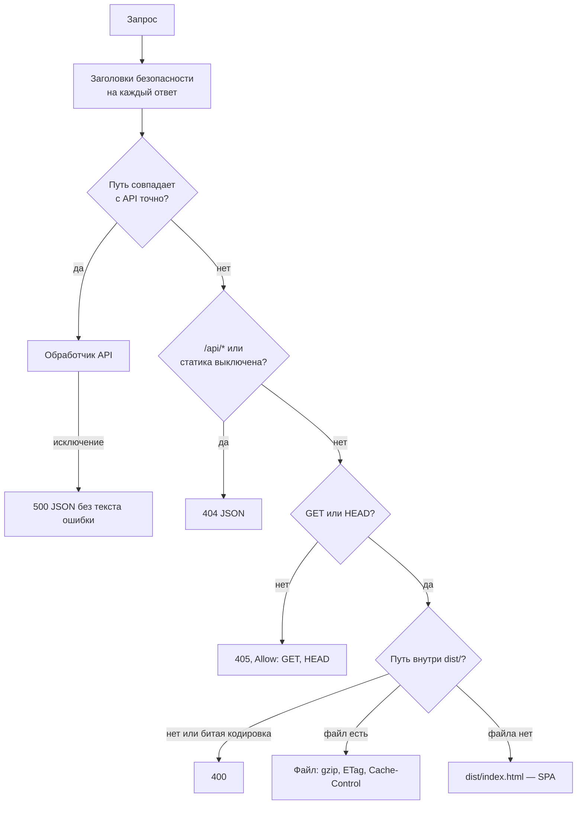

# 05. Бэкенд

Сервер — один процесс Node.js на `node:http`, без веб-фреймворка и без
npm-зависимостей в рантайме. Точка входа —
[backend/server.js](../backend/server.js).

## Жизненный цикл процесса

1. **Загрузка `.env`** из корня проекта через `process.loadEnvFile`, если
   файл есть. Переменная, уже заданная в окружении процесса (например, в
   unit-файле systemd), значением из `.env` не перезаписывается — это
   поведение Node, проверено при аудите на Node 22.
2. **Проверка `TRUST_PROXY`**: допустимо целое число от 0 до 5. Иное значение
   (`true`, `yes`, `-1`) — событие `server.bad_config` в журнале и выход с
   кодом 1 ([rateLimit.js](../backend/http/rateLimit.js), `validateTrustProxy`).
3. **Создание сервера** с таймаутами и потолками соединений (таблица ниже).
4. **Запуск `listen`** на `HOST:PORT` (по умолчанию `127.0.0.1:3001`), сразу
   после — загрузка графа дорог; в журнал пишется `server.started` со
   статусом `api+static` или `api-only`, `routing_provider: local | none` и
   типом хранилища токенов.
5. **Ленивая инициализация** остального: конвейер ассистента, кабинет,
   демо-запись и журнал аналитики создаются при первом обращении и
   кешируются как обещание, чтобы одновременные первые запросы не собирали
   их параллельно ([pipeline.js](../backend/pipeline.js), `getDefaultPipeline`).

Необработанное отклонение обещания пишется в журнал; необработанное
исключение — запись `process.uncaught_exception` и выход с кодом 1 в расчёте
на перезапуск менеджером процессов (`Restart=always` в unit-файле
[deployment.md](deployment.md)).

### Таймауты и соединения

| Параметр | Значение | Где |
|---|---|---|
| `headersTimeout` | 15 с | [server.js](../backend/server.js) |
| `requestTimeout` | 20 с | [server.js](../backend/server.js) |
| `keepAliveTimeout` | 5 с | [server.js](../backend/server.js) |
| `connectionsCheckingInterval` | 5 с | [server.js](../backend/server.js) |
| `maxConnections` | `MAX_CONNECTIONS`, по умолчанию 512 | [server.js](../backend/server.js) |
| Соединений с одного адреса | `MAX_CONNECTIONS_PER_IP`, по умолчанию 32; IPv6 — по сети /64; только при `TRUST_PROXY=0` | [server.js](../backend/server.js) |

## Маршрутизация запросов

- Сопоставление API — по **точному пути** (без строки запроса), а не по
  префиксу: `/api/routeXYZ` не попадает в обработчик `/api/route`.
- Таблица путей собирается из обработчиков: `/api/chat` (за проверкой входа
  в кабинет, [chatAccess.js](../backend/api/chatAccess.js)), `/api/route`,
  `/api/travel-times`, `/api/events`, `/api/config`, пути кабинета
  (`ACCOUNT_PATHS`) и демо-записи (`DEMO_BOOKING_PATHS`). Полный список —
  [12-api-reference.md](12-api-reference.md).
- Неизвестный `/api/*` — `404 {"error":"Not found"}`, а не `index.html`.

### Статика

Включена, если существует `dist/` и `SERVE_STATIC` не равен `off`. В
продакшене статику рекомендуется отдавать nginx ([15-deployment.md](15-deployment.md)).

| Правило | Значение |
|---|---|
| Выход за `dist/` | путь нормализуется, `..` и `\0` отклоняются (`400`) |
| `Cache-Control` | `public, max-age=31536000, immutable` для файлов с хэшем в `assets/`; иначе `no-cache` |
| `ETag` | слабый: размер и время изменения; `If-None-Match` → `304` |
| Сжатие | gzip для html, js, css, json, svg, webmanifest больше 1 КБ; кеш сжатых копий до 48 МБ, исходник до 8 МБ |
| Передача | `stream.pipeline`: при обрыве клиента файловый поток закрывается |

## Общая обвязка обработчиков

[http/request.js](../backend/http/request.js):

- `readBody(req, maxBytes)` — JSON с потолком размера (по умолчанию
  `LIMITS.MAX_BODY_BYTES` = 32 КБ). Превышение — `413` и
  `Connection: close`; битый JSON — `400`; пустое тело — `{}`.
- `respondJson` — `Content-Type: application/json; charset=utf-8`,
  `Cache-Control: no-store`.
- `verifyOrigin`:
  1. если задан `ALLOWED_HOSTS`, `Host` обязан быть в списке (защита от DNS
     rebinding);
  2. нет заголовка `Origin` — запрос пропускается (так ведут себя часть
     браузеров при same-origin);
  3. `Origin` из `ALLOWED_ORIGINS` — пропускается;
  4. иначе хост из `Origin` должен совпасть с `Host` (или с
     `X-Forwarded-Host`, но только при `TRUST_PROXY > 0`).

Изменяющие запросы кабинета и демо-записи дополнительно требуют
`Content-Type: application/json` и `Sec-Fetch-Site` равный `same-origin` или
`none`, если заголовок есть ([api/account.js](../backend/api/account.js),
[api/demoBooking.js](../backend/api/demoBooking.js)).

## Ограничение нагрузки

Сервер рассчитан на машину с одним ядром: разбор реплик и поиск маршрутов
идут в основном потоке. Поэтому ограничивается не только число запросов, но
и затраченное процессорное время ([rateLimit.js](../backend/http/rateLimit.js)).

### Механизмы

| Механизм | Как работает |
|---|---|
| Скользящее окно на адрес (`createRateLimiter`) | отметки времени в окне 5 минут; при переполнении карты адресов вытесняются давние |
| «Ведро» процессорного времени на адрес (`createCostLimiter`) | уровень пополняется линейно; запрос допускается при уровне > 0, после выполнения списывается фактическое время |
| Общий предохранитель (`createLoadShedder`) | сумма времени тяжёлых запросов за 10 с; ассистент отключается при доле > 60 %, маршруты — при > 85 %; ответ `503` с `Retry-After` |
| Очередь разбора ассистента (`createCpuQueue` в [api/chat.js](../backend/api/chat.js)) | одновременно `CHAT_MAX_CONCURRENCY` разборов (по умолчанию 1), очередь до 16, ожидание до 8 с; иначе `503 busy`. Ожидание ответа модели в очередь не входит |
| Бюджет вызовов модели (`createExternalBudget`) | 300 вызовов за 5 минут на процесс и `AI_DAILY_CALL_LIMIT` за сутки (по умолчанию 2000); исчерпан — локальный план, а не ошибка |

Ключ лимита — адрес клиента: адрес сокета или, при `TRUST_PROXY=N` и
соединении от доверенного прокси (`TRUSTED_PROXIES`, по умолчанию loopback),
N-е значение с конца `X-Forwarded-For`. IPv6 считается по сети /64.

### Значения по эндпоинтам

| Эндпоинт | Лимит запросов на адрес | Процессор | Тело |
|---|---|---|---|
| `POST /api/chat` | 20 за 5 мин | ведро 3000 мс, +30 мс/с; предохранитель 60 %; очередь | 32 КБ |
| `POST /api/route` | 120 за 5 мин | ведро 1500 мс, +50 мс/с; предохранитель 85 % | 32 КБ |
| `POST /api/travel-times` | 90 за 5 мин | то же ведро, что у маршрутов; 85 % | 32 КБ |
| `POST /api/events` | 120 за 5 мин; 1500 событий в сутки | — | 8 КБ, до 20 событий |
| `/api/demo/search` | 120 за 5 мин | — | 16 КБ |
| `/api/demo/slots`, `/api/demo/bookings/lookup`, `/api/demo/bookings/mine` | 600 за 5 мин | — | 16 КБ |
| прочие `/api/demo/*` | 60 за 5 мин | — | 16 КБ |
| `/api/auth/login`, `/api/auth/register` | 20 за 15 мин; 10 неудачных входов на email за 15 мин | scrypt: 2 расчёта одновременно, очередь 32 | 64 КБ |
| `/api/auth/demo` | 200 за 15 мин | — | 64 КБ |
| прочие запросы кабинета | 300 за 5 мин | — | 64 КБ |

Все счётчики живут **в памяти процесса**: при нескольких экземплярах сервера
суммарный лимит выше заявленного ([18-known-limitations.md](18-known-limitations.md)).

## Ошибки

- Обработчик бросил исключение — `500 {"error":"Внутренняя ошибка сервера."}`;
  в журнал пишется только код ошибки, без `message` и стека
  ([safeLogger.js](../backend/observability/safeLogger.js)).
- `/api/chat` при сбое конвейера — `502` с общей формулировкой; текст ошибки
  провайдера модели не пересылается и не пишется в журнал
  ([planner/client.js](../backend/planner/client.js)).
- Ошибки валидации входа возвращают формулировку валидатора — она не
  содержит пользовательского ввода ([shared/contract.js](../shared/contract.js)).

Перечень кодов по эндпоинтам — [12-api-reference.md](12-api-reference.md).

## Модули предметной логики

| Модуль | Документ |
|---|---|
| Конвейер ассистента: [pipeline.js](../backend/pipeline.js) | [06-ai-assistant.md](06-ai-assistant.md) |
| Privacy Gateway и Token Vault | [07-privacy.md](07-privacy.md) |
| Движок маршрутизации | [09-routing-engine.md](09-routing-engine.md) |
| Строгий подбор и хранилище записи | [11-demo-booking.md](11-demo-booking.md) |
| Кабинет | [accounts.md](accounts.md) |
| Аналитика | [analytics.md](analytics.md), [17-performance-and-observability.md](17-performance-and-observability.md) |
