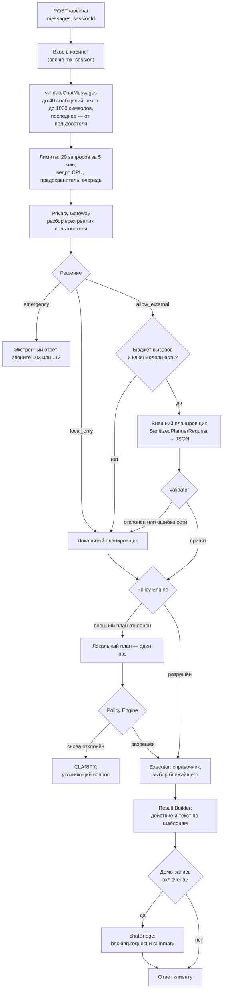

# 06. ИИ-ассистент

Ассистент принимает запрос обычными словами и возвращает **действие
интерфейса**: какие фильтры применить, к кому построить маршрут, что ответить
пользователю, а в демо-режиме — запрос строгого подбора свободного времени.

Главная идея: внешняя языковая модель здесь не «отвечает пользователю», а
работает **планировщиком** — выбирает действие и шаги из закрытых перечислений.
Всё остальное делает детерминированный код внутри доверенного контура:
понимает условия, ищет по справочнику, считает маршруты и собирает текст
ответа по шаблонам. Модель необязательна: без неё работает локальный
планировщик.

## Конвейер

Сборка — [backend/pipeline.js](../backend/pipeline.js), точка входа —
[backend/api/chat.js](../backend/api/chat.js). Перед ней —
[chatAccess.js](../backend/api/chatAccess.js): ассистент доступен только после
входа в личный кабинет ([accounts.md](accounts.md)); в конвейер из кабинета
ничего не передаётся.



### Шаги по порядку

| Шаг | Модуль | Что делает | Что при отказе |
|---|---|---|---|
| 0. Вход | [api/chatAccess.js](../backend/api/chatAccess.js) | действующая сессия кабинета (`CHAT_REQUIRES_ACCOUNT=off` — без неё) | 401 `login_required` / 503 `accounts_unavailable` |
| 1. Приём | [api/chat.js](../backend/api/chat.js) | метод `POST`, `Origin`, лимит частоты, тело до 32 КБ, `validateChatMessages` | 405 / 403 / 429 / 413 / 400 |
| 2. Разбор | [privacy/gateway.js](../backend/privacy/gateway.js) | детекторы, связывание со справочником, классификатор жалоб, условия, решение политики | сбой анализа → `local_only`, текст наружу не уходит |
| 3. План | [planner/client.js](../backend/planner/client.js) или [localPlanner.js](../backend/planner/localPlanner.js) | JSON-план из перечислений | любой сбой внешнего пути → локальный план |
| 4. Проверка | [planner/validator.js](../backend/planner/validator.js), [executor/policyEngine.js](../backend/executor/policyEngine.js) | схема, белые списки, токены этой сессии, бюджет сложности | внешний план заменяется локальным один раз; затем — уточняющий вопрос |
| 5. Исполнение | [executor/actions.js](../backend/executor/actions.js) | поиск по справочнику, снятие неоднозначности, выбор по времени в пути | — |
| 6. Ответ | [executor/resultBuilder.js](../backend/executor/resultBuilder.js) | текст из фактов исполнения, нормализация `sanitizeAiAction` | — |
| 7. Демо-запись | [demo/chatBridge.js](../backend/demo/chatBridge.js) | запрос строгого подбора из условий, понятых по тексту | без профиля — вопрос «какой специалист нужен» |

## Что видит модель и что она возвращает

### Запрос к модели

Внешний вызов делает **только** [planner/client.js](../backend/planner/client.js),
и только с объектом `SanitizedPlannerRequest`, который умеет создавать один
модуль — Privacy Gateway ([07-privacy.md](07-privacy.md)).

Тело запроса (`buildPlannerBody`):

| Поле | Значение |
|---|---|
| `messages` | системный промпт ([prompts.js](../backend/planner/prompts.js)), затем реплики из `SanitizedPlannerRequest`, затем системная подсказка с перечислимыми фактами (`buildHintBlock`) |
| `response_format` | `json_schema` со схемой `medkarta_plan`, `strict: false` ([schema.js](../backend/planner/schema.js)) |
| `temperature` | `0` |
| `max_tokens` | `700` |
| `reasoning` | `{effort}`, только если задан `AI_REASONING_EFFORT` (`none`, `minimal`, `low`, `medium`, `high`) |

В режиме по умолчанию (`PRIVACY_OUTBOUND_MODE=structured`) вместо слов
пользователя уходит **описание** из перечислимых значений. Пример — настоящий
исходящий текст из теста [pipeline.integration.test.js](../tests/pipeline.integration.test.js)
для «Построй маршрут сначала к терапевту Петрову, потом к ближайшему
стоматологу после 18:00, а потом домой»:

```text
Пользователь ищет врача по профилю: therapist, dentist. Упомянуты сущности:
@DOCTOR_C, @HOME. Порядок в запросе: @DOCTOR_C (therapist), затем dentist,
затем @HOME. Ограничения: availableAfter=18:00; selection=nearest.
Признаки намерения: route.
```

Перед отправкой тело **проверяется ещё раз**: детекторы ПДн и закрытый
словарь (`assertOutboundSafe`, `checkClosedVocabulary`). Если что-то найдено,
запрос не отправляется (`planner_outbound_assertion_failed`), и ответ
строится локально.

Транспорт: HTTPS (HTTP — только для модели на `localhost`), `redirect: 'error'`,
таймаут 20 с, ответ читается потоком с потолком 256 КБ. С `AI_PROXY_URL` —
туннель HTTP CONNECT или SOCKS5 и TLS до провайдера внутри туннеля
([proxyFetch.js](../backend/planner/proxyFetch.js)). Тело ошибки провайдера не
читается в журнал и не пересылается клиенту.

### План

Модель обязана вернуть один JSON-объект:

```json
{
  "action": "BUILD_ROUTE",
  "steps": [
    { "type": "specific_doctor", "token": "@DOCTOR_C" },
    { "type": "specialty", "specialty": "dentist", "selection": "nearest",
      "constraints": { "available_after": "18:00" } },
    { "type": "location", "token": "@HOME" }
  ],
  "constraints": {},
  "reply_hint": "route_built",
  "travel_mode": null,
  "sort_mode": null,
  "services": null
}
```

| Поле | Допустимые значения ([schema.js](../backend/planner/schema.js)) |
|---|---|
| `action` | `FIND_DOCTOR`, `FIND_CLINIC`, `BUILD_ROUTE`, `GET_AVAILABLE_SLOTS`, `SEARCH_SERVICE`, `CLEAR_FILTERS`, `CLARIFY` |
| `steps[].type` | `specific_doctor`, `specific_clinic`, `specialty`, `location` |
| `steps[].selection` | `nearest`, `best_rated`, `soonest`, `any` |
| `steps[].specialty` | 16 ключей: `therapist`, `neurologist`, `cardiologist`, `lor`, `ophthalmologist`, `surgeon`, `orthopedist`, `dermatologist`, `gynecologist`, `pediatrician`, `dentist`, `endocrinologist`, `gastroenterologist`, `urologist`, `psychiatrist`, `traumatologist` |
| `steps[].token` | только токены, выданные этому запросу; места — `@HOME`, `@CURRENT_LOCATION`, `@WORK` |
| `constraints` | ключи `available_after`, `available_before`, `open_now`, `weekend`, `evening`, `children`, `wheelchair`, `online_booking`, `ownership`, `district`, `max_distance_km`, `max_travel_minutes`, `dms_only`, `min_rating`, `min_experience_years` |
| `reply_hint` | `route_built`, `doctors_found`, `clinics_found`, `slots_found`, `services_found`, `filters_cleared`, `need_clarification`, `out_of_scope`, `nothing_found` |
| `travel_mode` | `driving`, `foot`, `bike`, `null` |
| `sort_mode` | `recommendation`, `rating`, `experience`, `distance`, `schedule`, `name`, `clinic`, `null` |

### Validator

[planner/validator.js](../backend/planner/validator.js) считает ответ модели
недоверенным вводом. Отказ — по первому нарушению:

- не JSON, больше 8 КБ, глубина больше 6, ключи `__proto__`,
  `constructor`, `prototype`;
- **неизвестное поле — отказ, а не молчаливое отбрасывание** (так видна
  попытка выйти за контракт);
- действие из списка `DENIED_ACTIONS` (`RAW_SQL`, `GET_ALL_PATIENTS`,
  `EXPORT_DATA` и др.) — отдельный код `plan_denied_action` для метрики
  инцидента; любое другое неизвестное действие — `plan_unknown_action`;
- больше 5 шагов, больше 8 ключей ограничений, время не в формате `ЧЧ:ММ`,
  `max_distance_km` вне 0,3–50, `max_travel_minutes` вне 5–120,
  `min_rating` вне 0–5, `min_experience_years` вне 0–60, район не из
  справочника;
- токен, которого нет среди выданных этому запросу (`unknown_token`);
- услуги — только из справочника; неизвестные отбрасываются.

### Policy Engine

[executor/policyEngine.js](../backend/executor/policyEngine.js) отвечает на
вопрос «разрешено ли исполнить этот план в этой сессии»:

- повторная проверка действия по белому и чёрному спискам;
- бюджет сложности: шагов не больше 5, разыменований токенов не больше 16
  (`COMPLEXITY_BUDGET`). Число кандидатов на шаг ограничивает справочник —
  не больше 50 записей на выборку (`limit` в
  [catalogRepository.js](../backend/executor/catalogRepository.js)); поля
  `maxCandidatesPerStep` и `maxCandidatesTotal` в `COMPLEXITY_BUDGET`
  объявлены, но в коде не применяются ([18-known-limitations.md](18-known-limitations.md));
- токен разыменовывается в Token Vault **с ключом этой сессии и запроса**;
  не найден (выдуман, истёк, чужой) — отказ всего плана;
- специальность должна существовать в справочнике;
- места (`@HOME`, `@CURRENT_LOCATION`, `@WORK`) на сервере не разыменовываются:
  координаты подставляет браузер;
- план без исполнимых шагов (кроме `CLEAR_FILTERS` и `CLARIFY`) отклоняется.

### Локальный планировщик

[localPlanner.js](../backend/planner/localPlanner.js) строит план той же
формы из уже извлечённых структур — порядка упоминаний (`outline`),
профилей, ограничений и признаков намерения. Он не видит исходного текста и
не обращается к сети. Выбор действия:

| Условие | Действие |
|---|---|
| нет ни одного шага | `CLARIFY` |
| признак `route` или несколько шагов по порядку | `BUILD_ROUTE` |
| признак `slots` | `GET_AVAILABLE_SLOTS` |
| признак `service` | `SEARCH_SERVICE` |
| есть врач или профиль | `FIND_DOCTOR` |
| иначе | `FIND_CLINIC` |

Профили, выведенные из жалобы, — это **альтернативы**, а не маршрут: из них
берутся максимум два шага-специальности, и маршрут из них не строится.
Признаки намерения ищутся по основам слов (`extractIntentSignals` в
[gateway.js](../backend/privacy/gateway.js)).

### Executor и Result Builder

- [executor/actions.js](../backend/executor/actions.js) ищет кандидатов по
  справочнику. Если фамилии соответствует несколько врачей, предпочтение
  отдаётся совпавшему по профилю из плана; иначе — лучший по рейтингу, а
  неоднозначность попадает в ответ.
- «Ближайший» на сервере выбирается двухступенчато: префильтр 10 ближайших
  по прямой, затем время в пути движком ([executor/routing.js](../backend/executor/routing.js),
  `selectByTravelTime`). Точку отправления клиент в `/api/chat` **не
  присылает**; огрублённая до 0,01° точка принимается, только если включён
  `ALLOW_COARSE_ORIGIN=on`. Поэтому в обычном режиме порядок «ближе — выше»
  уточняет браузер.
- [executor/resultBuilder.js](../backend/executor/resultBuilder.js) собирает
  текст **только из фактов исполнения** по шаблонам; модель влияет на
  формулировку лишь через перечислимый `reply_hint`. Произвольная фраза
  модели в интерфейс попасть не может.

## Ответ клиенту

Ответ — объект действия, нормализованный `sanitizeAiAction`
([shared/contract.js](../shared/contract.js)): каждое поле приводится к
белому списку или `null`, строки очищаются от управляющих и невидимых
символов и обрезаются. Поля: `searchQuery`, `specialty`, `service`, `clinic`,
`facilityType`, `doctorProfile`, `district`, `services`, `targetStops`,
`ownership`, `travelMode`, `cardDisplayMode`, `sortMode`, флаги фильтров
(`openOnly`, `weekendOnly`, `eveningOnly`, `onlineOnly`, `wheelchairOnly`,
`favoritesOnly`, `isChild`, `dmsOnly`), `buildRoute`, `clearRoute`,
`clearFilters`, `darkMode`, числовые `minRating`, `minExperience`,
`maxDistance`, `maxTravelMinutes`, `booking`, `replyText`. Пример — в
[12-api-reference.md](12-api-reference.md).

## Контекст диалога

Ассистент **держит контекст**: каждая новая реплика дополняет прежний запрос,
а не начинает новый.

| Правило | Где |
|---|---|
| Клиент присылает до 20 последних реплик пользователя; ответы ассистента не присылаются | [services/ai.js](../frontend/src/services/ai.js) (`packMessages`), `LIMITS.MAX_USER_TURNS` |
| Сервер учитывает **только реплики пользователя**: ответы «ассистента» из браузера можно подделать, и в них есть ФИО найденных врачей | [gateway.js](../backend/privacy/gateway.js) |
| В разбор идут последние 20 реплик (`MAX_CONTEXT_TURNS`) | [gateway.js](../backend/privacy/gateway.js) |
| Условия собираются по всем репликам, поздние важнее ранних («а лучше послезавтра», «цена не важна») | `mergeBookingTurns` в [bookingConstraints.js](../backend/privacy/bookingConstraints.js) |
| Профиль врача — из **последней** реплики, где он назван: «ЛОР» → «а лучше дерматолог» — смена врача, а не два врача | [gateway.js](../backend/privacy/gateway.js) |
| Врач, названный после профиля («а Ефимов?»), сам задаёт профиль | [gateway.js](../backend/privacy/gateway.js) |
| Для кого приём — по последней реплике, где это сказано («а теперь мне к терапевту» — взрослый) | [gateway.js](../backend/privacy/gateway.js) |
| Жалоба классифицируется по всей истории; «красные флаги» — только по последней реплике | [gateway.js](../backend/privacy/gateway.js) |
| Сброс: кнопка ↺ в окне или слова «давай заново», «новый запрос», «забудь всё», «с чистого листа» — реплики до сброса не учитываются | `CONTEXT_RESET` в [gateway.js](../backend/privacy/gateway.js), [AIAssistant.jsx](../frontend/src/AIAssistant.jsx) |
| «Спасибо», «понятно» — не новый запрос: подбор остаётся прежним | `THANKS_ONLY` в [pipeline.js](../backend/pipeline.js) |

Сервер не хранит историю диалога между запросами: контекст — это реплики,
которые прислал клиент. Перезагрузка вкладки очищает окно ассистента.

## Уточняющие вопросы

Если запрос можно понять двумя способами или данных не хватает, ассистент
**спрашивает, а не выбирает за пользователя**. Вопрос задаётся текстом ответа
и, в демо-режиме, кнопками в блоке подбора; короткий ответ в чате («вечера»,
«ближайшую», «к лору», «премиум») дополняет прежний запрос.

| Ситуация | Пример | Вопрос | Где |
|---|---|---|---|
| Час без «утра/вечера» | «терапевт после 7» | «после 07:00 (утра) или после 19:00 (вечера)?» | `combineTimeReadings` ([bookingConstraints.js](../backend/privacy/bookingConstraints.js)), статус подбора `needs: time_choice` |
| «Следующая пятница» раньше пятницы | «в следующую пятницу» | «ближайшую или через неделю?» | `askWeek`, `needs: date_choice` |
| Профиль не назван | «запишите на завтра после 18» | «какой специалист нужен?» | [chatBridge.js](../backend/demo/chatBridge.js), `needs: specialty` |
| Жалоба указывает на два профиля поровну | «болит голова и живот» | к кому записаться | `tied` в [symptoms.js](../backend/privacy/symptoms.js) |
| ДМС без программы | «по ДМС» | выбор программы | `needs: dms_plan` |
| Точка названа словами | «от дома», «рядом с Кремлём» | поставить точку на карте или подтвердить «я сейчас там» | `needs: origin_place` |
| Ограничение времени в пути без точки | «не дальше 20 минут» | нужна точка отправления | `needs: origin` |
| Несуществующая дата | «31 ноября» | «такой даты нет» | `needs: date_invalid` |
| День недели не совпадает с датой | «в субботу 16 октября», а 16-е — пятница | что имелось в виду | `needs: date_conflict` |
| Противоречивые часы | «после 18 до 10» | уточнить часы | `needs: time_conflict` |
| Однофамильцы | «к Ефимова» | показаны все, просьба уточнить | [chatBridge.js](../backend/demo/chatBridge.js) |
| Условие, которого нет в демо | «на дом», «анонимно», «с хорошими отзывами» | честное «не могу проверить» и кнопка согласия на то, что есть | `UNSUPPORTED_CONDITIONS` в [shared/demoSearch.js](../shared/demoSearch.js) |
| Профиля нет в справочнике | «косметолог», «мануальный терапевт» | «такого врача нет», подсказка похожего профиля | [unknownSpecialties.js](../backend/privacy/unknownSpecialties.js) |
| Неуверенный классификатор жалоб | «слабость» | «что беспокоит или к какому специалисту?» | `symptom_classifier_uncertain` |

Ответы и статусы подбора — [11-demo-booking.md](11-demo-booking.md); полный
список понимаемых фраз — [demo.md](demo.md).

## Безопасные ответы

- **Красные флаги** (боль в груди с иррадиацией, затруднённое дыхание,
  признаки инсульта, судороги, анафилаксия, кровотечение, высокая температура
  у младенца и др. — список в [symptoms.js](../backend/privacy/symptoms.js))
  → решение `emergency`: ответ «немедленно позвоните 103 или 112», ни модель,
  ни поиск не вызываются. Для мыслей о самоповреждении — отдельный текст
  ([resultBuilder.js](../backend/executor/resultBuilder.js)).
- **Документы** (СНИЛС, полис ОМС, паспорт, номер счёта) — запрос не уходит
  модели; ответ просит не присылать номера документов.
- **Диагнозы не ставятся**: классификатор выбирает только профиль; текст
  ответа это проговаривает.

## Деградация

| Сбой | Поведение | Метрика |
|---|---|---|
| Ключ не задан | локальный план; предупреждение в журнале один раз | `planner.error{code=planner_not_configured}` |
| Бюджет вызовов исчерпан | локальный план | `planner.budget_exhausted` |
| Таймаут, ошибка сети, ответ не JSON | локальный план | `planner.error` |
| Предохранитель перед отправкой сработал | локальный план | `gateway.outbound_blocked` |
| План не прошёл валидатор | локальный план | `planner.invalid_plan` |
| План отклонил Policy Engine | локальный план один раз, затем `CLARIFY` | `policy.rejected`, `policy.rejected_final` |
| Перегрузка | `503 busy` с `Retry-After` | `api.chat.busy`, `api.chat.shed` |

Резервной цепочки «отправить исходный текст другому провайдеру» нет по
конструкции: после Privacy Gateway исходного текста в конвейере уже нет.

## Инструменты проверки модели

| Команда | Что делает | Скрипт |
|---|---|---|
| `npm run ai:check` | один запрос той же формы, что у ассистента; диагностирует прокси, страну, ключ, баланс, имя модели | [ai-check.mjs](../scripts/ai-check.mjs) |
| `npm run ai:bench` | типичные запросы через весь конвейер с разной глубиной рассуждений: время, токены, доля принятых планов, цена | [ai-bench.mjs](../scripts/ai-bench.mjs) |
| `npm run ai:trace` | показывает исходный текст, ровно то, что ушло в модель, ответ и проверку на утечку | [ai-trace.mjs](../scripts/ai-trace.mjs) |

Эти команды обращаются к настоящей модели и требуют ключа; в рамках аудита
документации они **не запускались** (ключи из окружения не использовались).

## Ограничения

- Разбор текста — **правила и словари**, а не модель, понимающая язык:
  необычная формулировка может быть понята не полностью. Понятые условия
  всегда показываются над подбором, а непонятое не додумывается.
- Качество плана внешней модели на описании вместо текста автоматическими
  тестами не измеряется: тесты и оценка обезличивания используют заглушку
  модели ([privacy-evaluation.md](privacy-evaluation.md)).
- Все ограничения и риски — [18-known-limitations.md](18-known-limitations.md).
