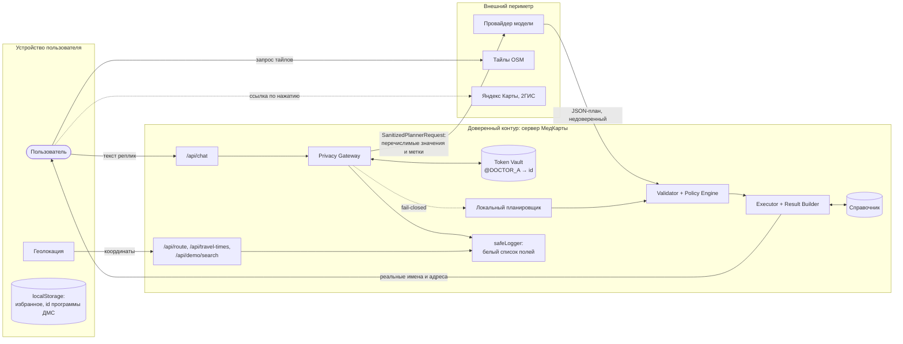
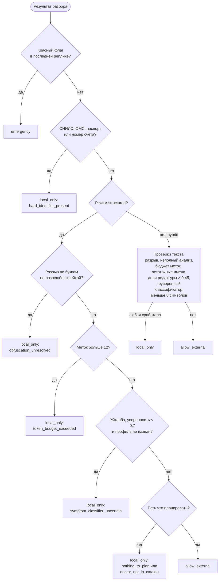

# 07. Приватность: Privacy Gateway и граница доверия

Этот документ — сжатое техническое описание того, **какие данные куда
попадают** и какими механизмами это обеспечено. Подробный разбор с историей
аудитов, примерами и вопросами юристу — в
[privacy-architecture.md](privacy-architecture.md) и
[privacy-evaluation.md](privacy-evaluation.md).

> Документ описывает технические меры. Он **не утверждает** соответствие
> 152-ФЗ, GDPR или другим нормам: правовая оценка — отдельная работа
> (перечень вопросов — раздел 10 [privacy-architecture.md](privacy-architecture.md)).
> Токенизация в проекте — **псевдонимизация**, а не обезличивание: она
> обратима при доступе к хранилищу токенов.

Версия политики приватности в коде — `2026-10-05.1` (`POLICY_VERSION` в
[policies.js](../backend/privacy/policies.js)); она пишется в журнал и в
каждый `SanitizedPlannerRequest`.

## Границы доверия

| Остаётся в доверенном контуре | Пересекает границу наружу |
|---|---|
| исходный текст реплик | в режиме `structured` — только описание из перечислимых значений |
| ФИО, телефоны, email, номера документов, адреса | метки вида `@PERSON_A`, `@PHONE_A` (без значений) |
| идентификаторы справочника | метки `@DOCTOR_A`, `@CLINIC_B` |
| описание жалоб и профиль, выведенный из жалобы | ничего: запрос со сведениями о здоровье планируется локально (с политики `2026-10-26.1`) |
| координаты пользователя | ничего: `@HOME`, `@CURRENT_LOCATION`, `selection=nearest` |
| соответствия токенов (Token Vault) | — |
| журнал, базы кабинета и демо-записи | — |

## Как граница закреплена в коде

Отправить сырой текст наружу нельзя не по соглашению, а по конструкции —
должны одновременно отказать несколько независимых механизмов:

1. **Тип.** Внешний планировщик принимает только `SanitizedPlannerRequest`
   ([models.js](../backend/privacy/models.js)). Его конструктор закрыт
   приватным `Symbol`; создать объект может только `mintSanitizedPlannerRequest`.
2. **Линтер.** Импорт `mintSanitizedPlannerRequest` разрешён только в
   [gateway.js](../backend/privacy/gateway.js) (`no-restricted-imports` в
   [eslint.config.js](../eslint.config.js)).
3. **Тест.** [boundary.test.js](../tests/boundary.test.js) проверяет то же по
   исходникам и что исходящий сетевой вызов к модели существует ровно в
   одном модуле.
4. **Повторная проверка перед `fetch`.** [planner/client.js](../backend/planner/client.js)
   ещё раз прогоняет текст через детекторы и закрытый словарь; при
   срабатывании запрос не отправляется.
5. **Сериализация.** `toJSON()` у `SanitizedPlannerRequest` отдаёт только
   число реплик, виды меток и подсказки — случайное логирование объекта не
   выводит текст.

## Privacy Gateway

[gateway.js](../backend/privacy/gateway.js), функция `process`. Работает
синхронно по репликам, между репликами уступает цикл событий.

### Этапы разбора одной реплики

| Этап | Модуль | Что делает |
|---|---|---|
| Скан-вид | [detectors.js](../backend/privacy/detectors.js), [normalize.js](../backend/privacy/normalize.js) | копия текста без невидимых символов, со свёрнутыми гомоглифами и картой индексов в исходник |
| Детекторы | [detectors.js](../backend/privacy/detectors.js) | виды: `PERSON`, `PHONE`, `EMAIL`, `SNILS`, `OMS`, `PASSPORT`, `COORDS`, `ADDRESS`, `UUID`, `INTERNAL_ID`, `DOB`, `ACCOUNT`, `HANDLE`, `URL`, `PLATE` |
| Entity linking | [entityResolver.js](../backend/privacy/entityResolver.js), [morphology.js](../backend/privacy/morphology.js) | связь с врачами и клиниками справочника: основы фамилий, n-граммы до 5 слов, склейка разорванных написаний до 14 токенов, нечёткое сравнение (не больше 24 сравнений на реплику) |
| Улицы и места | [vocabulary.js](../backend/privacy/vocabulary.js) | «на Ямашева» — улица, а не человек; места из закрытых списков |
| Родственники | `isNamedRelative` в [gateway.js](../backend/privacy/gateway.js) | «моя мама Гульнара Хабибуллина» — человек, а не врач справочника |
| Специальности | [entityResolver.js](../backend/privacy/entityResolver.js), [unknownSpecialties.js](../backend/privacy/unknownSpecialties.js) | названные профили, самоисправление («не, к гинекологу»), профили, которых нет в справочнике |
| Жалобы | [symptoms.js](../backend/privacy/symptoms.js) | профиль по жалобе и «красные флаги» — по тексту **без** найденных сущностей |

### Решение политики

Порядок проверок задан в `decideGatewayPolicy`
([policies.js](../backend/privacy/policies.js)): первое сработавшее правило
определяет решение, накопительной логики нет.

Пороги ([policies.js](../backend/privacy/policies.js), `POLICY`):

| Параметр | Значение |
|---|---|
| `medicalTextMode` | `local_only` — запрос со сведениями о здоровье (жалоба, симптом, диагноз, «гинеколог», «нарколог» — в любой реплике диалога) внешней модели не передаётся ни текстом, ни описанием; его планирует локальный планировщик. Других режимов нет ([privacy/04-health-data.md](privacy/04-health-data.md)) |
| `symptomConfidenceThreshold` | 0,7 |
| `maxRedactionRatio` | 0,45 (только `hybrid`) |
| `maxPlaceholders` | 12 меток на запрос; сверх бюджета выдаётся «пустая» метка без записи в хранилище |
| `minSanitizedChars` | 8 (только `hybrid`) |
| `maxResidualNameLike` | 0 «похожих на имя» слов после редактуры (только `hybrid`) |

### Режимы исходящего запроса

`PRIVACY_OUTBOUND_MODE` ([gateway.js](../backend/privacy/gateway.js)):

- **`structured`** (по умолчанию) — модель **никогда** не видит слов
  пользователя: только синтезированное описание из ключей профилей, мест из
  закрытых списков (районы, ориентиры, улицы без номера дома), ограничений,
  меток, порядка шагов и признаков намерения. Нераспознанное имя или телефон
  попасть в описание не может — в нём нет ни одного слова не из словаря.
- **`hybrid`** — санитизированный текст уходит, если **каждое** его слово из
  закрытого словаря ([vocabulary.js](../backend/privacy/vocabulary.js)), иначе —
  то же описание. При медицинском тексте наружу не уходит ничего (`local_only`).

Условия демо-записи (день, часы, цена, ДМС, район, стаж, пол врача)
извлекаются отдельно ([bookingConstraints.js](../backend/privacy/bookingConstraints.js))
и **наружу не уходят ни в каком режиме**: их исполняет строгий подбор на
сервере ([11-demo-booking.md](11-demo-booking.md)).

### Что gateway сознательно не принимает от клиента

- **Реплики ассистента** из истории отбрасываются: браузер может прислать
  поддельную «реплику ассистента» с диагнозом или телефоном, а настоящие
  ответы содержат ФИО найденных врачей.
- **Данные, разложенные по нескольким репликам**, ищутся и в склейке реплик:
  «снилс 123 456» → «789 01» — отказ.
- **Слово, разрезанное между репликами** («Кондра» → «шкина») считается
  нарочитым разрывом.

## Token Vault

[storage/tokenVault.js](../backend/storage/tokenVault.js) хранит соответствия
«метка → сущность доверенного контура».

| Свойство | Реализация |
|---|---|
| Ключ записи | `pv:` + `HMAC-SHA256(secret, "session:" + sessionId)[0..32]` + `HMAC(secret, "request:" + requestId)[0..16]` + метка |
| Изоляция | метку другой сессии или другого запроса разыменовать нельзя: ключ не совпадёт |
| Нестабильность меток | смещение алфавита меток — `HMAC(secret, "label:" + sessionId)[0] mod 26`: один и тот же врач в разных сессиях получает разные метки |
| TTL | `PRIVACY_TOKEN_TTL_SECONDS`, по умолчанию **120 с** (`DEFAULT_TTL_SECONDS`) |
| Секрет | `PRIVACY_TOKEN_SECRET` (не короче 16 символов); без него — случайный секрет процесса, и соответствия не переживают рестарт |
| Хранилище | память процесса (до 50 000 записей, вытеснение старых) или Upstash Redis по REST при `TOKEN_VAULT_BACKEND=upstash` (таймаут 3 с) |
| Идентификатор сессии | `sessionId` от клиента принимается, только если соответствует `^[A-Za-z0-9_-]{12,64}$`; иначе генерируется новый |

Разыменование — только в Policy Engine. Результат `null` (нет, истёк, чужая
сессия) трактуется как **отказ исполнения**, а не «пропустим шаг».

> В [policies.js](../backend/privacy/policies.js) есть поле
> `POLICY.tokenTtlSeconds` со значением по умолчанию 900, но оно нигде не
> используется: фактический TTL задаёт Token Vault (120 с). См.
> [18-known-limitations.md](18-known-limitations.md).

## Прочие каналы данных

| Канал | Что передаётся | Мера |
|---|---|---|
| `/api/route`, `/api/travel-times`, `/api/demo/search` | координаты пользователя и точек | обрабатываются собственным движком; в журнал идут только число точек, профиль, исход, время расчёта ([api/route.js](../backend/api/route.js), [api/travelTimes.js](../backend/api/travelTimes.js)) |
| Тайлы `tile.openstreetmap.org` | какой участок карты открыт | единственный внешний хост в CSP (`img-src`); нужен свой поставщик тайлов для продакшена ([deployment.md](deployment.md)) |
| Ссылки «Яндекс Карты / 2ГИС» | координаты точки отправления и целей в URL | только по нажатию пользователя ([externalMaps.js](../frontend/src/externalMaps.js)) |
| Адресная строка `?q=` | текст поиска | рекомендуемый формат журнала nginx без строки запроса ([deployment.md](deployment.md)) |
| `/api/events` | закрытый словарь событий | без текста, координат, IP; DNT/GPC уважаются ([analytics.md](analytics.md)) |
| Кабинет | email, имя, хэш пароля, id программы ДМС, избранное | не связан с ассистентом; регистрация выключена по умолчанию ([accounts.md](accounts.md)) |
| Демо-запись | слот, номер, токены | персональных данных пациента нет ни в запросах, ни в базе ([api/demoBooking.js](../backend/api/demoBooking.js)) |
| Журнал сервера | только поля из белого списка | см. ниже |

## Журнал и метрики

[safeLogger.js](../backend/observability/safeLogger.js):

1. принимаются только поля из `ALLOWED_FIELDS` (например, `event`,
   `decision`, `reason`, `status`, `code`, `latency_ms`, `count`);
2. поверх — запрет `FORBIDDEN_FIELDS` (`prompt`, `messages`, `content`,
   `text`, `name`, `phone`, `email`, `address`, `lat`, `lng`, `token`,
   `mapping`, `session_id`, `ip`, `body`, `stack` и др.);
3. объекты произвольной формы отбрасываются;
4. каждое строковое значение проверяется детекторами и при срабатывании
   заменяется на `[redacted]`; строки обрезаются до 120 символов;
5. ошибки пишутся только кодом — без `message` и стека.

Метки метрик — только значения вида `^[a-z0-9_.:-]{1,48}$`
([metrics.js](../backend/observability/metrics.js)).

## Измерение: проверка обезличивания

Методика — [privacy-evaluation.md](privacy-evaluation.md). Повторный прогон
при аудите:

- **Конфигурация:** коммит `d9c0de6`, публичный срез врачей (6 записей,
  `data/doctors.full.js` отсутствует), Node 22.22.2, Linux x64, 2 vCPU;
- **Команды:** `node scripts/privacy-eval.mjs --split all` и то же с
  `--mode hybrid`; набор: train + test + handwritten, 22 549 примеров.

| | `structured` | `hybrid` |
|---|---:|---:|
| Примеров с персональными данными | 14 622 | 14 622 |
| Утечек | **0** | 3 (0,02 %) |
| С данными ушло модели обезличенным | 85,89 % | 76,55 % |
| С данными ответили локально | 14,11 % | 23,43 % |
| Обычные запросы дошли до модели | 98,96 % | 99,97 % |
| Обычные запросы дошли словами пользователя | 0 % | 52,46 % |
| «Привет», «спасибо» ушли модели | 0 % из 300 | 35,67 % из 300 |
| Смысл дошёл: профиль / время / место | 100 / 100 / 100 % | 100 / 100 / 99,31 % |
| Отменено выходным предохранителем | 0 | 0 |
| Время разбора, p50 / p95 / max | 3,6 / 5,8 / 826,4 мс | 3,5 / 5,8 / 767,9 мс |

Цифры в [privacy-evaluation.md](privacy-evaluation.md) получены на полной
базе врачей (681 запись) и другой разбивке набора, поэтому отличаются;
вывод совпадает: в режиме `structured` утечек 0, в `hybrid` они есть из-за
имён, совпадающих со словами словаря.

Ограничения измерения: набор синтетический; ответ модели не оценивается
(заглушка); «утечка по смыслу» без самих значений не считается.

## Остаточные риски

| Риск | Почему остаётся |
|---|---|
| Факт обращения уходит наружу | при запросе **без** жалобы провайдер видит профиль и условия («кардиолог после 18:00»). Запрос с жалобой (и профиль, выведенный из неё) с политики `2026-10-26.1` наружу не уходит; запрос к ассистенту не связан с аккаунтом (пропуск `mk_ai` без id). Квалификацию «голого» профиля — на проверку юристу ([privacy/12-legal-questions.md](privacy/12-legal-questions.md)) |
| Псевдонимизация обратима | Token Vault — чувствительный актив; облачный Upstash (`*.upstash.io`) не используется — хранилище вне РФ, вместо него память процесса ([privacy/10-processors-and-localization.md](privacy/10-processors-and-localization.md)) |
| Детекторы неполны | правила и словари; защиту держит то, что нераспознанное не уходит текстом (`structured`), а не полнота поиска |
| Классификатор жалоб — правила | при неуверенности ответ локальный — полезность ниже |
| Инфраструктурное логирование | обратный прокси, APM или Sentry могут писать тела запросов — это настраивается вне кода ([SECURITY.md](../SECURITY.md)) |
| Провайдер модели | расположение серверов, хранение запросов и обучение на них определяются договором, а не кодом |
| `hybrid` | известны утечки имён-слов («Жене») — режим не по умолчанию |

Полный список — [18-known-limitations.md](18-known-limitations.md).
