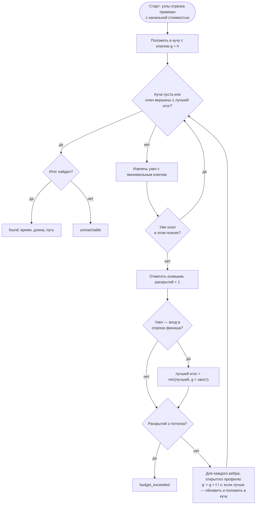
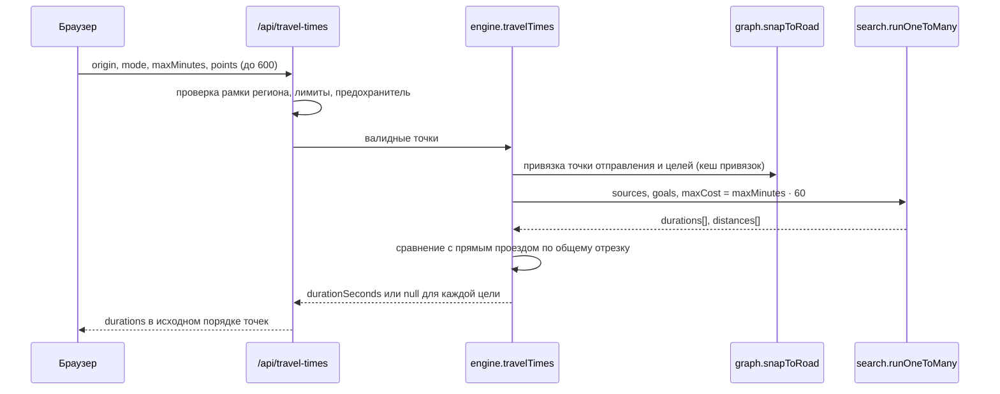

# 09. Движок маршрутизации

Маршруты и время в пути считает собственный движок внутри доверенного
контура — [backend/routing/](../backend/routing/engine.js). Сторонние сервисы
маршрутизации по умолчанию не используются: координаты пользователя не
покидают сервер МедКарты. Почему не OSRM, GraphHopper или Valhalla и как
собирать граф — в [routing.md](routing.md) и
[ADR 002](adr/002-own-routing-engine.md).

## Модули

| Модуль | Ответственность |
|---|---|
| [format.js](../backend/routing/format.js) | бинарный формат графа `GMK1`, профили передвижения |
| [osm.js](../backend/routing/osm.js) | разбор выгрузки Overpass: права проезда, скорости, одностороннее движение |
| [graph.js](../backend/routing/graph.js) | загрузка, проверка структуры, сетчатые индексы, главные компоненты связности, привязка к дороге |
| [astar.js](../backend/routing/astar.js) | A* «точка — точка» и Дейкстра «один ко многим» на переиспользуемом состоянии |
| [engine.js](../backend/routing/engine.js) | публичный интерфейс: `route`, `travelTimes`, `snapsToNetwork`, кеши, перезагрузка графа |
| [coverage.js](../backend/routing/coverage.js) | рамка графа, выведенная из справочника |
| [executor/routing.js](../backend/executor/routing.js) | выбор провайдера для ассистента: `local`, `haversine`, `osrm` |
| [build-road-graph.mjs](../scripts/build-road-graph.mjs) | сборка графа (`npm run build:graph`) |

## Граф

### Формат

Ориентированный граф в формате CSR (compressed sparse row): для узла `n`
исходящие рёбра лежат в диапазоне `offsets[n] … offsets[n+1]−1`.

| Секция | Тип | Длина | Смысл |
|---|---|---|---|
| заголовок | 64 байта | — | сигнатура `0x314B4D47` (`GMK1`), версия формата 1, размеры |
| `lat`, `lon` | `Int32` | узлы | градусы × 10⁶ (точность около 11 см) |
| `offsets` | `Uint32` | узлы + 1 | начало списка рёбер узла |
| `targets` | `Uint32` | рёбра | конец ребра |
| `lengths` | `Uint32` | рёбра | длина, метры |
| `speeds` | `Uint8` | рёбра | скорость для машины, км/ч |
| `access` | `Uint8` | рёбра | битовая маска: `CAR=1`, `FOOT=2`, `BIKE=4` |

Секции выровнены по 4 байта. Загрузчик проверяет структуру целиком:
смещения не убывают, последнее равно числу рёбер, все цели — существующие
узлы ([graph.js](../backend/routing/graph.js)).

### Профили

[format.js](../backend/routing/format.js), `PROFILES`:

| Профиль | Права проезда | Скорость на ребре | Скорость по умолчанию |
|---|---|---|---|
| `driving` | `CAR` | из тега `maxspeed` или по типу дороги | 40 км/ч |
| `foot` | `FOOT` | не используется | 4,8 км/ч |
| `bike` | `BIKE` | не используется | 15 км/ч |

Скорость по типу дороги без `maxspeed` ([osm.js](../backend/routing/osm.js),
`DEFAULT_SPEED`), км/ч: motorway 90, trunk 80, primary 60, secondary 55,
tertiary 50, unclassified 40, residential 30, service 20, living_street 15,
съезды (`*_link`) — 35–60; прочее — 30.

Правила проезда при сборке: кольца и автомагистрали — односторонние без
тега `oneway`; явное разрешение (`foot=yes`) сильнее общего запрета
(`access=no`); `trunk` проходим пешком и на велосипеде, если не
`motorroad=yes`; `access` из `no`, `private`, `military`, `delivery`,
`agricultural`, `forestry`, `emergency` закрывает проезд.

### Главная компонента связности

При загрузке для каждого профиля итеративным алгоритмом Тарьяна находится
**самая большая сильно связная компонента** (`markMainComponents`). Точки
привязываются только к рёбрам этой компоненты: двор с односторонним въездом,
обрывок дороги у края выгрузки или изолированная парковка не становятся
стартом, из которого «пути нет».

## Привязка точки к дороге

Здание почти никогда не лежит на дороге. `snapToRoad`
([graph.js](../backend/routing/graph.js)) проецирует точку на ближайший
**отрезок** дороги, а не на узел:

1. Сетчатый индекс отрезков с ячейкой 250 м; просмотр кольцами до 24 колец,
   пока кольцо может содержать что-то ближе найденного; дальше 2000 м
   (`MAX_SNAP_DISTANCE_M`) — точка вне сети.
2. Отрезок подходит, если открыт профилю хотя бы в одну сторону и оба конца
   лежат в главной компоненте профиля.
3. Проекция — в локальной плоской системе в метрах:

   ```text
   k_y = 111 320 / 10⁶ м на единицу координаты,  k_x = k_y · cos φ
   a = (A − P),  d = (B − A)          — в метрах
   t = clamp( −(a · d) / |d|², 0, 1 )
   расстояние = | a + t · d |
   ```

   где `P` — точка, `A→B` — отрезок, `t` — доля пути от `A`.
4. Для машины магистраль (≥ 80 км/ч) не выбирается, если обычная улица не
   дальше чем на 150 м сверх расстояния до магистрали: клиника у проспекта
   обслуживается с боковой улицы.

Результат привязки — отрезок, доля `t`, можно ли ехать вперёд и есть ли
встречное ребро. Поиск засевается **обоими концами** отрезка с уже
набежавшей стоимостью, а финиш — обоими концами отрезка назначения со
стоимостью «хвоста». Если обе точки на одном отрезке, прямой проезд по нему
сравнивается с обходом по сети и выбирается быстрейший.

## Алгоритмы

### Стоимость ребра

```text
c(e) = ℓ(e) / v(e)        секунды
v(e) = speed(e) / 3,6     для driving, если speed(e) > 0
v(e) = v_fallback / 3,6   иначе (foot — 4,8 км/ч, bike — 15 км/ч, driving без скорости — 40 км/ч)
```

`ℓ(e)` — длина ребра в метрах по формуле гаверсинуса между соседними
узлами OSM, округлённая до целого метра (не меньше 1 м) при сборке графа
([osm.js](../backend/routing/osm.js)). Частичный отрезок у точки привязки
считается той же формулой скорости (`edgeSpeedMps`), поэтому время маршрута
совпадает с тем, что минимизирует поиск.

### Расстояние по сфере

```text
a = sin²(Δφ/2) + cos φ₁ · cos φ₂ · sin²(Δλ/2)
d = 2 · R · arcsin( min(1, √a) ),   R = 6 371 000 м
```

### A* «точка — точка»

```text
f(n) = g(n) + h(n)
h(n) = d(n, goal) / v_max
```

- `v_max` для машины — **наибольшая скорость, реально встреченная в графе**
  среди рёбер, открытых машине (но не ниже 40 км/ч); для пешехода и
  велосипеда — скорость профиля. Так как длина ребра не короче прямой между
  его концами (с точностью до округления до метра), а `v(e) ≤ v_max`,
  эвристика не переоценивает остаток пути, и найденный путь оптимален по
  времени с той же точностью.
- Поиск останавливается, когда ключ вершины кучи не меньше лучшего
  найденного итога (`heap.peekKey() >= best`): с точками внутри рёбер финиш
  — не первый осевший узел, а минимум `g(узел) + хвост`.
- Потолок раскрытых узлов на участок — 400 000 (`DEFAULT_MAX_EXPANSIONS`),
  на весь запрос из нескольких участков — 1 000 000 (`MAX_REQUEST_EXPANSIONS`).
  Превышение — отказ `route_too_complex`.



### Дейкстра «один ко многим» с потолком

Для фильтра «не дольше N минут» и выбора ближайшего кандидата
(`runOneToMany` в [astar.js](../backend/routing/astar.js)):

- обычный Дейкстра без эвристики: эвристика нацелена на одну цель и для
  веера целей только мешает;
- **один обход на все цели**: узлы-входы всех целей отмечаются заранее; когда
  такой узел оседает, для его целей записывается `g(узел) + хвост`;
- остановка, когда осели все цели **или** ближайший неосевший узел дальше
  потолка `maxCost = N · 60` секунд — дальние цели не считаются вовсе;
- хвост от узла до здания добавляется после обхода, поэтому цель, которую
  хвост выводит за потолок, тоже считается недостижимой.



### Состояние поиска и кеши

- Массивы `gScore` (`Float64`), `parent` (`Int32`), `seen`, `settled`
  (`Uint32`) выделяются **один раз** на процесс; вместо очистки — счётчик
  поколений: запись своя, если её метка равна номеру текущего поиска.
- Куча — два плоских массива (`Uint32` узлы, `Float64` ключи).
- Кеш участков маршрута — 256 записей, вытеснение «первым пришёл — первым
  вышел»; ключ — отрезок и доля на нём с точностью до тысячной и, для
  точек на одном отрезке, направление. Отказы по бюджету не кешируются.
- Кеш привязок — до 4096 записей; ключ — профиль и координаты точки.
- Перезагрузка графа: раз в 30 с сверяется время изменения файла; новый граф
  загружается в фоне, запросы до конца загрузки обслуживает старый
  (`routing.graph_reloaded` в журнале).

## Выбор «ближайшего» в ассистенте

[executor/routing.js](../backend/executor/routing.js), `selectByTravelTime`:

1. префильтр — 10 ближайших кандидатов по прямой;
2. матрица времени в пути до них одним обходом;
3. минимум по времени.

Провайдер задаёт `ROUTING_PROVIDER`: `local` (по умолчанию; если графа
нет — оценка по прямой), `haversine` (всегда по прямой со скоростями 28 / 14
/ 4,5 км/ч, ответ помечен как приблизительный), `osrm` (сторонний сервер,
только явным флагом). Точку отправления клиент в `/api/chat` не передаёт,
поэтому в обычном режиме порядок кандидатов по удалённости уточняет браузер
([06-ai-assistant.md](06-ai-assistant.md)).

## Территория

- Рамка сборки графа — `CITY_BBOX` `[55.64, 48.75, 55.99, 49.43]`,
  расширенная на 6 км вокруг каждой точки справочника (учреждения, клиники,
  врачи; полная база — если файл есть), с округлением наружу до сотых
  ([coverage.js](../backend/routing/coverage.js)).
- Рамка допустимых координат в API — широта 54,0–57,5, долгота 47,0–51,5;
  за её пределами `/api/route` отвечает `400 outside_region`, а
  `/api/travel-times` возвращает `null` для такой цели.

## Ошибки

| Код | Когда | HTTP в `/api/route` |
|---|---|---|
| `routing_graph_unavailable` | файла графа нет или он не читается | 503 |
| `point_far_from_road_network` | точка дальше 2000 м от подходящей дороги; в ответе `point` — номер точки | 422 |
| `no_route_between_points` | путь не найден | 422 |
| `route_too_complex` | исчерпан бюджет раскрытий | 422 |
| `outside_region` | точка вне рамки региона | 400 |

Без графа интерфейс **не рисует прямую** вместо маршрута и сообщает, что
карта дорог не загружена ([routing.md](routing.md)).

## Замеры

Замеры воспроизводимы скриптом [docs/tools/bench-routing.mjs](tools/bench-routing.mjs):
пары точек — случайные пары учреждений из `data/facilities.js` с
фиксированным зерном; точка отправления «один ко многим» — центр Казани
`55.7963, 49.1088` (та же точка, что `defaultLocation` в интерфейсе).

**Конфигурация прогона (15.10.2026):** коммит `d9c0de6`; граф
`data/graph/kazan.graph` с машины разработчика — файл 10 457 464 байта от
23.09.2026, 299 833 узла, 685 940 рёбер; Node 22.23.2, Linux arm64 (виртуальная
машина на Apple Silicon), 4 vCPU, 4 ГБ; команда
`node docs/tools/bench-routing.mjs --pairs 1000 --seed 42`.

| Показатель | Значение |
|---|---|
| Граф в памяти с индексами | 14,0 МБ |
| Состояние поиска | 6,0 МБ |
| Загрузка и подготовка графа | 125 мс |

**Маршрут между двумя учреждениями** (`route`), 1000 пар:

| Профиль | Построено | Медиана | p95 | Максимум |
|---|---:|---:|---:|---:|
| driving | 1000 из 1000 | 4,7 мс | 18,2 мс | 37,7 мс |
| foot | 1000 из 1000 | 3,1 мс | 14,8 мс | 52,2 мс |
| bike | 1000 из 1000 | 1,9 мс | 9,3 мс | 42,0 мс |

Повтор того же маршрута из кеша участков — медиана 0,05 мс.

**Время в пути от центра до всех 487 учреждений** (`travelTimes`):

| Профиль | Потолок | Первый запрос | Повтор, медиана из 20 | Достижимо |
|---|---:|---:|---:|---:|
| driving | 30 мин | 91,9 мс | 38,5 мс | 486 |
| driving | 120 мин | 93,8 мс | 42,4 мс | 487 |
| foot | 30 мин | 37,9 мс | 2,7 мс | 52 |
| foot | 120 мин | 63,3 мс | 29,0 мс | 407 |

«Первый запрос» включает привязку всех адресов к дороге (холодный кеш
привязок). Время — по дорогам, без пробок.

Числа в разделе «Замеры» документа [routing.md](routing.md) получены на другой
сборке графа (255 386 узлов) и на синтетической решётке; при этом аудите они
не воспроизводились.

## Ограничения

- Время — свободный поток по скоростям из OSM: без пробок, времени суток и
  общественного транспорта.
- Запрещённые повороты и развороты не учитываются.
- Цепочки узлов степени 2 не сжимаются; двунаправленного поиска нет
  ([routing.md](routing.md), «Что осталось»).
- Поиск идёт в основном потоке процесса; нагрузку ограничивают бюджеты
  процессорного времени ([05-backend.md](05-backend.md)).
