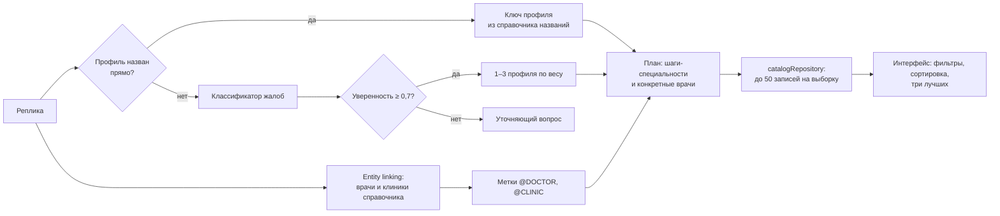

# 10. Медицинский поиск и данные

Документ описывает, **по каким данным** МедКарта ищет и **как** запрос
пользователя превращается в профиль врача, кандидатов и порядок выдачи.
Строгий подбор демо-записи — в [11-demo-booking.md](11-demo-booking.md),
форматы файлов — в [13-data-model.md](13-data-model.md).

> МедКарта не ставит диагнозы. Классификатор жалоб выбирает профиль
> специалиста для поиска по справочнику и ничего больше
> ([symptoms.js](../backend/privacy/symptoms.js)).

## Источники данных

| Набор | Файл | Объём на `d9c0de6` | Происхождение | Статус |
|---|---|---|---|---|
| Учреждения | [data/facilities.js](../data/facilities.js) | 487: больниц 68, клиник 227, амбулаторий 190, медцентров 2 | OpenStreetMap (ODbL) | Implemented |
| Врачи, публичный срез | [data/doctors.js](../data/doctors.js) | 6 | сайты государственных учреждений | Implemented |
| Врачи, полная база | `data/doctors.full.js` (вне git) | на машине разработчика — 681 | вне репозитория | Unknown |
| Клиники с расписанием | [data/clinics.js](../data/clinics.js) | 3 | снимок `generated_at` 05.04.2026, с источниками у каждой записи | Implemented |
| Частные клиники от сборщика | [data/private/catalog.json](../data/private/catalog.json) | 0 | `npm run data:build` | Partially Implemented |
| Демо-набор | [data/demo/](../data/demo/index.js) | 19 клиник, 27 филиалов, 118 врачей | генератор + 7 реальных частных клиник из OSM | Demo |
| Программы ДМС | [data/demo/insurance.js](../data/demo/insurance.js) | 1 страховщик, 3 программы, 250 правил покрытия | вымышлены | Demo |

Замечания по качеству, подтверждённые при аудите:

- **Форма собственности** учреждений OSM выставлена эвристикой и скриптом
  [reclassify-facility-ownership.mjs](../scripts/reclassify-facility-ownership.mjs):
  131 «Государственная», 356 «Частная». Частный статус семи реальных клиник
  демо-набора проверен отдельно ([demo.md](demo.md)).
- **Район** в записях `facilities.js` почти не заполнен (486 из 487 — пустая
  строка), поэтому фильтр по району для учреждений OSM практически не
  срабатывает.
- **Рейтингов, стажа и свободных слотов** в открытых источниках нет — проект
  их не выдумывает ([README.md](../README.md)); стаж и расписание есть только
  у вымышленных демо-врачей.
- В коммите нет результатов проверки госврачей (`data/verification.json`
  пуст) и нет принятых источников сборщика, кроме двух демо-источников.

## Справочник для ассистента

[privacy/catalog.js](../backend/privacy/catalog.js), `loadCatalog`, собирает в
памяти единый справочник для связывания сущностей и исполнения плана:

1. врачи — `data/doctors.full.js`, если файл есть и в нём больше записей, чем в публичном срезе; иначе `data/doctors.js`;
2. клиники — `data/clinics.js`;
3. учреждения OSM — `data/facilities.js` (выключается
   `PRIVACY_CATALOG_FACILITIES=off` ради холодного старта);
4. частные клиники от сборщика — `data/private/catalog.json`;
5. при `DEMO_DATA=on` — демо-набор;
6. в демо-режиме государственные записи скрываются, если не задан
   `PUBLIC_CLINICS=on` ([demo/flags.js](../backend/demo/flags.js)).

Справочник — публичные сведения, но ФИО врача остаются персональными данными:
наружу модель получает только метки `@DOCTOR_A`, а не записи
([07-privacy.md](07-privacy.md)).

## Специальности

16 канонических профилей ([shared/specialties.js](../shared/specialties.js),
`SPECIALTY_CANON`):

| Ключ | Название | Ключ | Название |
|---|---|---|---|
| `therapist` | Терапевт | `gynecologist` | Гинеколог |
| `neurologist` | Невролог | `pediatrician` | Педиатр |
| `cardiologist` | Кардиолог | `dentist` | Стоматолог |
| `lor` | ЛОР | `endocrinologist` | Эндокринолог |
| `ophthalmologist` | Офтальмолог | `gastroenterologist` | Гастроэнтеролог |
| `surgeon` | Хирург | `urologist` | Уролог |
| `orthopedist` | Ортопед | `psychiatrist` | Психиатр |
| `dermatologist` | Дерматолог | `traumatologist` | Травматолог |

- Название из справочника сводится к ключу поиском целого слова, длинные
  названия проверяются раньше коротких («ЛОР» не находится внутри
  «колоректальный»).
- Детский приём — по словам «детск…», «педиатр…», «неонатолог…» в профиле
  (`isPediatricRecord`).
- 33 профиля, **которых в справочнике нет** («косметолог», «аллерголог»,
  «мануальный терапевт», «психолог» и др.), распознаются отдельно
  ([unknownSpecialties.js](../backend/privacy/unknownSpecialties.js)): ответ
  честно говорит, что таких врачей нет, и при наличии предлагает похожий
  профиль словами (косметолог → дерматолог, андролог → уролог), но не
  подменяет профиль молча.

## Как текст превращается в профиль и кандидатов



### Связывание со справочником

[entityResolver.js](../backend/privacy/entityResolver.js) находит врачей и
клиники справочника в тексте детерминированно, без внешних сервисов:

- фамилии — по основе, инвариантной к падежу ([morphology.js](../backend/privacy/morphology.js));
- названия клиник — n-граммами до 5 слов; аббревиатуры и разговорные
  названия — по таблице алиасов (`РКБ`, `ДРКБ`, `МКДЦ`) в
  [catalog.js](../backend/privacy/catalog.js); слова, совпадающие с
  названиями, но обычно значащие своё («для», «рядом», «центр»), сами по
  себе клинику не задают;
- опечатки — нечёткое сравнение с порогом **0,82** и бюджетом 24 сравнения
  на реплику; исчерпание бюджета при оставшихся кандидатах — повод не
  отправлять текст наружу;
- разорванные написания («Г а л я в и ч у») — склейка до 14 токенов,
  принимается **только** при попадании в справочник.

Мера похожести ([normalize.js](../backend/privacy/normalize.js), `similarityOf`):

```text
L = max(|a|, |b|)
k = min(3, ⌊L / 3⌋ + 1)                    допустимое число правок
D = расстояние Дамерау — Левенштейна (вставка, удаление, замена,
    перестановка соседних символов), вычисляется до порога k
edit = 1 − D / L,  если D ≤ k;  иначе 0
sim  = edit,                     если edit ≥ 0,82
sim  = max(trigram(a, b), edit)  иначе
```

### Классификатор жалоб

[symptoms.js](../backend/privacy/symptoms.js), `classifySymptoms` — набор
правил по основам слов. Каждое правило имеет вес и список профилей; первый
профиль правила главный.

```text
score(s) = Σ по правилам r:  w_r · hits_r · (1, если s — первый профиль r; иначе 0,5)
         + 3 за каждое фразовое правило («по женским делам» → гинеколог,
                                          «по мужской части» → уролог)
если пациент — ребёнок и есть терапевт: score(педиатр) = score(терапевт) + 0,5

top        = максимальный score
total      = сумма всех score
dominance  = top / total
strength   = min(1, top / 3)
confidence = strength · (0,5 + 0,5 · dominance)
```

- Профили в ответе — до трёх лучших по `score`.
- При `confidence < 0,7` (`POLICY.symptomConfidenceThreshold`) профиль не
  угадывается: ассистент переспрашивает. Пример из кода: одно общее слово
  («слабость») даёт около 0,33.
- Если у двух профилей-специалистов (не терапевта) равный высший вес
  («болит голова и живот»), классификатор возвращает пару `tied`, и
  ассистент спрашивает, к кому записаться.
- Жалоба ищется в тексте **без** найденных сущностей: фамилия «Раков» не
  становится онкологией.

Группы правил: зубы, ЖКТ, сердце, неврология, кожа, глаза, ЛОР, эндокринология,
гинекология, урология, травмы и суставы, хирургия, тревога и депрессия, общие
симптомы, а также чувствительные группы (онкология, инфекции, зависимости,
психиатрия, репродуктивное здоровье) — их наличие делает запрос медицинским
и включает режим описания вместо текста.

### Красные флаги

Отдельный список правил ([symptoms.js](../backend/privacy/symptoms.js),
`RED_FLAG_IDS`): `chest_pain`, `breathing`, `consciousness`, `bleeding`,
`stroke`, `seizure`, `anaphylaxis`, `trauma`, `poisoning`, `abdomen`, `rash`,
`fever_high`, `infant_fever`, `head_injury`, `self_harm`. Проверка — по
последней реплике, и по тексту с вырезанными сущностями, и по исходному: для
неотложных состояний ложная тревога дешевле пропуска. Результат — ответ
«звоните 103 или 112» без поиска и без вызова модели.

Тесты: [third-audit.test.js](../tests/third-audit.test.js) (неотложные и
обычные фразы), [privacy-audit.test.js](../tests/privacy-audit.test.js).

## Поиск по справочнику на сервере

[executor/catalogRepository.js](../backend/executor/catalogRepository.js):

- выборка по специальности, по клиникам и по id; не больше 50 записей на
  выборку;
- ограничения плана `ownership`, `district`, `min_rating`,
  `min_experience_years`, `children`, `wheelchair`, `online_booking`,
  `evening`, `weekend`, `available_after`, `available_before` применяются к
  записям справочника; `open_now` передаётся интерфейсу как фильтр «открыто
  сейчас» ([resultBuilder.js](../backend/executor/resultBuilder.js));
- расписание врача в справочнике есть не у всех, поэтому часы приёма
  проверяются по расписанию учреждения, и ответ прямо просит уточнить время
  при записи ([resultBuilder.js](../backend/executor/resultBuilder.js)).

Окончательный порядок и «три лучших» считает браузер, потому что только у
него есть точка отправления, время в пути и программа ДМС
([04-frontend.md](04-frontend.md)).

## Часы работы

[shared/openingHours.js](../shared/openingHours.js) разбирает строки формата
OSM `opening_hours`: `24/7`, `08:00-20:00`, `Mo-Fr 08:00-20:00; Sa 09:00-15:00;
Su off`, списки и диапазоны дней, несколько интервалов в день (перерыв —
«закрыто»), `PH` игнорируется. Непонятная строка — `null`, и тогда берётся
расписание из данных как есть. По этим интервалам считаются «открыто
сейчас», «вечером» и «в выходные».

## Услуги и цены

[shared/services.js](../shared/services.js) — закрытый справочник из 40 услуг
(первичный и повторный приём по профилям и частая диагностика) с кодами
номенклатуры медицинских услуг (приказ Минздрава России № 804н). Строки
прайсов клиник сводятся к услуге правилами `matchService`; несопоставленная
строка уходит на ручную проверку ([data-pipeline.md](data-pipeline.md)).
Пакеты, «на дому», онлайн-консультации и смежные профили намеренно не
сопоставляются.

## Модель ДМС

[shared/dms.js](../shared/dms.js):

```text
страховщик → программа (взрослая / детская / семейная, срок действия)
программа × филиал × (вся амбулатория | специальность | услуга) → режим доступа
```

| Режим доступа | Подпись в интерфейсе |
|---|---|
| `direct` | прямое обращение с полисом |
| `via_pult` | запись через пульт страховой |
| `referral_required` | по направлению терапевта или педиатра |
| `approval_required` | нужно согласование со страховой |
| `excluded` | не входит в программу |

- Правило точнее — главнее: **услуга > специальность > вся амбулатория**
  (`coverageFor`).
- В браузере хранится **только id программы**; номер полиса, ФИО и
  работодатель не нужны и не спрашиваются ([DmsPanel.jsx](../frontend/src/DmsPanel.jsx)).
- Покрытие считается в браузере; в `/api/chat` программа не уходит. В
  строгий подбор программа передаётся явно (`dms.planId`).
- Демо-программы: **Demo Basic**, **Demo Standard**, **Demo Premium**
  страховщика «Демо-Страхование» — описание покрытия в [demo.md](demo.md).
- Лимиты программы (число визитов в год) и оформление согласования не
  моделируются.

## Ограничения

- Классификатор и связывание — правила и словари: необычная формулировка
  может не распознаться; при сомнении система переспрашивает или отвечает
  локально.
- Публичный срез врачей мал (6 записей); полная база вне git, её актуальность
  по репозиторию не проверить.
- Данные учреждений — снимок OSM; часы работы и форма собственности могут
  устаревать. Механизм проверки госврачей есть, но результатов в коммите нет.
