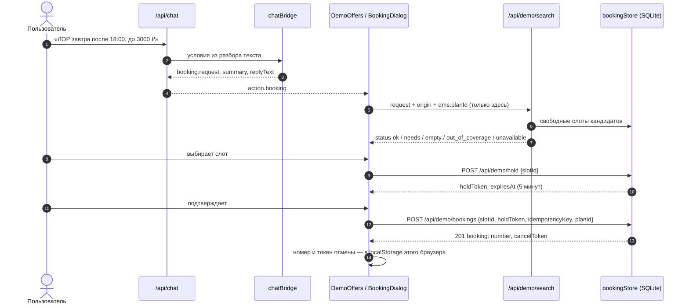
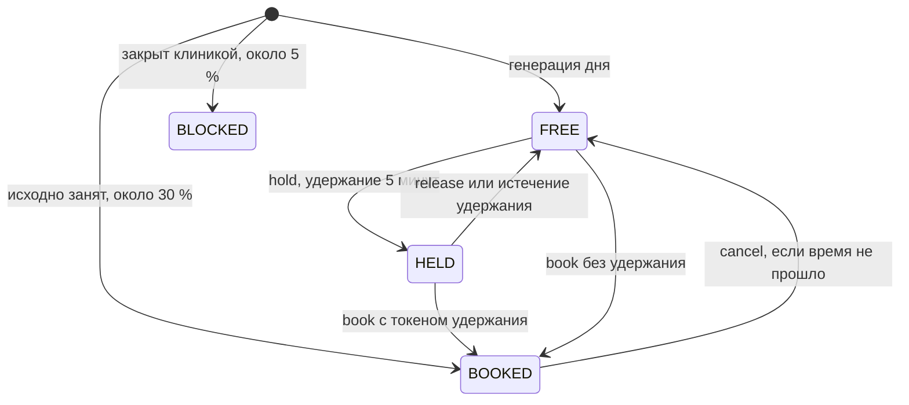

# 11. Демо-запись: строгий подбор, слоты, запись

**Статус: Demo.** Демо-запись — симуляция основного сценария МедКарты на
вымышленных данных. Она живёт только в базе МедКарты: в клиники, страховые
компании, МИС и каналы уведомлений ничего не отправляется, персональные
данные пациента не запрашиваются и не хранятся
([api/demoBooking.js](../backend/api/demoBooking.js),
[bookingStore.js](../backend/demo/bookingStore.js)).

Включение — `DEMO_DATA=on` (в `npm run dev` по умолчанию); выключить только
запись — `DEMO_BOOKING=off`; требуется Node 22.13+ (`node:sqlite`). Данные
набора, полный список понимаемых фраз и интерфейс — в [demo.md](demo.md).

## Поток

## От текста к запросу подбора

[chatBridge.js](../backend/demo/chatBridge.js), `buildBookingRequest`:

- условия берутся из **детерминированного разбора текста**
  ([bookingConstraints.js](../backend/privacy/bookingConstraints.js),
  [demoRefs.js](../backend/privacy/demoRefs.js)), а не из ответа модели:
  модель выбирает действие, но не может потерять или ослабить «завтра»,
  «после 18:00», «по ДМС» или «до 3000 ₽»;
- относительные даты разрешаются по московскому времени демо (`demoNow`,
  можно заморозить `DEMO_NOW` вне `NODE_ENV=production`);
- результат нормализуется `normalizeSearchRequest`
  ([shared/demoSearch.js](../shared/demoSearch.js)) — тем же модулем, что и на
  сервере подбора;
- ответ ассистента повторяет понятые условия (`summary`) и, если чего-то не
  хватает, задаёт вопрос ([06-ai-assistant.md](06-ai-assistant.md)).

### Запрос подбора

Поля после нормализации (`normalizeSearchRequest`); всё неизвестное
отбрасывается, неверное значение — в `errors`.

| Поле | Тип и допустимые значения |
|---|---|
| `specialty` | ключ из 16 профилей или `null` |
| `specialtyAny` | до 3 профилей — «невролог или терапевт» |
| `doctorIds`, `excludeDoctorIds` | `demo-doc-…`, до 5 и до 10 |
| `branchIds`, `excludeBranchIds` | `demo-…`, до 8 и до 10 |
| `districts`, `preferDistricts`, `excludeDistricts` | районы Казани: Авиастроительный, Вахитовский, Кировский, Московский, Ново-Савиновский, Приволжский, Советский |
| `serviceId`, `visit` | процедура `proc.*` / `diag.*`; `first`, `repeat`, `procedure`, `any` |
| `patient` | `adult` или `child` |
| `minExperience`, `preferMinExperience`, `preferExperience` | стаж 1–60 лет: условие, пожелание, «побольше» |
| `doctorGender`, `preferGender` | `female` / `male`: условие или пожелание |
| `date` | `kind`: `any`, `today`, `tomorrow`, `after_tomorrow`, `weekday`, `weekend`, `this_week`, `next_week`, `date`, `any_of` (до 7 вариантов, у каждого может быть своё окно), `range`, `invalid` |
| `excludeWeekdays`, `excludeDates`, `weekend`, `workdays` | исключения и фильтры дней |
| `timeFrom`, `timeTo`, `timeWindows`, `evening`, `preferTime`, `timeChoice` | часы `ЧЧ:ММ`; до 3 окон через «или»; вечер — с 17:00; два прочтения часа для вопроса |
| `maxPrice`, `preferCheap` | 100–100 000 ₽; «подешевле» без суммы |
| `dms` | `{required, planId, prefer}` |
| `travel` | `{maxMinutes: 5–120, mode: driving / foot / bike, nearest}` |
| `origin`, `originHint`, `originConfirmed` | точка от клиента; «от дома / от работы / от места»; подтверждение «я там» |
| `city` | Казань или населённый пункт вне покрытия (Иннополис, Москва и др.) |
| `unsupported`, `fallbacks` | условия, которых в демо нет, и заранее данные согласия на замену |
| `wheelchair`, `parking` | свойства филиала |
| `limit` | 1–5 вариантов |

## Строгий подбор

[demo/search.js](../backend/demo/search.js). Каждое условие **обязательно**;
ослабить его можно только по согласию пользователя.

### Ранние ответы до поиска

| Условие | `status` / `needs` |
|---|---|
| часть полей не разобралась | `needs: clarify` |
| нет ни профиля, ни врача | `needs: specialty` |
| город вне покрытия | `out_of_coverage` |
| «по ДМС» без программы или с неизвестной программой | `needs: dms_plan` |
| есть условие, которого в демо нет («на дом», «анонимно», отзывы) и на замену не дано согласия | `empty`: «проверить не могу» и кнопка поиска без этого условия с числом вариантов |
| точка названа словами и не подтверждена | `needs: origin_place` |
| ограничение времени в пути без точки | `needs: origin` |
| несуществующая дата | `needs: date_invalid` |
| день недели не совпадает с датой | `needs: date_conflict` |
| час без «утра/вечера» | `needs: time_choice` |
| «следующая пятница», сказанная раньше пятницы | `needs: date_choice` |
| «после» позже «до» | `needs: time_conflict` |

### Воронка

Ядро `run` применяет условия по очереди и записывает, сколько кандидатов
(пар «врач × филиал») осталось после каждого этапа:

```mermaid
flowchart LR
    a["specialty<br/>профиль"] --> b["doctor<br/>названный врач"]
    b --> c["age<br/>взрослый / детский"]
    c --> d["clinic<br/>клиника, филиал"]
    d --> e["district"]
    e --> f["gender"]
    f --> g["access<br/>среда, парковка"]
    g --> h["experience"]
    h --> i["service"]
    i --> j["price"]
    j --> k["dms"]
    k --> l["travel<br/>время в пути"]
    l --> m["slots<br/>свободное время"]
```

- **Цена** — по каждой услуге отдельно; при «по ДМС» или «лучше по ДМС» с
  выбранной программой покрытый приём проходит потолок цены (по ДМС пациент
  не платит).
- **Время в пути** — по графу дорог одним обходом на все филиалы
  ([09-routing-engine.md](09-routing-engine.md)); потолок по умолчанию для
  «поближе» — 120 минут. Без графа и с ограничением по времени —
  `unavailable` (оценка по прямой за время в пути не выдаётся); точка вне
  сети дорог — `unavailable: origin_off_network`.
- **Слоты** — свободные, не в прошлом, в нужные дни и часы; у варианта
  `any_of` может быть своё окно на каждый день.
- Филиал с неизвестным районом условие по району не проходит ни в какую
  сторону; у реальных клиник среда и парковка не указаны — не обещаются.

### Порядок вариантов

Сортировка `sortCandidates` — последовательно, каждое правило только при
своём условии:

1. «лучше по ДМС» — покрытые программой первыми;
2. «желательно в 18:30» — у кого есть ровно это время;
3. «в Советском, а если никого — Приволжский» — названный первым район;
4. «желательно женщина» — врачи нужного пола;
5. «лучше со стажем от 20» — у кого такой стаж;
6. «у кого стаж побольше» — по убыванию стажа;
7. «поближе» — по времени в пути;
8. «подешевле» — по цене;
9. затем всегда: самый ранний свободный слот → время в пути → цена.

Показывается до 5 вариантов (`MAX_RESULTS`), у каждого — до 6 ближайших
слотов.

### Если ничего не подошло

Ответ `status: empty` называет этап, на котором кончились кандидаты
(`blocking`), и **предлагает** послабления с числом вариантов — сам ничего не
снимает:

1. по одному условию: врач, клиника, район, пол, доступная среда, стаж, часы,
   день, цена, ДМС, время в пути;
2. если ни одно по отдельности не помогает и условий больше двух — до двух
   пар («Снять два условия: … и …»);
3. если и пары не помогают — все сразу («Снять сразу: …»).

Тексты ответов: «Подходящих вариантов нет: … Условия я не ослаблял.»

## Хранилище записи

[bookingStore.js](../backend/demo/bookingStore.js) — один файл SQLite
(`DEMO_BOOKING_DB_PATH`, по умолчанию `var/demo/booking.sqlite`), режим WAL,
`busy_timeout` 3 с, миграции по `PRAGMA user_version`.

### Состояния слота

Истёкшее удержание читается как `FREE` без отдельной записи в базу.
Прошедший слот не записывается (`slot_past`) и при отмене не
«освобождается».

### Гарантии

| Гарантия | Механизм |
|---|---|
| Слот не бывает одновременно свободным и занятым | статус — одно поле; переходы — условные `UPDATE … WHERE version = ?` внутри `BEGIN IMMEDIATE` |
| На слот не больше одной подтверждённой записи | частичный уникальный индекс `bookings_one_active_per_slot … WHERE status = 'CONFIRMED'` |
| Повтор после обрыва связи не создаёт вторую запись | `idempotencyKey` (16–80 символов `[A-Za-z0-9_-]`) уникален; повтор возвращает ту же запись (`200` вместо `201`); тот же ключ для другого слота — `409 idempotency_conflict` |
| Удержание знает только этот браузер | в базе — хэш токена удержания |
| Отменить может только владелец | токен отмены — HMAC-SHA256 с секретом базы от префикса `cancel` и id записи, в базе не хранится; секрет создаётся при первом запуске и лежит в таблице `meta` |
| Записи переживают перезапуск | файл на диске |

Номер записи — `DEMO-ГГММДД-XXXXX` (5 символов из алфавита без похожих
символов).

### Расписание

- Окно — **14 дней** от «сегодня» по Москве (`SLOT_WINDOW_DAYS`); недостающие
  дни генерируются при обращении, слоты старше недели удаляются.
- Генерация детерминирована: seed `medkarta-demo-2026`, врач и дата
  ([generator.js](../backend/demo/generator.js)). Исходно около 30 % слотов
  заняты «другими пациентами», около 5 % закрыты клиникой; у врачей бывают
  отпуска (неделя, вероятность 6 % на неделю) и отгулы (4 % на день).
- Смены врача не выходят за часы филиала; у реальных клиник часы — из OSM.
- Если демо-набор перегенерирован (изменился отпечаток), база сбрасывается.
- `npm run demo:reset` — удалить все демо-записи и вернуть слоты к исходным;
  можно при работающем сервере ([demo-reset.mjs](../scripts/demo-reset.mjs)).

## API

| Метод | Путь | Назначение | Лимит на адрес |
|---|---|---|---|
| POST | `/api/demo/search` | строгий подбор | 120 за 5 мин |
| GET | `/api/demo/slots?doctorId=&branchId=&from=&days=&planId=&patient=` | расписание врача (1–14 дней), цены, покрытие ДМС | 600 за 5 мин |
| POST | `/api/demo/hold` | удержать слот | 60 за 5 мин |
| POST | `/api/demo/release` | снять своё удержание | 60 за 5 мин |
| POST | `/api/demo/bookings` | записаться | 60 за 5 мин |
| POST | `/api/demo/bookings/cancel` | отменить | 60 за 5 мин |
| POST | `/api/demo/bookings/lookup` | состояние своих записей (до 20) | 600 за 5 мин |
| GET | `/api/demo/bookings/mine` | записи вошедшего пользователя (до 50); гость — `401` | 600 за 5 мин |

Запись, сделанная после входа в кабинет, привязана к его id (`account_id`) и
видна только этому аккаунту; запись гостя ни к кому не привязана, её номер и
код отмены хранит браузер ([accounts.md](accounts.md)).

Изменяющие запросы — только JSON с того же `Origin` (`Sec-Fetch-Site`),
тело до 16 КБ. При выключенном демо — `404 demo_disabled`. Коды ошибок
записи: `bad_request` 400, `slot_not_found` и `booking_not_found` 404,
`slot_taken`, `slot_held`, `slot_unavailable`, `slot_past`, `slot_conflict`,
`idempotency_conflict` 409. Примеры запросов и ответов — в
[12-api-reference.md](12-api-reference.md).

## Тесты

| Файл | Тестов | Что проверяет |
|---|---:|---|
| [demo-data.test.js](../tests/demo-data.test.js) | 21 (+1 с графом) | объём и маркировка набора, согласованность расписаний, детерминированность генерации |
| [demo-booking.test.js](../tests/demo-booking.test.js) | 16 | хранилище, гонки двух процессов, перезапуск, HTTP |
| [demo-scenarios.test.js](../tests/demo-scenarios.test.js) | 79 (+5 с графом) | текст → подбор → запись при замороженном времени, сложные условия, контекст диалога, приватность |
| [booking-constraints.test.js](../tests/booking-constraints.test.js) | 188 | разбор условий из текста |
| [booking-fuzz.test.js](../tests/booking-fuzz.test.js) | 2 | 60 случайных сочетаний одной фразой и 60 диалогом с фиксированным зерном |

Числа тестов — из прогона при аудите ([16-testing.md](16-testing.md)).

## Ограничения демо

- Врачи, цены, расписание и программы ДМС вымышлены, в том числе у реальных
  клиник; реальные клиники о них не знают. Покрытие ДМС — иллюстрация логики.
- Время в пути — без пробок и общественного транспорта.
- Нет отзывов, рейтингов, выезда на дом, онлайн-приёма, приёма по ОМС,
  возраста врачей, анонимного приёма, справок и записи нескольких пациентов
  подряд — ассистент честно говорит «не могу проверить».
- Лимиты программы ДМС и согласование со страховой не моделируются.
- Отменить запись можно только из браузера, где сохранены номер и токен.
