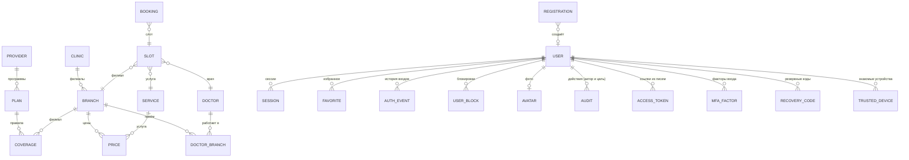

# 13. Модель данных

Документ перечисляет форматы данных, которые читает и пишет МедКарта:
справочники в `data/`, базы SQLite, граф дорог, журнал аналитики и состояние
в браузере. Источник истины — модули, указанные в каждом разделе.



Диаграмма объединяет справочник частных клиник и демо-набор
([shared/privateCatalog.js](../shared/privateCatalog.js),
[generator.js](../backend/demo/generator.js)), ДМС ([shared/dms.js](../shared/dms.js)),
базу демо-записи и базу кабинета. Справочники в `data/` — ES-модули и JSON,
а не таблицы; «связи» — ссылки по идентификаторам, которые проверяет код.

## Справочники в `data/`

### Карточка врача или учреждения

Общий плоский формат записей `data/facilities.js` (`kazanFacilities`) и
`data/doctors.js` (`verifiedDoctors`):

| Поле | Смысл |
|---|---|
| `id` | идентификатор записи (`osm-node-…`, `verified-…` и т. п.) |
| `name`, `specialty`, `clinic`, `facilityType` | имя, профиль, учреждение, тип: Больница, Клиника, Амбулатория, Медцентр |
| `address`, `district`, `lat`, `lng` | адрес и точка |
| `ownership` | `Государственная` или `Частная` |
| `rating`, `experience` | в открытых данных не заполняются содержательно |
| `schedule`, `hours` | расписание по дням и исходная строка часов |
| `phone`, `website` | контакты |
| `services`, `features` | услуги и признаки (детский приём, доступная среда и др.) |
| `description`, `source` | описание и источник |

### Клиники с расписанием — `data/clinics.js`

`ClinicsData = {generated_at, city, clinics[]}`; у клиники — `clinic_id`,
`name`, `facility_type`, `ownership`, `address_full`, `district`,
`coordinates {lat, lng}`, `working_hours` (по дням и `raw`), `phones[]`,
`website`, `booking_url`, `doctors[]`, `sources[]`.

### Справочник частных клиник — `data/private/catalog.json`

Строится `npm run data:build` из принятых снимков сборщика
([data-pipeline.md](data-pipeline.md)). Структура и правила проверки —
`validatePrivateCatalog` в [shared/privateCatalog.js](../shared/privateCatalog.js):

```text
{ meta, clinics[], doctors[], prices[] }
clinic   → id, name, ownership, facilityType, website, branches[]
branch   → id, name, address, district, lat, lng, phone, hours, features
doctor   → id, name, specialty, branchIds[], …
price    → branchId, serviceId, price
```

Проверяется: идентификаторы `^[a-z0-9][a-z0-9-]{1,63}$`; ссылки только
http(s); телефон — цифры и разделители; координаты в пределах широт 53,5–57
и долгот 46,5–55; длины строк; ссылки между записями (врач в
несуществующем филиале или цена несуществующей услуги — ошибка). На
`d9c0de6` файл пуст.

### Демо-набор — `data/demo/`

| Файл | Содержимое |
|---|---|
| [generated.js](../data/demo/generated.js) | `demoCatalog = {meta, clinics, doctors, prices, services, insurance}`; генерируется `npm run demo:generate`, вручную не правится |
| [realClinics.js](../data/demo/realClinics.js) | точки 11 филиалов реальных частных клиник (снимок OSM) |
| [insurance.js](../data/demo/insurance.js) | `demoInsurance = {meta, providers, plans, coverage}` |
| [private.js](../data/demo/private.js), [index.js](../data/demo/index.js) | сборка набора для интерфейса и сервера |
| `sites/` | локальные страницы двух вымышленных клиник для демонстрации сборщика |

Поля демо-набора:

| Сущность | Поля |
|---|---|
| клиника | `id`, `name`, `ownership`, `facilityType`, `website`, `description`, `tier` (эконом / стандарт / премиум), `real`, `branches[]` |
| филиал | `id`, `name`, `district` (или `null`), `address`, `lat`, `lng`, `phone`, `hours`, `features` |
| врач | `id` (`demo-doc-…`), `name`, `specialty`, `specialtyKey`, `ageGroups`, `branchIds`, `serviceIds`, `hoursByBranch`, `schedule`, `experienceYears`, `gender`, `features`, `description` |
| услуга | `id` (`consult.<профиль>.first` или `.repeat`, `proc.*`, `diag.*`), `name`, `specialty`, `kind`, `visit`, `durationMinutes` |
| цена | `branchId`, `serviceId`, `price` |
| программа ДМС | `id`, `providerId`, `name`, `insured` (`adult` / `family`), `validFrom`, `validTo`, `sourceDoc`, `summary` |
| правило покрытия | `planId`, `branchId`, `scope` (`all_outpatient` / `specialty` / `service`), `specialty` или `serviceId`, `access` |

Режимы доступа и приоритет правил — [10-medical-search-and-data.md](10-medical-search-and-data.md).

## SQLite: аккаунты (схема 6)

[backend/accounts/sqliteStore.js](../backend/accounts/sqliteStore.js); файл
`ACCOUNTS_DB_PATH` (по умолчанию `var/accounts/medkarta.sqlite`). Прагмы:
`foreign_keys = ON`, `busy_timeout = 2000`, `secure_delete = ON`, WAL для
файла; миграции — по `user_version` в транзакции: 1 — пользователи, сессии,
избранное; 2 — демо-копии; 3 — роли, статусы, журналы, аватары, настройки;
4 — приглашения: `users.activated_at` и таблица `access_tokens`; 5 —
регистрация, двухфакторная защита, счётчики подбора, очередь писем (ниже).
Перед миграцией сервер сам копирует базу (`VACUUM INTO`,
`medkarta.sqlite.before-v5-….bak`, права 600). При переходе на схему 5
пароли, роли и статусы сохраняются, email активированных аккаунтов
считается подтверждённым, **все сессии завершаются**. Отката миграций нет:
перед обновлением — `npm run accounts -- backup`.

```sql
CREATE TABLE users (
  id            TEXT PRIMARY KEY,               -- 32 hex, случайный
  email         TEXT NOT NULL UNIQUE COLLATE NOCASE,
  display_name  TEXT NOT NULL,                  -- «Имя Фамилия», для совместимости
  password_hash TEXT,                           -- scrypt2$N$r$p$соль$хэш (NFKC); прежний scrypt$… пересчитывается при входе
  dms_plan_id   TEXT,
  demo_key      TEXT UNIQUE,                    -- устарел, не заполняется
  created_at    INTEGER NOT NULL,
  updated_at    INTEGER NOT NULL,               -- у демо-копии — время последнего входа
  demo_template TEXT,                           -- схема 2: ключ демо-профиля
  demo_owner    TEXT,                           -- схема 2: SHA-256 от cookie mk_demo (демо-вход убран 20.10.2026)
  first_name    TEXT NOT NULL DEFAULT '',       -- схема 3 и ниже
  last_name     TEXT NOT NULL DEFAULT '',
  role          TEXT NOT NULL DEFAULT 'user'    -- user | moderator | admin | superadmin
                CHECK (role IN ('user', 'moderator', 'admin', 'superadmin')),
  status        TEXT NOT NULL DEFAULT 'active'  -- active | blocked | archived
                CHECK (status IN ('active', 'blocked', 'archived')),
  blocked_until INTEGER,                        -- NULL — бессрочно
  block_reason  TEXT,
  must_change_password INTEGER NOT NULL DEFAULT 0,
  password_changed_at  INTEGER,
  last_login_at        INTEGER,
  last_seen_at         INTEGER,                 -- последний запрос с сессией
  failed_logins        INTEGER NOT NULL DEFAULT 0, -- подряд, сбрасывается при входе
  last_failed_login_at INTEGER,
  created_by    TEXT,                           -- id сотрудника; NULL — CLI или старая регистрация
  version       INTEGER NOT NULL DEFAULT 1,     -- оптимистическая блокировка правок
  search_text   TEXT NOT NULL DEFAULT '',       -- id, email, имя в нижнем регистре (кириллица — в JS)
  activated_at  INTEGER,                        -- схема 4: пароль задан; NULL — «ожидает активации»
  email_verified_at INTEGER,                    -- схема 5: владение адресом подтверждено ссылкой
  signup_source TEXT                            -- схема 5: self (регистрация) | admin | legacy
);
CREATE TABLE registrations (                    -- схема 5: заявки на регистрацию
  id TEXT PRIMARY KEY, token_hash TEXT NOT NULL UNIQUE,  -- SHA-256 от токена ссылки
  email TEXT NOT NULL COLLATE NOCASE, created_at, expires_at,
  opened_at, context_hash TEXT UNIQUE, context_expires_at, -- контекст — cookie mk_register, 30 минут
  used_at, revoked_at, revoked_reason, delivery_status, ip_prefix, user_id
);
CREATE TABLE mfa_factors (                      -- схема 5: факторы входа
  id TEXT PRIMARY KEY, user_id → users ON DELETE CASCADE,
  type CHECK (type IN ('totp', 'webauthn')), label, status CHECK (status IN ('pending', 'active', 'revoked')),
  secret_enc TEXT,                              -- TOTP: AES-256-GCM ключом MFA_SECRET_KEY
  last_step INTEGER,                            -- TOTP: последний принятый шаг (код не принимается дважды)
  credential_id TEXT UNIQUE, public_key, algorithm, sign_count, transports, backed_up, -- ключ доступа
  user_verified INTEGER,                        -- схема 6: ключ проверил человека (PIN, биометрия); NULL — добавлен раньше
  created_at, confirmed_at, last_used_at, revoked_at, expires_at
);
CREATE TABLE mfa_recovery_codes (user_id → users, code_hash, created_at, used_at,  -- HMAC-SHA-256
  PRIMARY KEY (user_id, code_hash)) WITHOUT ROWID;
CREATE TABLE auth_challenges (id_hash PRIMARY KEY, user_id, purpose CHECK (purpose IN ('login', 'webauthn_register', 'reauth')),
  created_at, expires_at, attempts, challenge, data, consumed_at);  -- одноразовые вызовы
CREATE TABLE auth_throttle (key PRIMARY KEY, failures, window_start, locked_until, lock_count, data, updated_at);
  -- ключи — усечённые SHA-256: ip:…, ipacct:…, acct:…, dev:…, mfa:…; без email и адресов
CREATE TABLE trusted_devices (token_hash, user_id → users, created_at, last_used_at, expires_at,
  PRIMARY KEY (token_hash, user_id)) WITHOUT ROWID;  -- cookie mk_device, 180 дней
CREATE TABLE mail_outbox (id PRIMARY KEY, kind, to_hash, to_address, payload, key_id,
  status CHECK (status IN ('pending', 'sending', 'sent', 'failed')), attempts, next_attempt_at,
  last_error, source_key, ref_type, ref_id, created_at, sent_at,
  expires_at);                                  -- схема 6: срок ссылки в письме — после него письмо не уходит
  -- payload писем со ссылками зашифрован (AES-256-GCM) ключом писем: HMAC-SHA-256(MFA_SECRET_KEY, назначение),
  -- key_id — его открытый идентификатор; письмо переживает перезапуск. last_error: expired, link_inactive,
  -- key_changed, unreadable или код SMTP. После отправки to_address и payload стираются
CREATE TABLE access_tokens (                    -- схема 4: приглашения и ссылки для смены пароля
  id               TEXT PRIMARY KEY,            -- 24 hex, публичный id для отзыва (не токен)
  token_hash       TEXT NOT NULL UNIQUE,        -- SHA-256 от токена ссылки; сам токен не хранится
  user_id          TEXT NOT NULL REFERENCES users(id) ON DELETE CASCADE,
  purpose          TEXT NOT NULL CHECK (purpose IN ('invite', 'reset', 'email_change')),
  email            TEXT NOT NULL,               -- адрес на момент выдачи: сменили — ссылка не действует
  new_email        TEXT,                        -- схема 5: новый адрес для email_change
  source           TEXT NOT NULL CHECK (source IN ('admin', 'self', 'cli')),
  delivery         TEXT NOT NULL CHECK (delivery IN ('email', 'manual')),
  delivery_status  TEXT NOT NULL DEFAULT 'pending' CHECK (delivery_status IN ('pending', 'sent', 'failed', 'manual')),
  created_at INTEGER NOT NULL, expires_at INTEGER NOT NULL,
  created_by TEXT, created_by_label TEXT,       -- кто выдал (проверяется и при использовании)
  opened_at INTEGER, used_at INTEGER, revoked_at INTEGER, revoked_reason TEXT,
  context_hash       TEXT UNIQUE,               -- SHA-256 от контекста активации (cookie mk_activation)
  context_expires_at INTEGER                    -- 30 минут на пароль после «Принять приглашение»
);
CREATE TABLE sessions (
  token_hash   TEXT PRIMARY KEY,                -- SHA-256 от токена из cookie
  user_id      TEXT NOT NULL REFERENCES users(id) ON DELETE CASCADE,
  created_at   INTEGER NOT NULL,
  expires_at   INTEGER NOT NULL,                -- сдвигается при активности, не дальше предела
  public_id    TEXT UNIQUE,                     -- схема 3: id для отзыва, не токен
  last_seen_at INTEGER,
  client       TEXT,                            -- «Chrome 129 · macOS»
  ip_prefix    TEXT,                            -- 203.0.113.0/24 или /48 для IPv6
  aal          INTEGER NOT NULL DEFAULT 1,      -- схема 5: 1 — пароль, 2 — пароль и второй фактор
  mfa_at       INTEGER,                         -- когда подтверждён второй фактор
  reauth_at    INTEGER,                         -- когда подтверждена личность (критичные действия)
  device_hash  TEXT                             -- SHA-256 cookie mk_device
);
CREATE TABLE favorites (user_id, item_id, created_at, PRIMARY KEY (user_id, item_id));

CREATE TABLE auth_events (id, at, type, user_id, session_id, client, ip_prefix, reason);
  -- type: login_ok | login_failed | login_denied | logout | password_changed
  --       | session_revoked | sessions_revoked | access_link_requested | access_link_opened
  --       | account_activated | password_reset | account_registered | login_locked | login_throttled
  --       | mfa_challenge | mfa_failed | mfa_enabled | mfa_disabled | mfa_reset | recovery_codes
  --       | recovery_code_used | reauth | reauth_failed | email_change_requested | email_changed
  --       | email_verified | login_unlocked; хранится retention.authEventsDays (90)
CREATE TABLE audit_log (id, at, action, actor_id, actor_label, target_id, target_label,
  result CHECK (result IN ('ok', 'denied', 'failed')), details, search_text);
  -- action: user.create, user.role, user.block, user.invite, user.reset_link, user.invite_revoke,
  --         user.activate, user.password_set, …, settings.update; details — JSON без секретов и ссылок;
  -- хранится retention.auditDays (365)
CREATE TABLE user_blocks (id, user_id → users ON DELETE CASCADE, at,
  action CHECK (action IN ('block', 'unblock', 'expired')), until, reason, actor_id, actor_label);
CREATE TABLE user_activity (user_id → users ON DELETE CASCADE, day, PRIMARY KEY (user_id, day)) WITHOUT ROWID;
  -- день по Москве; основа DAU/WAU/MAU; хранится 400 дней
CREATE TABLE avatars (user_id PRIMARY KEY → users ON DELETE CASCADE, mime, data BLOB, etag, updated_at);
CREATE TABLE settings (key PRIMARY KEY, value JSON, updated_at, updated_by);
CREATE TABLE role_overrides (role PRIMARY KEY, permissions JSON, updated_at, updated_by);
```

Индексы: `users(role)`, `users(status)`, `users(created_at)`, демо-копии,
неактивированные (`users_pending`); `access_tokens(user_id, created_at)`,
`access_tokens(expires_at)`;
`sessions(user_id)`, `sessions(expires_at)`; журналы — по `(user_id, at)`,
`(type, at)`, `(target_id, at)`, `(actor_id, at)`, `(action, at)`, `at`.

Сроки сессий — настройки `sessions.idleDays` (14) и `sessions.maxDays` (30),
у сотрудников — `sessions.staffIdleMinutes` (30) и `sessions.staffMaxHours` (12),
демо-сессии — 12 часов; сессий на пользователя — `sessions.maxPerUser` (10);
избранного — до 500 записей; демо-копия без входов 30 дней удаляется, копий —
до 10 000 ([service.js](../backend/accounts/service.js), `ACCOUNT_LIMITS`).
Раз в час сервер удаляет просроченные сессии, окончившиеся блокировки
переводит в «активен», журналы старше срока хранения — удаляет, ссылки и
заявки, истёкшие больше 30 дней назад, — тоже; заодно — просроченные вызовы,
счётчики подбора, доверенные устройства и записи об отправленных письмах. Подробности
о ролях и безопасности — [accounts.md](accounts.md).

## SQLite: демо-запись

[backend/demo/bookingStore.js](../backend/demo/bookingStore.js); файл
`DEMO_BOOKING_DB_PATH` (по умолчанию `var/demo/booking.sqlite`).

```sql
CREATE TABLE meta (key TEXT PRIMARY KEY, value TEXT NOT NULL);   -- secret, fingerprint
CREATE TABLE days (day TEXT PRIMARY KEY, generated_at INTEGER NOT NULL);
CREATE TABLE absences (doctor_id TEXT NOT NULL, day TEXT NOT NULL, kind TEXT NOT NULL,
                       PRIMARY KEY (doctor_id, day));
CREATE TABLE slots (
  id TEXT PRIMARY KEY,                      -- <врач>--<филиал>--ГГГГММДД-ЧЧММ
  clinic_id TEXT NOT NULL, branch_id TEXT NOT NULL, doctor_id TEXT NOT NULL,
  service_id TEXT NOT NULL, day TEXT NOT NULL,
  start_at INTEGER NOT NULL, end_at INTEGER NOT NULL,
  status TEXT NOT NULL CHECK (status IN ('FREE', 'HELD', 'BOOKED', 'BLOCKED')),
  hold_token_hash TEXT, hold_expires_at INTEGER,
  updated_at INTEGER NOT NULL, version INTEGER NOT NULL DEFAULT 0,
  CHECK (end_at > start_at)
);
CREATE UNIQUE INDEX slots_doctor_start ON slots(doctor_id, start_at);
CREATE INDEX slots_day ON slots(day);
CREATE TABLE bookings (
  id TEXT PRIMARY KEY,
  number TEXT NOT NULL UNIQUE,              -- DEMO-ДДММГГ-XXXXX (дата оформления)
  slot_id TEXT NOT NULL REFERENCES slots(id),
  status TEXT NOT NULL CHECK (status IN ('CONFIRMED', 'CANCELLED')),
  idempotency_key TEXT UNIQUE,
  plan_id TEXT,
  created_at INTEGER NOT NULL,
  cancelled_at INTEGER,
  account_id TEXT                           -- схема 2: id аккаунта кабинета; у гостя NULL
);
CREATE UNIQUE INDEX bookings_one_active_per_slot ON bookings(slot_id) WHERE status = 'CONFIRMED';
CREATE INDEX bookings_account ON bookings(account_id, created_at) WHERE account_id IS NOT NULL;
```

Персональных данных пациента в схеме нет; `account_id` — случайный id из
базы кабинета, без email и имени. При удалении аккаунта он обнуляется.
Время — миллисекунды Unix.

## Граф дорог

Бинарный файл `data/graph/kazan.graph` (вне git) — формат `GMK1` версии 1,
описан в [09-routing-engine.md](09-routing-engine.md) и
[format.js](../backend/routing/format.js).

## Журнал аналитики

[backend/analytics/eventStore.js](../backend/analytics/eventStore.js):

- файл на день — `events-ГГГГ-ММ-ДД.jsonl` в `ANALYTICS_DIR`
  (по умолчанию `var/analytics/`); день — по московскому времени (UTC+3);
- строка — проверенное событие из закрытого словаря
  [shared/analytics.js](../shared/analytics.js) плюс время сервера,
  округлённое до минуты;
- IP-адресов, заголовков и User-Agent нет;
- потолки: `ANALYTICS_MAX_EVENTS_PER_DAY` (по умолчанию 50 000),
  `ANALYTICS_MAX_TOTAL_MB` (500), `ANALYTICS_RETENTION_DAYS` (180).

Типы событий: `search`, `result_open`, `contact_click`, `route_build`,
`external_map_click`, `feedback`, `data_report`; поля каждого — в
[analytics.md](analytics.md).

## Сборщик данных

| Путь | Что | В git |
|---|---|---|
| `data/sources.json` | источники: `id`, вид, адрес или файл, признак демо | да |
| `data/collected/<источник>.json` | принятые снимки | да (кроме `demo-*`) |
| `data/review/pending.json` | очередь ручной проверки с сырым текстом страниц | нет |

Подробно — [data-pipeline.md](data-pipeline.md).

## Состояние в браузере

Ключи `localStorage` и `sessionStorage` — [04-frontend.md](04-frontend.md).
Номера и токены демо-записей гостя хранятся только в браузере
(`medkarta.demo-bookings`); записи кабинета браузер получает с сервера.
