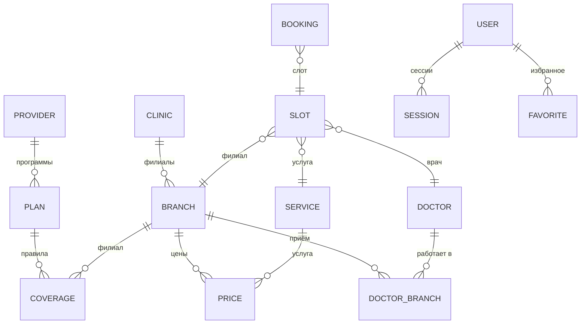

# 13. Модель данных

Документ перечисляет форматы данных, которые читает и пишет МедКарта:
справочники в `data/`, базы SQLite, граф дорог, журнал аналитики и состояние
в браузере. Источник истины — модули, указанные в каждом разделе.



Диаграмма объединяет справочник частных клиник и демо-набор
([shared/privateCatalog.js](../shared/privateCatalog.js),
[generator.js](../backend/demo/generator.js)), ДМС ([shared/dms.js](../shared/dms.js)),
базу демо-записи и базу кабинета. Справочники в `data/` — ES-модули и JSON,
а не таблицы; «связи» — ссылки по идентификаторам, которые проверяет код.

## Справочники в `data/`

### Карточка врача или учреждения

Общий плоский формат записей `data/facilities.js` (`kazanFacilities`) и
`data/doctors.js` (`verifiedDoctors`):

| Поле | Смысл |
|---|---|
| `id` | идентификатор записи (`osm-node-…`, `verified-…` и т. п.) |
| `name`, `specialty`, `clinic`, `facilityType` | имя, профиль, учреждение, тип: Больница, Клиника, Амбулатория, Медцентр |
| `address`, `district`, `lat`, `lng` | адрес и точка |
| `ownership` | `Государственная` или `Частная` |
| `rating`, `experience` | в открытых данных не заполняются содержательно |
| `schedule`, `hours` | расписание по дням и исходная строка часов |
| `phone`, `website` | контакты |
| `services`, `features` | услуги и признаки (детский приём, доступная среда и др.) |
| `description`, `source` | описание и источник |

### Клиники с расписанием — `data/clinics.js`

`ClinicsData = {generated_at, city, clinics[]}`; у клиники — `clinic_id`,
`name`, `facility_type`, `ownership`, `address_full`, `district`,
`coordinates {lat, lng}`, `working_hours` (по дням и `raw`), `phones[]`,
`website`, `booking_url`, `doctors[]`, `sources[]`.

### Справочник частных клиник — `data/private/catalog.json`

Строится `npm run data:build` из принятых снимков сборщика
([data-pipeline.md](data-pipeline.md)). Структура и правила проверки —
`validatePrivateCatalog` в [shared/privateCatalog.js](../shared/privateCatalog.js):

```text
{ meta, clinics[], doctors[], prices[] }
clinic   → id, name, ownership, facilityType, website, branches[]
branch   → id, name, address, district, lat, lng, phone, hours, features
doctor   → id, name, specialty, branchIds[], …
price    → branchId, serviceId, price
```

Проверяется: идентификаторы `^[a-z0-9][a-z0-9-]{1,63}$`; ссылки только
http(s); телефон — цифры и разделители; координаты в пределах широт 53,5–57
и долгот 46,5–55; длины строк; ссылки между записями (врач в
несуществующем филиале или цена несуществующей услуги — ошибка). На
`d9c0de6` файл пуст.

### Демо-набор — `data/demo/`

| Файл | Содержимое |
|---|---|
| [generated.js](../data/demo/generated.js) | `demoCatalog = {meta, clinics, doctors, prices, services, insurance}`; генерируется `npm run demo:generate`, вручную не правится |
| [realClinics.js](../data/demo/realClinics.js) | точки 11 филиалов реальных частных клиник (снимок OSM) |
| [insurance.js](../data/demo/insurance.js) | `demoInsurance = {meta, providers, plans, coverage}` |
| [private.js](../data/demo/private.js), [index.js](../data/demo/index.js) | сборка набора для интерфейса и сервера |
| `sites/` | локальные страницы двух вымышленных клиник для демонстрации сборщика |

Поля демо-набора:

| Сущность | Поля |
|---|---|
| клиника | `id`, `name`, `ownership`, `facilityType`, `website`, `description`, `tier` (эконом / стандарт / премиум), `real`, `branches[]` |
| филиал | `id`, `name`, `district` (или `null`), `address`, `lat`, `lng`, `phone`, `hours`, `features` |
| врач | `id` (`demo-doc-…`), `name`, `specialty`, `specialtyKey`, `ageGroups`, `branchIds`, `serviceIds`, `hoursByBranch`, `schedule`, `experienceYears`, `gender`, `features`, `description` |
| услуга | `id` (`consult.<профиль>.first` или `.repeat`, `proc.*`, `diag.*`), `name`, `specialty`, `kind`, `visit`, `durationMinutes` |
| цена | `branchId`, `serviceId`, `price` |
| программа ДМС | `id`, `providerId`, `name`, `insured` (`adult` / `family`), `validFrom`, `validTo`, `sourceDoc`, `summary` |
| правило покрытия | `planId`, `branchId`, `scope` (`all_outpatient` / `specialty` / `service`), `specialty` или `serviceId`, `access` |

Режимы доступа и приоритет правил — [10-medical-search-and-data.md](10-medical-search-and-data.md).

## SQLite: личный кабинет

[backend/accounts/sqliteStore.js](../backend/accounts/sqliteStore.js); файл
`ACCOUNTS_DB_PATH` (по умолчанию `var/accounts/medkarta.sqlite`). Прагмы:
`foreign_keys = ON`, `busy_timeout = 2000`, `secure_delete = ON`, WAL для
файла; миграции — по `user_version`.

```sql
CREATE TABLE users (
  id            TEXT PRIMARY KEY,
  email         TEXT NOT NULL UNIQUE COLLATE NOCASE,
  display_name  TEXT NOT NULL,
  password_hash TEXT,            -- scrypt$N$r$p$соль$хэш; у демо-аккаунтов NULL
  dms_plan_id   TEXT,
  demo_key      TEXT UNIQUE,
  created_at    INTEGER NOT NULL,
  updated_at    INTEGER NOT NULL
);
CREATE TABLE sessions (
  token_hash TEXT PRIMARY KEY,   -- SHA-256 от токена из cookie
  user_id    TEXT NOT NULL REFERENCES users(id) ON DELETE CASCADE,
  created_at INTEGER NOT NULL,
  expires_at INTEGER NOT NULL
);
CREATE TABLE favorites (
  user_id    TEXT NOT NULL REFERENCES users(id) ON DELETE CASCADE,
  item_id    TEXT NOT NULL,
  created_at INTEGER NOT NULL,
  PRIMARY KEY (user_id, item_id)
);
```

Срок сессии — 30 дней, демо-сессии — 12 часов; не больше 10 сессий на
пользователя (на демо-аккаунт — до 2000), избранного — до 500 записей ([service.js](../backend/accounts/service.js), `ACCOUNT_LIMITS`).

## SQLite: демо-запись

[backend/demo/bookingStore.js](../backend/demo/bookingStore.js); файл
`DEMO_BOOKING_DB_PATH` (по умолчанию `var/demo/booking.sqlite`).

```sql
CREATE TABLE meta (key TEXT PRIMARY KEY, value TEXT NOT NULL);   -- secret, fingerprint
CREATE TABLE days (day TEXT PRIMARY KEY, generated_at INTEGER NOT NULL);
CREATE TABLE absences (doctor_id TEXT NOT NULL, day TEXT NOT NULL, kind TEXT NOT NULL,
                       PRIMARY KEY (doctor_id, day));
CREATE TABLE slots (
  id TEXT PRIMARY KEY,                      -- <врач>--<филиал>--ГГГГММДД-ЧЧММ
  clinic_id TEXT NOT NULL, branch_id TEXT NOT NULL, doctor_id TEXT NOT NULL,
  service_id TEXT NOT NULL, day TEXT NOT NULL,
  start_at INTEGER NOT NULL, end_at INTEGER NOT NULL,
  status TEXT NOT NULL CHECK (status IN ('FREE', 'HELD', 'BOOKED', 'BLOCKED')),
  hold_token_hash TEXT, hold_expires_at INTEGER,
  updated_at INTEGER NOT NULL, version INTEGER NOT NULL DEFAULT 0,
  CHECK (end_at > start_at)
);
CREATE UNIQUE INDEX slots_doctor_start ON slots(doctor_id, start_at);
CREATE INDEX slots_day ON slots(day);
CREATE TABLE bookings (
  id TEXT PRIMARY KEY,
  number TEXT NOT NULL UNIQUE,              -- DEMO-ГГММДД-XXXXX
  slot_id TEXT NOT NULL REFERENCES slots(id),
  status TEXT NOT NULL CHECK (status IN ('CONFIRMED', 'CANCELLED')),
  idempotency_key TEXT UNIQUE,
  plan_id TEXT,
  created_at INTEGER NOT NULL,
  cancelled_at INTEGER
);
CREATE UNIQUE INDEX bookings_one_active_per_slot ON bookings(slot_id) WHERE status = 'CONFIRMED';
```

Персональных данных пациента в схеме нет. Время — миллисекунды Unix.

## Граф дорог

Бинарный файл `data/graph/kazan.graph` (вне git) — формат `GMK1` версии 1,
описан в [09-routing-engine.md](09-routing-engine.md) и
[format.js](../backend/routing/format.js).

## Журнал аналитики

[backend/analytics/eventStore.js](../backend/analytics/eventStore.js):

- файл на день — `events-ГГГГ-ММ-ДД.jsonl` в `ANALYTICS_DIR`
  (по умолчанию `var/analytics/`); день — по московскому времени (UTC+3);
- строка — проверенное событие из закрытого словаря
  [shared/analytics.js](../shared/analytics.js) плюс время сервера,
  округлённое до минуты;
- IP-адресов, заголовков и User-Agent нет;
- потолки: `ANALYTICS_MAX_EVENTS_PER_DAY` (по умолчанию 50 000),
  `ANALYTICS_MAX_TOTAL_MB` (500), `ANALYTICS_RETENTION_DAYS` (180).

Типы событий: `search`, `result_open`, `contact_click`, `route_build`,
`external_map_click`, `feedback`, `data_report`; поля каждого — в
[analytics.md](analytics.md).

## Сборщик данных

| Путь | Что | В git |
|---|---|---|
| `data/sources.json` | источники: `id`, вид, адрес или файл, признак демо | да |
| `data/collected/<источник>.json` | принятые снимки | да (кроме `demo-*`) |
| `data/review/pending.json` | очередь ручной проверки с сырым текстом страниц | нет |

Подробно — [data-pipeline.md](data-pipeline.md).

## Состояние в браузере

Ключи `localStorage` и `sessionStorage` — [04-frontend.md](04-frontend.md).
Номера и токены демо-записей хранятся только в браузере
(`medkarta.demo-bookings`).
