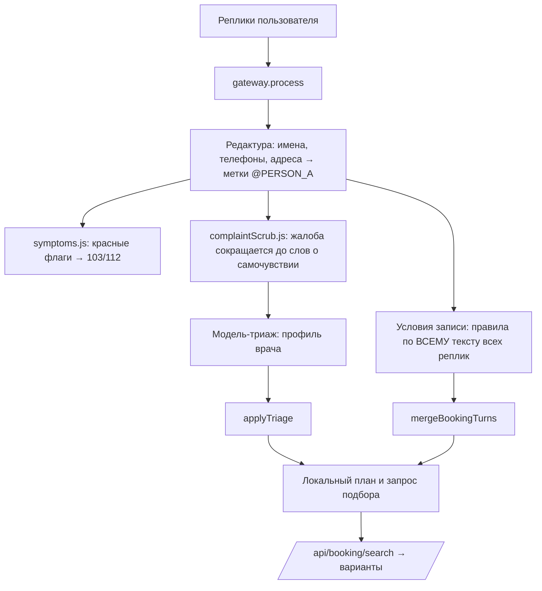
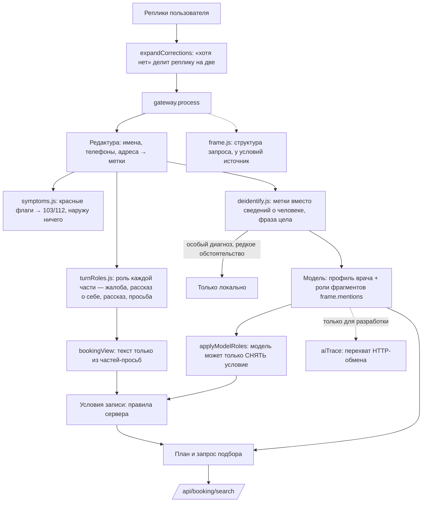

# Ассистент МедКарты: как понимается запрос. Отчёт о переработке

Ветка `feature/ai-understanding`. Все данные в сценариях вымышлены.

**Что проверено и как.** Основная проверка — 188 сценариев, прогнанных через весь путь
запроса на сервере. Модель в них заменена локальной заглушкой, сети нет. Плюс
сквозная проверка в браузере без модели и тесты кода. Настоящая модель (OpenRouter) на
новом коде **ещё не запускалась**: это платно и ждёт вашего «да» (раздел E2). Поэтому все
числа ниже говорят о правилах сервера, обезличивании и контексте диалога, но **не о
качестве ответов настоящей модели**.

Метки в отчёте: `MOCK` — ответ локальной заглушки, `REAL` — ответ настоящей модели.

---

## A. Как было устроено до переработки



Где ломалось, проверено на поведении, а не только по коду:

1. **Условия брались из всего текста.** «С утра тошнит» давало условие приёма «до 12:00»
   (№30), «работаю учителем в Авиастроительном районе» — фильтр по району (№2). В рассказе
   о симптоме или о себе правила видели время и место записи.
2. **Сокращение жалобы теряло смысл.** `complaintScrub.js` оставлял только слова о самочувствии:
   пропадали «не знаю, к какому врачу», отрицания, часть описания. При этом названия
   организаций и районов иногда проходили (сценарии P02, P08 в `main`).
3. **Исправление внутри одной реплики не замечалось.** «Нужен кардиолог… Хотя нет, болит
   колено» оставляло кардиолога (пример В из задачи).
4. **Не было структурного представления запроса.** Что понято как жалоба, что как условие,
   откуда взялось условие, нигде не фиксировалось.
5. **Нельзя было увидеть настоящий обмен с моделью.** Прежние «трассы» восстанавливали
   запрос заново, а не перехватывали отправленный.
6. **Перечень особых диагнозов был неполным:** «рак» уходил наружу.
7. **Пробелы в красных флагах:** не ловились «путается речь», температура у младенца,
   нарастающая боль в животе, двоение в глазах с головокружением.

## B. Как устроено теперь



Принцип: **модель понимает, сервер решает.** Значения условий (день, время, цена, район)
всегда берутся правилами из слов человека. Модель может сказать, что фрагмент относится к
симптому, к другому событию или к биографии, и тогда сервер это условие снимает. Создать
условие модель не может никакой ролью. Фрагмент, которого не было в отправленном тексте,
игнорируется. Догадка не сужает подбор.

Структура запроса (`buildQueryFrame`, этап 2 в трассах) разделяет жалобы, названный и
предложенный профиль, место из биографии и место поиска, день и время, цену, ДМС, пациента,
вид каждой реплики и неуверенности. У каждого условия есть источник: `explicit` (сказано),
`inferred` (выведено) или `unset` (не задано).

Виды реплик: `new_request`, `new_complaint`, `complaint_detail`, `specialty_change`,
`specialty_confirmed`, `return_to_earlier`, `condition_change`, `condition_cancelled`,
`answer_to_question`.

**Почему это не «ещё больше регулярных выражений».** Правила остались: модели нельзя
доверять значения фильтров, а без модели (сбой, лимит) сервис должен работать. Но изменилась
сама схема. Раньше условия извлекались из всего текста. Теперь сначала определяется роль
части фразы, потом извлекаются условия, и есть второй слой, который правила проверить не могут:
роли от модели. Одна попытка общего правила провалилась, и от неё я отказался. Правило
«условие — только в явной просьбе» на корпусе из 1600 тестов отбрасывало настоящие условия
(«а есть кто-то после 18», «окулист на выходных», «анализ крови рядом утром»): 25 провалов
ради 3 исправленных фраз. Поэтому рассказ определяется только по явным признакам, а
необычные случаи оставлены модели.

## C. Что исправлено

| Проблема | Решение | Файлы |
|---|---|---|
| Время симптома и место работы становились фильтрами (№2, №30) | Роли частей реплики; правила видят только просьбу | `backend/understanding/turnRoles.js`, `backend/privacy/gateway.js` |
| Рассказ («сегодня сильнее», «езжу через район») становился условием | Роль `narrative` по явным признакам | `turnRoles.js` |
| Необычное время симптома и время другого события | Роли от модели: `symptom_time`, `event_time`, `biography_place`; модель только снимает условие | `backend/planner/triage.js`, `backend/pipeline.js` |
| «Хотя нет» внутри реплики | Реплика делится на две | `turnRoles.js` (`expandCorrections`) |
| Обезличивание резало смысл | Метки вместо вырезания: `[имя]`, `[место_1]`, `[организация]`, `[должность]`, `[дата]`, `[номер]`, `[страховая]`; фраза цела | `backend/privacy/deidentify.js` (заменил `complaintScrub.js`) |
| Названия с заглавной в середине фразы | Заменяются меткой `[название]` | `deidentify.js` |
| Чужие сведения о здоровье («у мамы рак, а у меня кашель») | Особый диагноз → только локально; чужое состояние → метка | `deidentify.js`, `backend/privacy/symptoms.js` |
| Два перечня особых диагнозов | Один перечень на всю систему (`SENSITIVE_RULE_IDS`) | `symptoms.js`, `deidentify.js` |
| «Сыну» распознавалось как имя | Слова родства — не имена | `backend/privacy/detectors.js` |
| «Район неважно», «цена любая», «время без разницы» | Одно правило снятия для цены, района и времени | `backend/privacy/bookingConstraints.js` |
| «Утром не смогу, давайте вечером» | Отказ после условия снимает его | `backend/privacy/normalize.js` |
| Красные флаги | Путается речь, температура у младенца, нарастающая боль в животе, двоение с головокружением | `symptoms.js`, список для врача — `docs/medical-rules.md` |
| Нет структуры запроса | `buildQueryFrame`, источники условий | `backend/understanding/frame.js` |
| Нет настоящего обмена с моделью | Перехват на последней точке перед `fetch`; только вне production | `backend/observability/aiTrace.js`, `backend/planner/client.js`, `scripts/ai-diagnose.mjs` |
| Политика описывала старое сокращение | Новая редакция от 8 ноября, §4.6 | `legal/privacy-policy/2026-11-08.md`, `docs/privacy/*` |

`backend/privacy/complaintScrub.js` больше не используется, но **не удалён**: удаление файлов —
только с вашего согласия. Его тест остался и проходит.

## D. Результаты по сценариям

### D1. Прежние 30 запросов (MOCK, новая версия)

Ожидания заданы до изменения кода. В колонке «Прежде» — что дала прежняя версия с
**настоящей** моделью 6 ноября (REAL, сохранённый прогон `model3.json`, сборка 19e024a).

| ID | Запрос | Ожидание | Фактический результат | Статус | Причина ошибки / прежде |
|---|---|---|---|---|---|
| 1 | «…рядом с площадью Тукая… закладывает правое ухо… после 17:30, до 2 500 ₽, не дальше 20 минут… завтра после 18:00» | ЛОР, оба окна, ≤2500, ≤20 мин от Тукая | ЛОР; сегодня или завтра после 18:00; до 2 500 ₽; 20 мин от площади Тукая | ✅ | Прежде REAL то же; но модели уходило сокращённое «закладывает правое ухо», без «к какому врачу» |
| 2 | «Я Гульнара, завуч школы № 12 в Авиастроительном районе, у сына Рината 7 лет болит живот…» | педиатр, детский, **без района**, ни имён, ни № 12, ни района наружу | педиатр; детский; района нет; модели: «Я [имя], [должность] школы в [место_1], у моего сына [имя] 7 лет болит живот…» | ✅ | Прежде: фильтр «Авиастроительный» (в `main` ещё и № 12 с районом наружу). Только MOCK: есть имена |
| 3 | «Меня зовут Гульнара Хайруллина, телефон…, неделю болит поясница» | невролог/терапевт, ни имени, ни телефона наружу | невролог; текст с телефоном наружу не ушёл | ✅ | Только MOCK |
| 4 | «Закладывает нос и болит горло, завтра после 18, до 3000, по ДМС СберСтрахования» | ЛОР, завтра, после 18, ≤3000, ДМС, честно о страховой | всё сохранено, «покрытие по ней я не проверяю» | ✅ | — |
| 5 | «у мужа ВИЧ, а у меня болит голова» | ничего наружу | 0 обращений к модели, невролог локально | ✅ | В `main` уходило «у мужа @PERSON_C, а у меня болит голова» |
| 6 | «Плохо вижу вблизи, живу на Горках, работаю учителем» | офтальмолог, без района | офтальмолог | ✅ | — |
| 7 | «Сыпь на руках… рядом с Кремлём, сегодня вечером» | дерматолог, сегодня, вечер | дерматолог; сегодня; вечер | ✅ | — |
| 8 | «Частое мочеиспускание и жжение, работаю в компании на Баумана» | уролог, без места, «Баумана» не наружу | уролог; «[место_1]» | ✅ | В `main` «Баумана» уходило наружу |
| 9–13 | запросы без жалоб: стоматолог после 18; …от Тукая 25 минут; ЛОР по ДМС; «болит ухо, не знаю, к кому»; терапевт сегодня | как в формулировке | совпадает | ✅ | — |
| 14 | «Сильно болит в груди и трудно дышать» | 103/112, ничего наружу | 103/112 | ✅ | — |
| 15–17 | кардиолог → болит в коленке / → после травмы / кардиолог → болит голова | ортопед/травматолог; невролог | совпадает | ✅ | — |
| 18 | кардиолог → болит сердце | кардиолог без ложной тревоги (вопрос допустим) | кардиолог | ✅ | Прежде REAL то же. Признаки инфаркта — см. `docs/medical-rules.md` |
| 19–20 | кардиолог → колет в боку / → ниже, ближе к животу | вопрос; потом гастроэнтеролог/терапевт | вопрос; гастроэнтеролог | ✅ | Прежде REAL на шаге 20 снова вопрос |
| 21 | кардиолог завтра после 18 до 3000 → болит колено | ортопед/травматолог, условия сохранены | ортопед; завтра; после 18:00; до 3000 | ✅ | Прежде REAL — уточняющий вопрос |
| 22 | … → после травмы | травматолог, условия сохранены | травматолог; завтра; после 18:00; до 3000 | ✅ | — |
| 23 | кардиолог → болит колено → нет, всё-таки кардиолог | кардиолог | кардиолог, без обращения к модели | ✅ | Прежде REAL тоже кардиолог. Что было ошибкой в №23, в задаче не сказано, поэтому проверено и второе толкование: смена врача с сохранением условий (пример В, №21, №22, e2e шаг 3) — ✅ |
| 24–28 | колено → зуб; горло → ухо; МРТ → кардиолог; лор → завтра вечером; кардиолог → мигрень | последняя жалоба / названный врач | совпадает | ✅ | — |
| 29 | болит живот → с утра тошнит | гастроэнтеролог/терапевт, **без утра** | гастроэнтеролог, без условия времени | ✅ | Прежде «до 12:00» (в `main` и предыдущей ветке) |
| 30 | болит живот → с утра тошнит → вверху, под рёбрами | гастроэнтеролог, **без «до 12:00»** | гастроэнтеролог, без условия времени | ✅ | Прежде REAL: гастроэнтеролог, **до 12:00** |

На этом наборе код и отлаживался, поэтому 30 из 30 — не доказательство качества.

### D2. Первые замеры на контрольных наборах

Наборы написаны **после** заморозки кода, первый результат записан как есть.

| Набор | Сценариев | `main` | предыдущая ветка | новая версия, первый замер |
|---|---|---|---|---|
| Контрольный 1 (X) | 48 | 34 | 37 | 41 |
| Контрольный 2 (Y), написан после исправлений по X | 32 | 19 | 21 | 24 |
| **Вместе** | **80** | **53 (66 %)** | **58 (73 %)** | **65 (81 %)** |

Провалы новой версии в первых замерах и что с ними сделано:

| ID | Запрос | Ожидание | Фактический результат | Статус | Причина ошибки |
|---|---|---|---|---|---|
| X06 | «Вчера вечером заболел зуб, сегодня сильнее» | без условия дня | условие «сегодня» | исправлено | рассказ о состоянии читался как просьба → роль `narrative` |
| X07 | «Две недели шумит в ушах после 6 вечера» | без времени | «после 18:00», вечер | исправлено | «шумит» не было среди слов жалобы |
| X09 | «Я водитель, езжу через Ново-Савиновский район, болит спина» | без района | фильтр района | исправлено | поездка читалась как место поиска |
| X29 | «нужен терапевт в Советском районе» → «район неважно» | район снят | район остался | исправлено | не было общего правила снятия |
| X33 | «Работаю в банке Акибанк на Баумана…» | «Акибанк» не наружу | **ушло наружу** | исправлено | **ухудшение** по сравнению с прежним сокращением: целая фраза пропускала название → метка `[название]` |
| X35 | «У мамы рак, а у меня кашель» | «рак» не наружу | ушло наружу (во всех трёх версиях) | исправлено | неполный перечень особых диагнозов |
| X45 | «Живот болит всё сильнее уже шесть часов, рвота не прекращается» | 103/112 | подбор (во всех трёх версиях) | исправлено | нет правила нарастающей боли |
| Y03 | «К ночи поднимается температура, утром нормально» | без утра | «утро» | исправлено | «нормально» — признак рассказа |
| Y04 | «Сегодня зуб отпустило, но вчера ночью болел» | без дня | «сегодня» | исправлено | то же |
| Y05 | «Завтра экзамен, а горло совсем пропало» | без дня | «завтра» | **не исправлено правилами** | время другого события правила не отличают; снимается только ролью `event_time` от модели (проверено тестом с заданным ответом модели; настоящая модель — в E2) |
| Y06 | «На выходных простудился, кашель» | без дня | «выходные» | исправлено | «простудился» не было среди слов жалобы |
| Y16 | «стоматолог до 2000 завтра» → «цена любая» | цена снята | осталась | исправлено | общее правило снятия |
| Y18 | «окулист послезавтра утром» → «утром не смогу, давайте вечером» | вечер, без утра | утро и вечер | исправлено | отказ после условия |
| Y19 | «работаю в газпромнефти, болит спина» | название не наружу | **ушло наружу** | **не исправлено** | название строчными буквами программа не отличает от обычного слова |
| Y27 | «Сильно кружится голова и двоится в глазах» | 103/112 | подбор (во всех трёх версиях) | исправлено | правило на проверку врачу |

После исправлений: контрольный 1 — 48 из 48, контрольный 2 — 30 из 32 (Y05 и Y19). Эти
числа уже не независимы: по провалам вносились правки.

## E. Трассы обращений к модели

### E1. Трассы `MOCK` (12 сценариев)

Как получены: `node scripts/ai-diagnose.mjs --mode mock --ids P01,P02,P05,P18,P23,P30,H02,D04,X25,X35,Y15,V01`.
Перехват стоит в `requestCompletion` (`backend/planner/client.js`) на последней точке
перед `fetch`. Записывается тот самый объект, что уходит в сеть, а не его реконструкция.
Ответ модели здесь — **локальная заглушка**: о настоящей модели он ничего не говорит.
Полные файлы трасс лежат в `var/ai-trace/` (не попадает в git) и воспроизводятся этой же командой.

Общее для всех запросов: `POST`, модель из настройки (`mock` здесь), `temperature: 0`,
`max_tokens: 600`, `response_format` — JSON-схема `medkarta_triage`, заголовки
`Content-Type` и `Authorization` (значение в трассу не записывается), размер тела 13,3–13,9 КБ.
Сообщения: системная инструкция 7 035 символов (`backend/planner/triage.js`, одинакова для
всех), сообщение `user` с репликами и для ребёнка вторая системная строка «Приём детский.».
В сообщениях нет id аккаунта, IP, координат и cookie.

<details><summary>Пример полного тела запроса (№30) и полного ответа</summary>

```json
{
 "model": "mock",
 "messages": [
  { "role": "system", "content": "<системная инструкция, 7035 символов: backend/planner/triage.js>" },
  { "role": "user", "content": "Реплики пользователя:\n1. болит живот\n2. с утра тошнит\n3. вверху, под рёбрами" }
 ],
 "response_format": { "type": "json_schema", "json_schema": { "name": "medkarta_triage", "strict": false, "schema": "… status, specialties (16 профилей), question, options, frame {symptoms, patient, mentions[{text, role}]} …" } },
 "temperature": 0,
 "max_tokens": 600
}
```

Ответ (MOCK):

```json
{"id":"mock","model":"mock","choices":[{"index":0,"message":{"role":"assistant","content":"{\"status\":\"specialist\",\"specialties\":[\"gastroenterologist\"],\"question\":null,\"options\":null}"},"finish_reason":"stop"}],"usage":{"prompt_tokens":0,"completion_tokens":0,"total_tokens":0}}
```

</details>

| № | Исходное сообщение | Обезличенный payload (сообщение `user`) | Ответ модели (MOCK) | Разобрано | Итоговый подбор |
|---|---|---|---|---|---|
| 1 | «Я нахожусь в Казани, рядом с площадью Тукая. Последние несколько дней у меня закладывает правое ухо, не знаю, к какому врачу обратиться. Подбери… после 17:30, до 2 500 ₽… завтра после 18:00» | «1. Я нахожусь в Казани, рядом с [место_1]. Последние несколько дней у меня закладывает правое ухо, не знаю, к какому врачу обратиться. Подбери… желательно после 17:30, стоимостью до 2 500 ₽…» | `specialist`, `lor` | ЛОР | ЛОР; сегодня или завтра после 18:00; желательно после 17:30; до 2 500 ₽; ≤20 мин на машине от площади Тукая |
| 2 | «Я Гульнара, завуч школы № 12 в Авиастроительном районе, у моего сына Рината 7 лет болит живот, лечимся у доктора Сафина» | «1. Я [имя], [должность] школы в [место_1], у моего сына [имя] 7 лет болит живот, лечимся у доктора [имя]» + «Приём детский.» | `specialist`, `pediatrician` | педиатр | педиатр, детский приём, **без района** |
| 5 | «у мужа ВИЧ, а у меня болит голова» | **запроса нет**: особый диагноз | — | — | невролог (локальный классификатор) |
| 18 | «кардиолог» → «болит сердце» | «1. кардиолог\n2. болит сердце» | `specialist`, `cardiologist` | кардиолог | кардиолог |
| 23 | «кардиолог» → «болит колено» → «нет, всё-таки кардиолог» | **запроса нет**: врач назван прямо | — | вид реплики `return_to_earlier` | кардиолог |
| 30 | «болит живот» → «с утра тошнит» → «вверху, под рёбрами» | «1. болит живот\n2. с утра тошнит\n3. вверху, под рёбрами» | `specialist`, `gastroenterologist` | гастроэнтеролог | гастроэнтеролог, **без условия времени** |
| H02 | «Я работаю учителем в Авиастроительном районе. У сына болит живот» | «1. Я работаю учителем в [место_1]. У сына болит живот» + «Приём детский.» | `specialist`, `pediatrician` | педиатр | педиатр, детский, без района |
| D04 | «болит живот» → «это у ребёнка, ему 5 лет» | «1. болит живот\n2. это у ребёнка, ему 5 лет» + «Приём детский.» | `specialist`, `pediatrician` | педиатр | педиатр, детский |
| X25 | «окулист в четверг после 16» → «хотя нет, сильно чешется кожа» | «1. хотя нет, сильно чешется кожа» (первая реплика — новая просьба без жалобы, модели не нужна) | `specialist`, `dermatologist` | дерматолог | дерматолог; в четверг; после 16:00 |
| X35 | «У мамы рак, а у меня кашель» | **запроса нет**: особый диагноз | — | — | терапевт (локально) |
| Y15 | «лор завтра» → «а нет, кашель у ребёнка» | «1. а нет, кашель у ребёнка» + «Приём детский.» | `specialist`, `pediatrician` | педиатр | педиатр; детский; завтра |
| V01 | «Меня зовут Иванов Пётр Сергеевич, телефон +7 917 123-45-67, болит колено» | **запроса нет**: имя вместе с номером телефона | — | — | травматолог (локально) |

Этап 2 (структура запроса) для №30, сокращённо: `complaints: ["болит живот", "с утра тошнит"]`,
`suggestedSpecialty: {value: ["gastroenterologist"], source: "inferred", by: "model"}`,
`schedule.timeTo: {value: null, source: "unset"}`, `turns: ["new_request", "complaint_detail", "answer_to_question"]`.

### E2. Трассы `REAL` — не выполнены

Настоящая модель на новом коде не запускалась: каждый прогон платный, нужен ваш ответ «да».
Подготовлен ограниченный прогон из 40 сценариев без идентификаторов: прежние 28 запросов
(кроме №2 и №3 с именами), H02 как заменитель №2 без имён и 11 фраз из контрольных наборов.
Жёсткий предел — 70 обращений. Скрипт записывает настоящий запрос, сырой ответ, разбор,
подбор, время, токены и стоимость из ответа OpenRouter (`usage.cost`).

```bash
cd <папка проекта> && AI_SYMPTOM_TRIAGE=on SMTP_HOST= SMTP_URL= node --env-file=.env --no-warnings scripts/ai-diagnose.mjs --mode real --confirm-real --max-calls 70 --ids P01,P04,P05,P06,P07,P08,P09,P10,P11,P12,P13,P14,P15,P16,P17,P18,P19,P20,P21,P22,P23,P24,P25,P26,P27,P28,P29,P30,H02,X06,X07,X09,X17,X22,X25,X27,Y03,Y05,Y15,Y18
```

Сценарии с идентификаторами (`real: false`: P02, P03, V01–V16, X31–X38, Y19–Y24) скрипт в
режиме `real` не отправляет никогда.

## F. Сравнение до и после

Метод: все 188 сценариев через весь путь запроса на сервере, модель — одна и та же
заглушка для всех трёх версий (`node scripts/ai-eval.mjs --root <версия>`). Заглушка выбирает
врача по словам, которые ей реально передали, поэтому потеря смысла при обезличивании
видна. Качество настоящей модели этим **не** измеряется.

| Показатель | `main` (e4a8b7e) | предыдущая ветка (60fbaca) | новая версия |
|---|---|---|---|
| Контрольные наборы, первый замер (80, независимо) | 53 (66 %) | 58 (73 %) | 65 (81 %) |
| Все сценарии (188; 108 из них использовались при отладке) | 131 | 143 | 186 |
| Придуманные фильтры (случаев) | 41 | 41 | 1 (Y05) |
| Потери контекста | 1 | 1 | 0 |
| Лишние уточняющие вопросы | 0 | 0 | 0 |
| Утечки в проверках приватности (совпадений) | 33 | 10 | 1 (Y19) |
| Ошибки красных флагов (пропуск или ложная тревога) | 8 | 8 | 0 |
| Потеря смысла при передаче модели | 0 | 5 | 0 |
| Ошибки разбора ответа модели | не измеряется заглушкой | — | — |
| Время ответа | локально 11–13 мс в среднем, без сети; со временем настоящей модели не сравнимо | | |
| Токены и стоимость | только после прогона E2 | | |

Как читать: 80 контрольных сценариев — небольшая выборка, разница 65 против 58 — это 7
сценариев. Она показывает направление, а не точный процент. Утечки в `main` считаются по
совпадениям: в одном сценарии их может быть несколько.

**Размер запроса вырос.** Системная инструкция — 7 035 символов против 6 040, а жалоба
передаётся целиком, а не сокращённой. Значит, токенов на обращение больше. По прежнему
прогону это было около 2,1 тыс. токенов на вызов, теперь ожидается около 2,5 тыс. Точное
число даст прогон E2.

### Проверки

| Проверка | Результат |
|---|---|
| `npm test` | 1657 тестов: 1654 прошли, 0 провалов, 1 пропущен (как и раньше), 2 — известные ограничения (Y05, Y19) отмечены `todo` |
| `npm run test:hybrid` | 1657 тестов: 1654 прошли, 0 провалов (сценарные тесты закреплены за режимом по умолчанию, см. G) |
| `npm run lint` | без ошибок |
| `npm run build` | собирается |
| `npm run test:e2e` | 4 сценария, 66 шагов, все прошли: админка 21, вход 25, регистрация 13, новый ассистент 7 |
| `npm audit` | 0 уязвимостей |
| Секреты | в трассы не пишется значение `Authorization`, это проверено тестом; каталог `var/` в `.gitignore`; диагностика в production не включается (тест) |
| Отрицательный контроль e2e | на предыдущей версии `e2e-assistant` падает в 5 шагах из 7: тест ловит именно эти ошибки |

## G. Что не решено и что проверить

1. **Настоящая модель не проверена на новом коде** (E2). Особенно важно увидеть, ставит ли
   она роли `symptom_time` и `event_time`: от этого зависит Y05 и похожие фразы.
2. **Обезличивание — снижение риска, а не гарантия.** Название строчными буквами (Y19),
   необычное описание человека, сочетание мелких признаков программа может пропустить.
   Время, цена, возраст и работа намеренно остаются в тексте.
3. **Условия записи тоже уходят модели** (время, цена). Это не идентификаторы, и модель
   не может их поменять, но для выбора врача они не нужны. Можно убрать, но тогда модель
   хуже различает время симптома и время приёма. Решение за вами.
4. **Правила неотложных состояний не проверены врачом.** Список и вопросы — `docs/medical-rules.md`.
5. **Юристу:** передача текста жалобы (сведений о здоровье, пусть и без идентификаторов)
   поставщику в США; формулировка §4.6 новой редакции политики; нужно ли повторное
   ознакомление пользователей с редакцией от 8 ноября.
6. **Лишняя осторожность:** особый перечень иногда срабатывает на постороннее («бред какой-то»,
   «эко-продукты»). Такой текст не уходит модели и разбирается локально, качество чуть ниже.
7. **Контрольные наборы теперь использованы.** Для следующей проверки нужен новый, никем не виденный набор.
8. **Ветка начата не от `main`, а от `fix/launch-hardening`:** в `main` нет этой работы, а
   без неё ассистент ведёт себя иначе. Сначала нужно влить `fix/launch-hardening`.
9. Прокси (`AI_PROXY_URL`) 6 ноября не отвечал; прогон E2 при такой же ошибке пойдёт напрямую.
10. `complaintScrub.js` не используется; удалить можно после вашего согласия.
11. **Режим `PRIVACY_OUTBOUND_MODE=hybrid`** (не по умолчанию): 6 жалоб без слов из словаря
    («плохо вижу вблизи», «срываю голос», «шумит в ушах», «кашляет») до модели не доходят, и
    ассистент просит уточнить. Предыдущая версия ведёт себя так же. Если на сервере включён
    `hybrid`, это стоит исправить отдельно.
