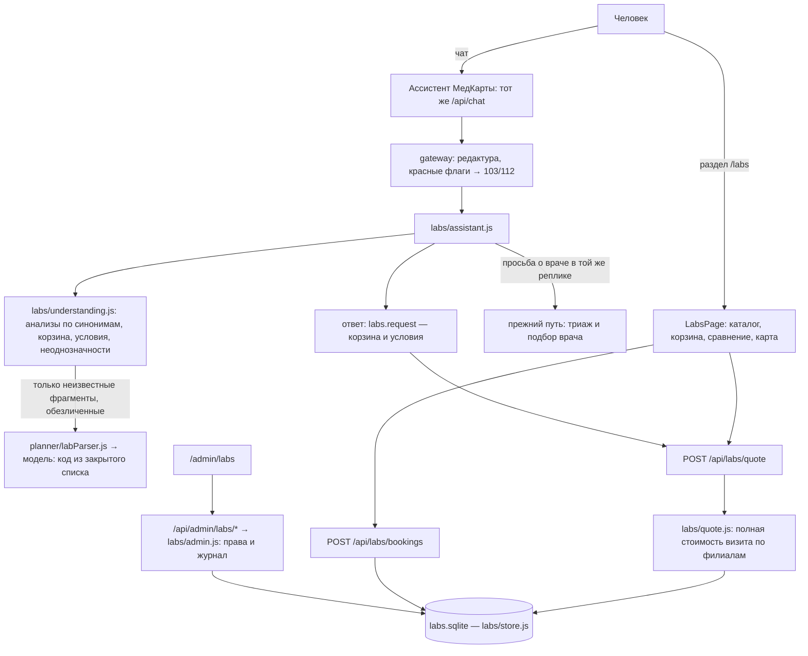

# Лабораторный модуль МедКарты: отчёт

Ветка `feature/laboratories` от `main` (17af9a7, после слияния переработки ассистента).
Все данные демонстрационные: лаборатории, филиалы, цены, сроки, слоты и примеры бланков
вымышлены. Ничего не уходит в настоящие лаборатории. Публичная регистрация не открыта.

**Что проверено:** код, HTTP API, права админки, 49 сценариев ассистента и сквозные проверки
в браузере. Модель в этих проверках — локальная заглушка. **Настоящая модель (OpenRouter)**
проверена 09.11.2026 на двух сценариях, где она нужна: 2 вызова, оба ответа верные,
$0,0018 (раздел 10). Больше на настоящей модели ничего не проверялось.

---

## 1. Архитектура



Принцип тот же, что у подбора врачей: **модель понимает, сервер решает.** Исследования, цены,
филиалы, сроки и слоты берутся только из базы. Ассистент возвращает запрос подбора (коды
исследований и условия), а исполняет его сервер. Модель ничего не может выдумать: она видит
только список кодов и короткие фрагменты, а её ответ проверяется по закрытому списку.

Модуль переиспользует существующие части:

- разбор дат, времени, цены и места — правила записи к врачу (`privacy/gateway.js`, `bookingConstraints.js`);
- нормализацию запроса — `shared/demoSearch.js`;
- обезличивание — `privacy/deidentify.js`, перехват обмена с моделью — `observability/aiTrace.js`;
- маршрутизатор для времени в пути, систему ролей, журнал действий, лимиты и защиту от подделки запросов;
- компоненты админки.

Параллельной архитектуры нет: ассистент не отдельный, а та же ветка `pipeline.js`.

Конфликтов с переработкой ассистента нет: она уже в `main`, лабораторная ветка от неё и начата.

## 2. Таблицы и миграции

Отдельная база `var/demo/labs.sqlite` (`LAB_DB_PATH`), миграции через `PRAGMA user_version`,
как у демо-записи к врачам. Включаются внешние ключи, используются `BEGIN IMMEDIATE`, ограничения `CHECK` и индексы.

| Таблица | Назначение | Ключевые ограничения |
|---|---|---|
| `laboratories` | Лаборатория: название, описание, логотип, контакты, активна, демо | `name UNIQUE`, `version` против гонки правок |
| `lab_branches` | Филиал: адрес, координаты, часы работы и приёма биоматериала (по дням недели), длительность и вместимость слота, способы записи, активен | координаты в пределах Казани; слот 5–60 мин, вместимость 1–10 |
| `lab_tests` | Каталог исследований: код, название, категория, описание, биоматериал, единица, подготовка, срок, «по записи», «натощак», состав | `code UNIQUE`, биоматериал из списка |
| `lab_test_synonyms` | Синонимы и сокращения | `(test_id, normalized)`, индекс по `normalized` |
| `lab_offerings` | Исследование в филиале: цена, валюта, доступность, срок, условия, дата цены, демо | `UNIQUE(branch_id, test_id)`, `price ≥ 0` |
| `lab_fees` | Процедура взятия по виду биоматериала (кровь из вены, мазок…) | `PRIMARY KEY(branch_id, kind)` |
| `lab_days`, `lab_slots` | Расписание на 30 дней: слот, вместимость, занято другими, записано | `CHECK(taken + booked ≤ capacity)`, `UNIQUE(branch_id, start_at)` |
| `lab_bookings` | Запись: номер, филиал, слот, итог, статус, ключ идемпотентности, аккаунт или гость, демо, кто отменил | `number UNIQUE`, `idempotency_key UNIQUE` |
| `lab_booking_items` | Состав записи построчно: исследования и процедуры с ценой на момент записи | итог восстанавливается из строк, поздние правки цен его не меняют |
| `lab_demo_results` | Синтетические примеры бланков с единицами и референсами | помечены «не для медицинских решений» |

Двойная запись невозможна. Место в слоте берётся одним условным `UPDATE … WHERE taken + booked
< capacity` внутри `BEGIN IMMEDIATE`, а превысить вместимость не даст и `CHECK` самой таблицы.
Это проверено тестом, в котором два процесса записываются в один слот одновременно.

## 3. API и права

Публичные (`backend/api/labs.js`). Лимиты и защита от подделки запросов — как у записи к врачам:

| Путь | Что делает |
|---|---|
| `GET /api/labs/catalog` | исследования (минимальная цена, число лабораторий), категории, лаборатории, филиалы |
| `GET /api/labs/tests/:code` | исследование: синонимы, подготовка, где сделать и почём, пример бланка |
| `GET /api/labs/labs`, `/labs/:id`, `/branches/:id` | лаборатории, филиалы, часы, процедуры, цены |
| `POST /api/labs/quote` | подбор: полная стоимость корзины по филиалам с фильтрами и сортировкой |
| `GET /api/labs/slots` | расписание филиала и стоимость корзины в нём |
| `POST /api/labs/bookings`, `/bookings/cancel`, `/bookings/lookup`, `GET /bookings/mine` | запись (идемпотентно, со сверкой итога), отмена, свои записи |

Админка (`/api/admin/labs/*`) проходит через тот же вход, что и вся панель: сессия,
`admin.access` и второй фактор. Затем проверяется конкретное разрешение:

- `labs.view` — просмотр;
- `labs.manage` — лаборатории, филиалы, расписания, исследования, цены, доступность, сроки и процедуры;
- `labs.bookings` — демо-записи: просмотр и отмена.

По умолчанию администратор получает все три права, модератор — только `labs.view`. Каждое
изменение пишется в журнал действий, попытка без права — с результатом `denied`.

## 4. Интерфейс

- **`/labs`** — поиск и категории исследований, корзина, условия: день, время, срок готовности,
  цена «за всё», откуда ехать, время в пути. Сравнение вариантов отсортировано по полной
  стоимости, есть пометки «дешевле всего среди демо» и «быстрее результат». Показаны разбор
  цены, время в пути, ближайшие слоты, частичные совпадения с перечнем недостающего,
  подготовка, карта филиалов с ценами.
- **`/labs/lab/:id`** — лаборатория: филиалы с часами работы и приёма биоматериала,
  процедуры, каталог с ценами, запись с текущей корзиной.
- **`/labs/test/:code`** — исследование: синонимы, биоматериал, состав, подготовка с
  оговоркой, где сделать, пример бланка с предупреждением.
- **Диалог записи** — день, слот, построчный итог, подтверждение, номер, отмена. «Мои
  записи»: гостевые хранятся в браузере, записи из кабинета — на сервере.
- **Ассистент** — под ответом три лучших варианта с записью прямо из чата и ссылка
  «Все варианты и карта». На главной странице — вход в раздел.
- **Админка → «Лаборатории»** — вкладки «Лаборатории», «Филиалы» (с расписаниями и
  процедурами), «Исследования», «Цены», «Записи».

Интерфейс собран на тех же Tailwind-стилях, иконках lucide и компонентах админки. Проверен
на ширине 1440 px и на телефоне 375 px (горизонтальной прокрутки нет).

## 5. Интеграция с ассистентом

1. Сначала прежние проверки: редактура и красные флаги. Неотложное состояние — сразу
   103/112, лабораторная ветка не запускается.
2. `labs/understanding.js` разбирает диалог:
   - **исследования** — по синонимам каталога с учётом падежей («общего анализа крови» = ОАК);
     ОАК с лейкоцитарной формулой и без неё — разные коды;
   - **корзина между репликами** — «добавь», «ещё», «убери», «без», «вместо X — Y», «не X, а
     Y», «только X»; слова внутри самого названия командой не считаются;
   - **условия** — те же правила, что у записи к врачу, по тексту без названий анализов: «Т4»
     и «25-OH» не читаются как часы и цена. Сюда же относятся «дешевле», «быстрее
     результат», «ближе», «в тот же день», «за один раз»;
   - **неоднозначности** — «анализ на железо» (железо сыворотки или ферритин), «сахар»
     (глюкоза или HbA1c) уточняются кнопками. На «щитовидку», «гормоны», «биохимию» и
     «сдать кровь» ассистент набор анализов не подбирает: их назначает врач. Предлагается
     написать названия из направления или записаться к эндокринологу;
   - **намерения** — `laboratory_search`, `laboratory_test_search`, `laboratory_cart`,
     `laboratory_booking`, `laboratory_preparation_info`, `clarification`,
     `unsupported_request`, `doctor_search`. Намерений может быть несколько сразу.
3. Модель вызывается **только для фрагментов, которых нет в каталоге**, после «анализ на …»
   или «сдать …» («ферритинн», «печёнку»). Ей уходят лишь сами обезличенные фрагменты и
   список кодов. Ответ проверяется: код должен быть из каталога, а фрагмент — из переданных.
   Область без названия («печень») модель обязана вернуть как `UNKNOWN`. Особые диагнозы в
   фрагментах (`hasSensitiveCondition`) модели не отправляются.
4. Просьба о враче в той же реплике («нужен эндокринолог и анализ ТТГ») — ответ из двух
   частей. Врач в роли «назначил» («кардиолог назначил липидограмму») просьбой не считается.
5. Расшифровку результатов («у меня гемоглобин 98») ассистент вежливо отклоняет и в модель не
   отправляет.

Даты разрешаются по московскому времени сервера, а не по модели.

## 6. Демо-данные

- **6 вымышленных лабораторий** («ЛабТочка», «Пробирка», «Медиана», «Эритро», «Аналитика 24»,
  «Кристалл-Лаб»). Совпадение с действующими сетями случайно, партнёрства нет. Разные
  ценовые категории (множитель 0,88–1,22), процедуры взятия от 0 до 400 ₽, сроки, приём
  биоматериала только утром или весь день, работа в выходные.
- **24 филиала** стоят в точках настоящих пунктов сдачи анализов по OpenStreetMap (снимок
  `data/facilities.js`, у каждого филиала — `osmId`). На карте филиал оказывается там, где в
  Казани действительно сдают анализы: 22 точки в OSM отмечены как медицинские пункты, одна —
  в торговом центре, одна — на первом этаже жилого дома. По одному филиалу в точке, районы
  взяты из OSM. Адрес — только улица («Казань, улица Восстания (демо-филиал, номер дома не
  указан)»), чтобы он не читался как адрес настоящей сети. Сначала филиалы стояли со сдвигом
  50–250 м от известных мест и попадали в детский сад, монастырь, на парковку и на дорогу,
  поэтому их перенесли. Тест сверяет каждую точку с OSM.
- **76 исследований** в 9 категориях с принятыми названиями и синонимами.
- **1600 предложений «филиал — исследование»**. Не все сети делают всё: посевы, мазки и
  глюкозотолерантный тест есть только в больших пунктах.
- **Расписание на 30 дней**: около 33 тысяч слотов. Часть мест уже занята «другими
  пациентами», утро загружено сильнее.
- **4 синтетических примера бланков** с единицами и референсами и пометкой «не для
  медицинских решений». Автоматической интерпретации нет.

Набор детерминированный: сброс даёт те же данные. Цены и слоты врачей не менялись.

## 7. Тесты бэкенда

| Набор | Тестов | Что проверено |
|---|---|---|
| `tests/labs-store.test.js` | 19 | объём демо-данных; точки филиалов совпадают с пунктами сдачи анализов в OSM; уникальность кодов и синонимов; построчный итог; идемпотентность; вместимость слота; отмена освобождает место; прошедшее время, недоступное исследование, изменившаяся цена; записи кабинета и удаление аккаунта; **гонка двух процессов** за последнее место; проверки ввода, версия, смена расписания с сохранением записей; отмена администратором; подбор (полная стоимость, процедуры, потолок цены с причиной, натощак, сортировки, время в пути, срок, неверные коды) |
| `tests/labs-api.test.js` | 9 | публичный API через HTTP: каталог, исследование, лаборатория, подбор, расписание, запись, повтор, просмотр, отмена, CSRF (`Origin` и `Sec-Fetch-Site`), лимит 429, выключенный раздел. Админ-API: суперадминистратор меняет цену, расписание, процедуру и исследование, всё в журнале; **обычный пользователь — 403**; **модератор — только просмотр**, попытка изменения в журнале как `denied`; отмена записи администратором |
| `tests/labs-assistant.test.js` | 53 | ассистент, раздел 9 |

Весь `npm test` на последнем коммите ветки: **1742 теста, 1739 прошли, 0 упали**, 1 пропущен и
2 помечены TODO — все три были в `main` до ветки. `npm run lint` — без ошибок, `npm run build` —
собирается.

Одно ожидание в тестах изменено. Сначала тест требовал 403 для записи совсем без заголовка
`Origin`, а сервер её пропускает. Так у всего проекта, включая запись к врачу: некоторые
браузеры не присылают `Origin` для запросов со своего сайта. Чужой сайт отсекается по
несовпадающему `Origin` или по `Sec-Fetch-Site: cross-site` — это тест и проверяет.

## 8. Интерфейс и e2e

`scripts/e2e-labs.mjs` (добавлен в `npm run test:e2e`, его запускает CI), настоящий сервер и
Chromium. Результат: **9 из 9**.

1. API: каталог и подбор корзины.
2. Раздел: корзина, условия, сравнение, сортировка по цене, оговорка «не по всему городу».
3. Запись из сравнения и отмена.
4. «Мои записи»: запись видна и отменяется.
5. Страницы исследования (подготовка, бланк) и лаборатории (часы, процедуры).
6. Телефон 375 px: нет горизонтальной прокрутки, диалог помещается.
7. Ассистент: корзина из фразы, варианты под ответом, запись из чата, «Добавь ещё ТТГ»
   сохраняет корзину и цену.
8. Неотложное состояние — 103/112 без подбора.
9. Названия анализов не попадают в журнал сервера, ошибок JavaScript нет.

В `scripts/e2e-admin.mjs` добавлен шаг 24: суперадминистратор со вторым фактором меняет
цену в филиале и отменяет демо-запись через интерфейс, оба действия попадают в журнал.

Вся цепочка `npm run test:e2e` на последнем коммите ветки, без ключей модели:

| Скрипт | Результат |
|---|---|
| `e2e-admin.mjs` | 22 из 22, включая шаг 24 |
| `e2e-auth.mjs` | 25 из 25 |
| `e2e-register.mjs` | 13 из 13 |
| `e2e-assistant.mjs` | 7 из 7 |
| `e2e-labs.mjs` | 9 из 9 |

Найдено и исправлено во время проверок:

- Escape в диалоге записи закрывал всё окно ассистента;
- на телефоне колонка была шире экрана;
- ссылка в шапке сжимала логотип до «МедКа…» — перенесена под демо-плашку.

## 9. Сценарии ассистента

`tests/labs-assistant.test.js` — 49 сценариев через весь путь запроса (`pipeline.handle`) плюс
4 проверки. Модель — заглушка, которая сопоставляет только опечатку «ферритинн». Результат:
**53 из 53**.

Сценарии: все 15 примеров из постановки, падежи и состав, «без лейкоцитарной формулы»,
отрицание («не ферритин, а железо сыворотки»), «только», «вместо», снятие условий («время
не важно», «цена любая»), натощак утром и вечером, «в тот же день», врач-«назначил», особые
диагнозы, расшифровка результатов. Ещё 2 сценария про врачей и 1 совмещённый («нужен
эндокринолог и анализ ТТГ») проверяют, что поиск врачей не сломался, 1 — неотложное состояние.

Первый прогон — 51 из 53. Расхождения:

- **L24 — ошибка в коде:** «без» внутри названия «ОАК без лейкоцитарной формулы» читалось как
  «убери». Исправлено.
- **L23 — неточность в ожидании:** кнопка называется «Глюкоза в крови», а не полным названием
  «Глюкоза в крови (венозная плазма)». Поведение верное: предлагается выбор между глюкозой и
  HbA1c, кнопка понимается как глюкоза. В ожидании изменён только текст кнопки.

`scripts/labs-diagnose.mjs --mode mock` записывает все этапы каждого сценария: 45 из 45, модель
вызывается только в 3 сценариях (две опечатки «ферритинн» и «печёнка»). Первый прогон
отправлял в модель ещё «с результатом» и «хочу сдавать не завтра» — исправлено.

## 10. Запросы к модели

Перехват стоит в `requestCompletion` на последней точке перед `fetch`. Трассы — в
`var/ai-trace/labs-*` (не в git), значение `Authorization` не записывается.

**MOCK, L28 «Хочу сдать ферритинн»** — полностью:

| Этап | Значение |
|---|---|
| Исходный запрос | «Хочу сдать ферритинн» |
| Понято на сервере | корзина пуста, нераспознанный фрагмент «ферритинн» |
| Обезличенный фрагмент | `ферритинн` |
| Запрос к модели | `POST`, `messages`: system — правила и каталог (3 612 символов, 76 кодов), user — «Фрагменты:\n1. ферритинн», `response_format` — строгая схема `medkarta_lab_parse` (код из enum каталога или `UNKNOWN`), `temperature: 0`, `max_tokens: 300` |
| Ответ (заглушка) | `{"items":[{"fragment":"ферритинн","code":"FERRITIN"}]}` |
| Разобрано | `FERRITIN`: код из каталога, фрагмент из переданных |
| Условия подбора | `tests: ["FERRITIN"]` |
| Итог | «Эритро · Баки Урманче» — 720 ₽ (540 ₽ + взятие 180 ₽), ближайшее время 9 ноября 09:10, результат через 2 дня |

Остальные трассы MOCK, коротко:

| ID | Запрос | Модель | Понято / условия | Итог |
|---|---|---|---|---|
| L01 | «Где сдать ОАК завтра утром?» | не вызывалась | ОАК; завтра, утро | «ЛабТочка · Восстания» 550 ₽ (400 + 150), завтра 07:00 |
| L04 | «…ОАК и ферритин до 2000» → «Добавь ещё ТТГ» → «Убери ферритин» | не вызывалась | ОАК + ТТГ; до 2 000 ₽ | 1 020 ₽ (870 + 150) |
| L08 | «Мне назначили анализ на железо» | не вызывалась | уточнение: железо сыворотки или ферритин | кнопки, подбора нет |
| L17 | «Врач назначил ОАК, СРБ и глюкозу. Хочу сдать всё за один раз» | не вызывалась | 3 исследования, натощак → до 12:00 | 1 130 ₽ (980 + 150) |
| L19 | «…завтра утром до 2000» → «не завтра, а в пятницу» | не вызывалась | пятница, утро, до 2 000 ₽ | 1 140 ₽, пятница 07:10 |
| L29 | «Хочу сдать анализ на печёнку» | фрагмент `печенку` → `UNKNOWN` | корзина пуста | «Не нашёл в каталоге… набор анализов назначает врач» |
| L33 | «Сдать витамин Д и ферритин после 18:00» | не вызывалась | после 18:00, предупреждение «натощак» | «Пробирка · Мулланура Вахитова» 2 540 ₽, 18:10 |
| L49 | «Хочу сдать ферритинн, я Иван Петров» | фрагмент `ферритинн` (без имени) | ферритин | 720 ₽ |

**REAL, 09.11.2026** — `openai/gpt-5.4-mini` через OpenRouter, модель из `AI_MODEL`.
Из 45 лабораторных сценариев модель нужна только в двух, которые можно отправлять: L28 и L29.
L49 содержит имя, поэтому в настоящую модель не уходит никогда.

| | L28 «Хочу сдать ферритинн» | L29 «Хочу сдать анализ на печёнку» |
|---|---|---|
| Понято на сервере | корзина пуста, нераспознанный фрагмент | то же |
| Обезличенный фрагмент | `ферритинн` | `печенку` |
| Запрос | `POST https://openrouter.ai/api/v1/chat/completions`, `model: openai/gpt-5.4-mini`, system — 3 612 символов (правила и 76 кодов), user — «Фрагменты:\n1. ферритинн», строгая схема `medkarta_lab_parse`, `temperature: 0`, `max_tokens: 300` | то же, user — «Фрагменты:\n1. печенку» |
| Ответ (HTTP 200, провайдер OpenAI) | `{"items":[{"fragment":"ферритинн","code":"FERRITIN"}]}` | `{"items":[{"fragment":"печенку","code":"UNKNOWN"}]}` |
| Разобрано | `FERRITIN` принят: код из каталога, фрагмент из переданных | `UNKNOWN`: в корзину ничего не добавлено |
| Ответ человеку | «Подбираю лабораторию: Ферритин… Название «ферритинн» сопоставил с каталогом: Ферритин. Если в направлении другое — поправьте. Ферритин сдаётся натощак — показываю время до 12:00…» | «Не нашёл в каталоге: «печенку». Если это область (например, печень или почки), набор анализов назначает врач. Какие анализы нужно сдать?…» |
| Итог подбора | на момент прогона — «Эритро · Аметьево», 720 ₽ (540 + взятие 180), 10 ноября 07:20, результат через 2 дня. После переноса филиалов тот же код даёт «Эритро · Баки Урманче» по той же цене: подбор делает сервер, модель на него не влияет | подбора нет, это и ожидалось |
| Токены, цена, время | 1 732 + 30, $0,00143, 2,9 с | 1 731 (из них 1 536 из кэша) + 26, $0,00038, 2,0 с |

Итого 2 вызова, 3 463 + 56 токенов, **$0,0018**, оба ответа совпали с ожиданием. Ключ и заголовки
в трассы не записываются.

Сначала прогон шёл через прокси из `AI_PROXY_URL`. Обе попытки закончились `proxy_timeout`:
прокси принял соединение, но за 15 секунд не открыл туннель к openrouter.ai. До модели запросы
не дошли и не оплачивались. Повтор шёл напрямую, без прокси, только для этого запуска —
настройки не менялись.

```bash
node --env-file=.env --no-warnings scripts/labs-diagnose.mjs --mode real --confirm-real --max-calls 10 --ids L28,L29
```

## 11. Ограничения

- Всё демонстрационное: настоящих лабораторий, цен и записи нет. Вход в раздел есть только
  при `DEMO_DATA=on`.
- Время в пути без маршрутизатора считается по прямой и помечено «примерно». На сервере с
  графом дорог — по дорогам.
- Разговорные названия вне синонимов распознаёт только модель. Без неё (сбой, лимит)
  ассистент честно пишет «не нашёл в каталоге». На настоящей модели проверены только два
  фрагмента: «ферритинн» и «печёнку».
- В ответе «Не нашёл в каталоге» фрагмент показан в нормализованном виде: «печенку», а не
  «печёнку», как написал человек.
- Если в одной реплике и врач, и анализы, условия вроде «до 2000» относятся к обеим частям.
  Разделить «до 2000 за анализы» и «до 3000 за приём» правила пока не умеют.
- Подготовка к анализам — общие справочные тексты с оговоркой. Тексты должен проверить врач
  или лаборатория.
- Гостевые записи видны только в том браузере, где сделаны (номера хранятся в нём). Записи
  из кабинета хранятся на сервере.
- У гостя на `/labs` в консоли браузера видна ошибка 401 от `/api/labs/bookings/mine` — это
  ожидаемый ответ «не вошли», ошибки JavaScript нет.
- В ответах ассистента названия анализов совпадают с названиями кнопок каталога. Одно
  ожидание в сценариях (L23) поправлено под это, раздел 9.

## 12. Запуск и выкладка

Локально, без ключей модели:

```bash
cd ~/med-navigator-admin && npm ci && npm run build && DEMO_DATA=on CHAT_REQUIRES_ACCOUNT=off node backend/server.js
```

Раздел — http://localhost:3001/labs, админка — http://localhost:3001/admin/labs (суперадминистратор с вторым фактором).

Переменные: `LABS=off` выключает раздел, `LAB_DB_PATH` — путь к базе (по умолчанию
`var/demo/labs.sqlite`), `AI_LAB_MODEL` — модель для неизвестных названий (по умолчанию
`AI_TRIAGE_MODEL` или `AI_MODEL`).

Демо-база заполняется только при первом запуске. Если локальная `var/demo/labs.sqlite`
создана до переноса филиалов (коммит ecbe021), в ней остаются старые точки: удалите этот файл,
и при следующем запуске база соберётся заново.

Выкладка — как обычно, архивом из `main`. База лабораторий создаётся при первом запуске,
схемы прежних баз не меняются. Откат — прежней командой. Права для лабораторий у
сохранённой матрицы ролей: суперадминистратор получает их сразу, администратору их
добавляет суперадминистратор в «Ролях и правах», если матрица ролей уже менялась.

## 13. Подключение настоящих лабораторий

1. Договор с лабораторией: доступ к API или выгрузкам прейскуранта и расписания, условия
   использования, партнёрская программа.
2. Коннектор по образцу записи к врачам (`backend/booking/connectors`): каталог и цены —
   синхронизация с датой актуальности, слоты — запрос в момент подбора, запись — в их систему.
3. Сопоставление кодов лаборатории с каталогом МедКарты (таблица соответствий и проверка
   человеком). Названия у сетей разные — это основная работа.
4. Юридическое: оператор персональных данных, согласие на передачу данных записи
   лаборатории, уведомление Роскомнадзора, договор поручения.
5. Подготовку брать у лаборатории, а не из общих текстов.
6. Результаты анализов — только по отдельному решению и с медицинской экспертизой:
   передавать их внешним моделям нельзя.
