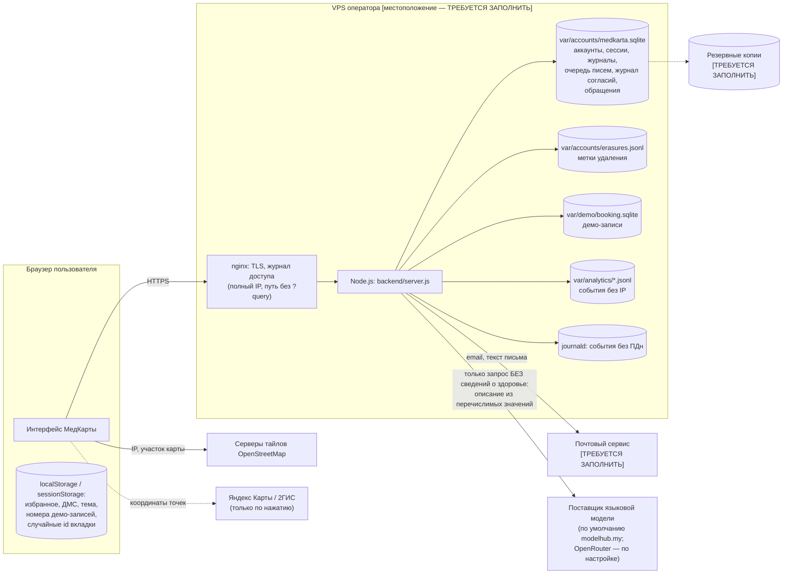

# 01. Карта персональных данных

Составлена по коду ветки `feature/secure-auth` (26.10.2026): схема базы
аккаунтов 7 (`backend/accounts/sqliteStore.js`), обработчики `backend/api/*`,
конвейер ассистента (`backend/pipeline.js`, `backend/privacy/*`), демо-запись
(`backend/demo/*`), аналитика (`backend/analytics/*`), фронтенд
(`frontend/src/*`) и документы по развёртыванию (`docs/deployment.md`).
Инфраструктура сервера (где стоит VPS, кто провайдер, как настроены nginx и
резервное копирование) по коду **не проверяется** — эти места помечены
`[ТРЕБУЕТСЯ ЗАПОЛНИТЬ ОПЕРАТОРОМ]`.

## Потоки

Чего в потоках нет: запросы к ассистенту не связываются с аккаунтом и не
сохраняются; координаты пользователя не покидают сервер (маршрут строит
собственный модуль `backend/routing/*`); в журнал приложения не пишутся
IP, тексты запросов, email и сведения о здоровье (`safeLogger.js`, белый
список полей).

## Таблица по категориям

Сроки «по умолчанию» меняются в админ-панели («Настройки» → «Хранение
журналов», «Сессии и вход»).

| № | Категория и состав | Субъекты | Источник | Цель | Основание | Где хранится | Срок | Кто имеет доступ | Передача третьим лицам / за рубеж | Меры защиты |
|---|---|---|---|---|---|---|---|---|---|---|
| 1 | Аккаунт: email, имя и фамилия (по желанию), хэш пароля, роль и статус, даты, программа ДМС, избранное, аватар | пользователи | сам пользователь (регистрация, профиль); администратор (приглашение: email, имя) | работа аккаунта | п. 5 ч. 1 ст. 6 — исполнение соглашения | `users`, `favorites`, `avatars`, `user_activity` | пока действует аккаунт; при удалении — сразу; `user_activity` (дни посещения) — 400 дней | пользователь; сотрудники с `users.view`; выгрузка CSV — `users.export` (с повторным подтверждением) | email — почтовому сервису (служебные письма); хостинг — [ТРЕБУЕТСЯ ЗАПОЛНИТЬ] | scrypt для паролей; TLS; роли и права; журнал действий; удаление в профиле |
| 2 | Учётные записи сотрудников: то же + второй фактор | работники, привлечённые лица | оператор | доступ к админ-панели | трудовой или гражданско-правовой договор — [вопрос юристу](12-legal-questions.md) | те же таблицы | на время работы — [ТРЕБУЕТСЯ ЗАПОЛНИТЬ] | суперадминистратор | — | обязательная MFA, короткие сессии (30 мин / 12 ч), повторное подтверждение критичных действий |
| 3 | Безопасность входа: сессии (хэш токена, «Chrome · macOS», сеть /24 или /48), история входов, счётчики попыток (хэши ключей), знакомые устройства, факторы MFA (секрет TOTP зашифрован, у ключей доступа — открытый ключ), резервные коды (HMAC), вызовы | пользователи, сотрудники | сервер при входе | защита аккаунта | п. 5 ч. 1 ст. 6; ст. 19 | `sessions`, `auth_events`, `auth_throttle`, `trusted_devices`, `mfa_*`, `auth_challenges` | сессия: 14 дн. без активности, не дольше 30 дн.; история входов 90 дн.; устройство 180 дн.; вызовы — минуты | пользователь (свои сессии и входы); сотрудники с `users.sessions` | — | хэши вместо токенов; AES-256-GCM с ключом вне базы; полного IP нет |
| 4 | Ссылки и заявки: email, хэш токена, срок, кто выдал | приглашённые, регистрирующиеся | администратор; форма регистрации | заключение договора по инициативе человека | п. 5 ч. 1 ст. 6 | `access_tokens`, `registrations` | 30 дней после истечения; при удалении аккаунта — сразу | сотрудники с `users.create` | — | в базе только SHA-256 токена; одноразовость |
| 5 | Очередь писем: хэш адреса, адрес и текст (зашифрованы до отправки), статус | пользователи, сотрудники | сервер | служебные письма | п. 5 ч. 1 ст. 6 | `mail_outbox` | адрес и текст стираются после отправки; запись — 30 дней; при удалении аккаунта — сразу | никто через интерфейс | почтовому сервису [ТРЕБУЕТСЯ ЗАПОЛНИТЬ: кто, где серверы] | AES-256-GCM; ссылка в письме проверяется перед отправкой |
| 6 | Журнал принятия документов и согласий: id аккаунта, цель, вид, действие, редакция, SHA-256 текста, способ, время, хэш цепочки | пользователи | сервер при регистрации, активации, принятии новой редакции, удалении | доказательство заключения соглашения и ознакомления с политикой; согласия (сейчас не собираются) | п. 5 и п. 2 ч. 1 ст. 6 (ч. 1, 3 ст. 9; ст. 18.1) — [уточнить](12-legal-questions.md) | `consent_log` | пока действует аккаунт и 3 года после последней записи удалённого аккаунта | пользователь (своя история); сотрудники с `privacy.requests` (чтение) | — | только добавление (триггеры), цепочка хэшей, без email и IP |
| 7 | Обращения по ПДн: id аккаунта, замаскированный email, вид, текст, ответ, сроки, сотрудник | пользователи | профиль «Мои данные» | ответ на запросы и требования | п. 2 ч. 1 ст. 6 (ст. 14, 20, 21) | `privacy_requests` | 3 года после закрытия; текст стирается при удалении аккаунта | заявитель; сотрудники с `privacy.requests` | — | право `privacy.requests` с повторным подтверждением; письма без текста обращения |
| 8 | Журнал действий сотрудников: метки «Имя · e***@домен», id, действие, детали | сотрудники, пользователи | сервер | подотчётность персонала, расследование инцидентов | ст. 18.1, 19; основание — [вопрос юристу](12-legal-questions.md) | `audit_log` | по умолчанию 365 дней; свои действия удалённого аккаунта — псевдонимизируются сразу | сотрудники с `audit.view` | — | без паролей и токенов; маска email |
| 9 | Демо-запись: номер, врач, клиника, время; id аккаунта (если вход выполнен) | пользователи, гости | форма записи | демонстрация записи | п. 5 ч. 1 ст. 6 | `var/demo/booking.sqlite`; номера — в браузере | связь с аккаунтом — 30 дней после даты приёма; при удалении аккаунта — сразу | пользователь | никому: в клиники и МИС не передаётся | — |
| 10 | Запрос к ассистенту: текст (может содержать сведения о здоровье) | пользователи | поле ассистента | подбор врача и маршрута | не связан с аккаунтом и не хранится; квалификация — [04](04-health-data.md), [вопрос юристу](12-legal-questions.md) | память процесса на время ответа; метки токенов — память, 2 мин | не хранится | никто | внешней модели — **только** запрос без сведений о здоровье, описанием из перечислимых значений, без слов пользователя | пропуск `mk_ai` без id; `local_only` для жалоб; журналы без текста |
| 11 | Местоположение и поиск: координаты, параметры поиска | все посетители | браузер (с разрешения) | расстояния и маршрут | обработка в момент запроса, без хранения; основание — [вопрос юристу](12-legal-questions.md) | память процесса | не хранится | никто | — | nginx пишет путь без строки запроса |
| 12 | Статистика: событие из закрытого словаря, случайный id вкладки, время до минуты | все посетители | браузер | улучшение справочника и интерфейса | данные без идентификации; [вопрос юристу](12-legal-questions.md) | `var/analytics/*.jsonl` | 180 дней (`ANALYTICS_RETENTION_DAYS`) | сотрудники с доступом к отчёту | — | без IP и аккаунта; DNT/GPC и отказ в «Моих данных» |
| 13 | Журнал веб-сервера: полный IP, время, метод, путь без строки запроса, код | все посетители | nginx | безопасность и работоспособность | ст. 19; п. 7 ч. 1 ст. 6 — [уточнить](12-legal-questions.md) | `/var/log/nginx/medkarta.access.log` | [ТРЕБУЕТСЯ ЗАПОЛНИТЬ: ротация logrotate] | администратор сервера | — | без строки запроса и тел |
| 14 | Сведения о врачах: ФИО, специальность, место работы, стаж и рейтинг (если есть в источнике) | врачи | официальные сайты медицинских организаций (`docs/data-pipeline.md`) | справочник | [ТРЕБУЕТСЯ ЗАПОЛНИТЬ] — [вопрос юристу](12-legal-questions.md) | `data/`, сборка фронтенда | пока ведётся справочник | все посетители (публикуется) | публикация на сайте | уточнение и удаление по обращению врача |
| 15 | Метки удаления: id аккаунта и время | удалённые пользователи | сервер при удалении | повторить удаление после восстановления копии | ч. 3–5 ст. 21 (обязанность уничтожить) | `var/accounts/erasures.jsonl` | пока существуют копии, сделанные до удаления, — [ТРЕБУЕТСЯ ЗАПОЛНИТЬ: срок копий] | администратор сервера | — | без email и имени |
| 16 | Резервные копии базы аккаунтов | все выше из базы | `npm run accounts -- backup` | восстановление | ст. 19 | [ТРЕБУЕТСЯ ЗАПОЛНИТЬ] | [ТРЕБУЕТСЯ ЗАПОЛНИТЬ] | администратор сервера | [ТРЕБУЕТСЯ ЗАПОЛНИТЬ: где лежат копии] | `--encrypt` (AES-256-GCM), ключ отдельно от копий |
| 17 | Тайлы карты: IP, User-Agent, участок карты | все посетители | браузер напрямую | показ карты | [вопрос юристу](12-legal-questions.md): передачу совершает браузер, а не сервер | серверы OpenStreetMap | по правилам OSMF | — | OSM Foundation (Великобритания) и её CDN — см. [10](10-processors-and-localization.md) | раскрыто в политике (п. 4.7) |

## Хранилище браузера и cookie

| Где | Что | Зачем |
|---|---|---|
| cookie `mk_sid` | токен сессии (HttpOnly) | вход |
| cookie `mk_mfa` | вызов второго шага входа (минуты) | вход с MFA |
| cookie `mk_activation`, `mk_register` | контекст ссылки на 30 минут | установка пароля |
| cookie `mk_device` | случайный токен устройства | «знакомое устройство», защита от блокировки чужими попытками |
| cookie `mk_ai` (Path=/api/chat) | пропуск к ассистенту на час: срок и случайное число, **без id** | ассистент только для вошедших, без связи запроса с аккаунтом |
| localStorage `medkarta.account`, `medkarta.guest`, `medkarta.dms.plan`, `medkarta.demo` | избранное, программа ДМС, номера демо-записей | работа без аккаунта |
| sessionStorage `medkarta.ai.session`, `medkarta.analytics.sid` | случайные id вкладки | связность диалога; статистика |
| localStorage `medkarta.analytics.optout` | отказ от статистики | настройка |

Рекламных и сторонних отслеживающих cookie нет; счётчиков сторонних систем
аналитики во фронтенде нет (проверено поиском внешних адресов в
`frontend/src`: только тайлы OpenStreetMap и ссылки на Яндекс/2ГИС/Госуслуги
по нажатию).
